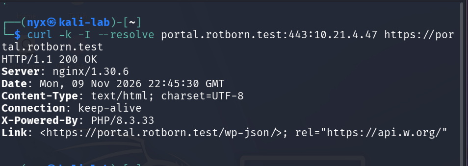
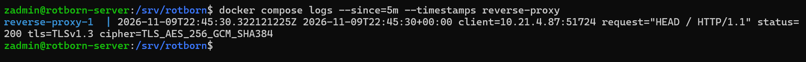
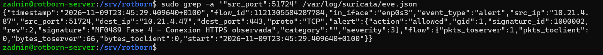

# Evidencias de correlación de registros: Nginx y Suricata

## Objetivo

Aportar dos registros brutos, uno de Nginx y otro de Suricata, correspondientes a la misma petición HTTPS, y demostrar la coincidencia de las direcciones IP, los puertos y las horas expresadas en UTC.

## 1. Prueba HTTPS desde Kali

Desde Kali se ejecutó la siguiente petición:

```bash
curl -k -I --resolve portal.rotborn.test:443:10.21.4.47 https://portal.rotborn.test
```

El servidor respondió `HTTP/1.1 200 OK`.



## 2. Registro bruto de Nginx

Nginx registró la petición con los siguientes datos:

```text
2026-11-09T22:45:30+00:00 client=10.21.4.87:51724 request="HEAD / HTTP/1.1" status=200 tls=TLSv1.3 cipher=TLS_AES_256_GCM_SHA384
```



## 3. Registro bruto de Suricata

Suricata generó una alerta con la regla `1000002`, revisión `2`:

```json
{
  "timestamp": "2026-11-09T23:45:29.409640+0100",
  "event_type": "alert",
  "src_ip": "10.21.4.87",
  "src_port": 51724,
  "dest_ip": "10.21.4.47",
  "dest_port": 443,
  "proto": "TCP",
  "alert": {
    "signature_id": 1000002,
    "rev": 2,
    "signature": "MF0489 Fase 4 - Conexion HTTPS observada"
  }
}
```



## 4. Correlación de los registros

| Campo | Nginx | Suricata |
|---|---|---|
| IP de origen | `10.21.4.87` | `10.21.4.87` |
| Puerto de origen | `51724` | `51724` |
| IP de destino | `10.21.4.47` | `10.21.4.47` |
| Puerto de destino | `443` | `443` |
| Hora UTC | `22:45:30` | `22:45:29` |

La marca temporal de Suricata aparece como `23:45:29.409640+0100`. Convertida a UTC, corresponde a `22:45:29.409640Z`. La marca temporal de Nginx es `22:45:30+00:00`.

Las direcciones IP y los puertos de origen y destino coinciden. Las marcas temporales están expresadas en UTC y difieren aproximadamente un segundo. Esta diferencia es coherente con el momento en que cada herramienta registra el evento: Suricata detecta el inicio de la conexión TCP y Nginx registra la petición HTTP procesada.

## Conclusión

Las evidencias muestran la correlación de una misma conexión HTTPS observada por Nginx y Suricata. Coinciden la IP y el puerto de origen (`10.21.4.87:51724`), el destino (`10.21.4.47:443`) y las marcas temporales UTC, con una diferencia aproximada de un segundo.

## Índice de evidencias

- [1. Prueba HTTPS desde Kali](correlacion-logs/prueba-https-kali.png)
- [2. Registro bruto de Nginx](correlacion-logs/registro-nginx.png)
- [3. Alerta de Suricata](correlacion-logs/alerta-suricata.png)
