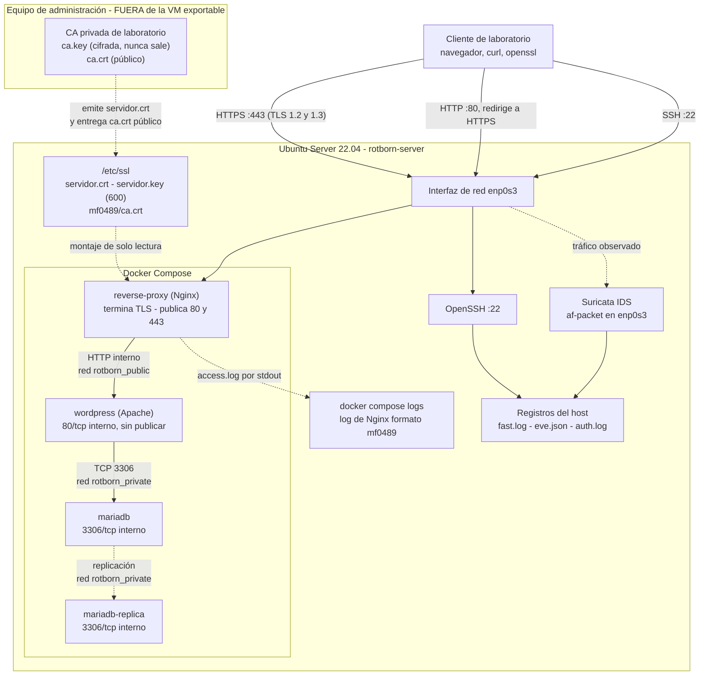
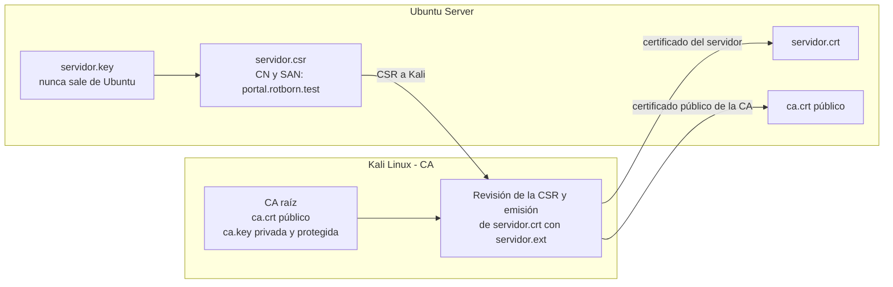

# Arquitectura del laboratorio — MF0489

Arquitectura de Rotborn Studios para publicar la aplicación web mediante HTTPS. Parte de la arquitectura del MF0488 (SSH, WordPress, MariaDB con réplica, Suricata) y le incorpora un reverse proxy Nginx, una autoridad certificadora de laboratorio y un certificado TLS de servidor.


## 1. Punto de partida (MF0488)

La arquitectura heredada publicaba la aplicación directamente por HTTP (`8080`), sin cifrado ni proxy:

```text
                           CLIENTES / LABORATORIO
                                      │
                       ┌──────────────┼──────────────┐
                       │              │              │
                      SSH            HTTP           ICMP
                    TCP/22         TCP/8080        Tráfico
                       │              │              │
                       └──────────────┼──────────────┘
                                      │
                                      ▼
                         ┌─────────────────────────┐
                         │      UBUNTU SERVER      │
                         │    Rotborn Studios      │
                         │    Ubuntu 22.04.5 LTS   │
                         └────────────┬────────────┘
                                      │
                 ┌────────────────────┼────────────────────┐
                 │                    │                    │
                 ▼                    ▼                    ▼
              OPENSSH              SURICATA              DOCKER
               :22                   IDS                   │
                                    │                      │
                                    │          ┌───────────┴───────────┐
                                    │          │                       │
                                    │          ▼                       ▼
                                    │    RED PÚBLICA              RED PRIVADA
                                    │  (`rotborn_public`)      (`rotborn_private`)
                                    │          │                       │
                                    │          ▼                       │
                                    │      WORDPRESS                   │
                                    │       (:8080)                    │
                                    │          │                       │
                                    │          └───────────┬───────────┘
                                    │                      │
                                    │                      ▼
                                    │              ┌───────────────┐
                                    │              │MariaDB Primary│
                                    │              └───────┬───────┘
                                    │                      │
                                    │                 Replicación
                                    │                      │
                                    │                      ▼
                                    │              ┌───────────────┐
                                    │              │MariaDB Replica│
                                    │              └───────────────┘
                                    │
                                    ▼
                              LOGS / ALERTAS
                              - fast.log
                              - eve.json
                              - auth.log
                              - Apache / Docker
```

## 2. Cambios respecto al MF0488

| Elemento | MF0488 | MF0489 |
|---|---|---|
| Acceso a la web | HTTP directo a WordPress (`8080`) | HTTPS por Nginx (`443`); el `80` solo redirige a HTTPS |
| Reverse proxy | No existía | Nginx (servicio `reverse-proxy`), único punto de entrada web |
| Certificados | No había | Certificado de servidor emitido por una CA de laboratorio |
| Autoridad certificadora | — | Fuera de la VM exportable; `ca.key` nunca sale de ella |
| Redes Docker | `rotborn_public` y `rotborn_private` | Las mismas; Nginx se une a `rotborn_public` |
| Suricata | IDS en la interfaz del servidor | Igual; ahora observa también tráfico TLS (solo metadatos) |
| Registros | `fast.log`, `eve.json`, `auth.log`, Docker | Además, el log de Nginx con versión TLS y cipher suite |

## 3. Requisitos de seguridad y mecanismos criptográficos

### 3.1. HTTP frente a HTTPS

| Propiedad | HTTP (MF0488) | HTTPS (MF0489) |
|---|---|---|
| Confidencialidad | No: petición y respuesta viajan en claro | Sí: el contenido va cifrado con TLS |
| Integridad | No: un intermediario puede modificar el tráfico | Sí: cifrado autenticado (AEAD) |
| Autenticación del servidor | No | Sí: certificado verificado con la CA del laboratorio |
| Qué ve un observador de la red | Método, ruta, cabeceras y contenido | Solo metadatos: IP, puertos, tamaños, tiempos, SNI y versión TLS |

Evidencia: en la captura con `tcpdump` del puerto 80 (`auditoria-tls-monitorizacion.md`, apartado 5.1), la petición `GET /mf0489-prueba-http` se lee en texto claro. Como el acceso a WordPress implica enviar credenciales al iniciar sesión, la aplicación no debe servirse por HTTP: el puerto 80 queda solo para redirigir a HTTPS.

### 3.2. Selección de TLS

- **Versiones admitidas: TLS 1.2 y TLS 1.3.** TLS 1.0 y 1.1 están obsoletos (RFC 8996) y SSLv2/SSLv3 no se admiten. Comprobado: el servidor rechaza TLS 1.1 con la alerta 70 (`auditoria-tls-monitorizacion.md`, apartado 4).
- **Cipher suites.** No se fijan manualmente: se usan las de Nginx y OpenSSL por defecto. Las negociadas fueron `ECDHE-RSA-AES256-GCM-SHA384` (TLS 1.2) y `TLS_AES_256_GCM_SHA384` (TLS 1.3): cifrado autenticado AES-256-GCM y, en TLS 1.2, intercambio de claves efímero (*forward secrecy*).
- **Dónde se aplica.** En Nginx, que termina TLS (apartado 5.1).

### 3.3. Algoritmos de los certificados

| Elemento | Elección |
|---|---|
| Clave de la CA | RSA 4096, protegida con contraseña |
| Certificado de la CA | Autofirmado, SHA-256, 10 años |
| Clave del servidor | RSA 3072, sin contraseña |
| Certificado del servidor | Firmado por la CA con SHA-256, 1 año, SAN `DNS:portal.rotborn.test` |

La justificación de cada tamaño y algoritmo está en `pki.md`, apartado 1.

## 4. Diagrama de arquitectura

Actualiza el diagrama del MF0488 con el reverse proxy, la CA, el certificado y los puertos y redes reales.



La CA se representa fuera de la infraestructura que se exportará como máquina vulnerable: solo el certificado público (`ca.crt`) y el certificado del servidor llegan a Ubuntu. En el laboratorio, Kali Linux cumple a la vez el papel de equipo de administración (CA) y de cliente de pruebas; en un entorno real serían equipos distintos.

## 5. Explicación técnica

### 5.1. Dónde se implementa TLS

TLS se implementa y **termina en Nginx**, el único servicio que descifra el tráfico. El tramo cliente → Nginx va por HTTPS en el puerto 443, con TLS 1.2 y TLS 1.3 (no se admiten SSL ni TLS 1.0/1.1). El puerto 80 solo devuelve una redirección permanente a HTTPS.

### 5.2. Qué servicio gestiona los certificados

- **Nginx usa** el certificado y la clave del servidor. Se instalan en el host (`/etc/ssl/`) y se montan en el contenedor en **solo lectura**; no se copian a ninguna imagen.
- **La CA emite**. Firma la solicitud (CSR) que genera el servidor y entrega `servidor.crt`. Los clientes necesitan únicamente el certificado público `ca.crt` para verificarlo.
- **No hay gestión automática** (ni ACME ni renovación programada): la renovación es manual (ver `pki.md`).

### 5.3. Qué comunicaciones permanecen dentro de Docker

| Comunicación | Protocolo | Red Docker | ¿Sale al host? |
|---|---|---|---|
| Nginx → WordPress | HTTP, `wordpress:80` | `rotborn_public` | No |
| WordPress → MariaDB | MySQL, `mariadb:3306` | `rotborn_private` | No |
| MariaDB → réplica | Replicación | `rotborn_private` | No |

El tramo Nginx → WordPress **no está cifrado**: es una decisión consciente, limitada a una red interna del host.

### 5.4. Redes Docker

| Red | Componentes | Función |
|---|---|---|
| `rotborn_public` | `reverse-proxy`, `wordpress` | Nginx alcanza a la aplicación por el DNS interno de Docker |
| `rotborn_private` | `wordpress`, `mariadb`, `mariadb-replica` | Comunicación con la base de datos; Nginx no tiene acceso |

Solo `reverse-proxy` publica puertos en el host (80 y 443). WordPress y las bases de datos no publican ninguno.

### 5.5. Suricata: ubicación y qué puede observar

Suricata se ejecuta en el host y monitoriza la interfaz de red (`enp0s3`), no los puentes de Docker.

| Tráfico | ¿Lo ve Suricata? |
|---|---|
| ICMP | Sí |
| SSH `:22` | Los metadatos de la conexión; el contenido va cifrado |
| HTTP `:80` | Sí, en claro (la redirección a HTTPS) |
| HTTPS `:443` | Solo metadatos: IP, puertos, tamaños, tiempos, SNI y versión TLS. El certificado solo es visible en TLS 1.2. **No** ve el método, la ruta ni el contenido |
| Nginx → WordPress, WordPress → MariaDB y replicación | **No**: no pasan por la interfaz monitorizada |

La petición HTTPS ya descifrada solo se ve en el log de Nginx. Para relacionar ambas fuentes se correlaciona por IP, puerto de origen y hora (ver `auditoria-tls-monitorizacion.md`).

## 6. Infraestructura de clave pública (PKI)

Se separan las tareas de la CA raíz de las del servidor.

### 6.1. Entornos

| Entorno | Función | Datos registrados |
|---|---|---|
| A — Kali Linux | Crear y gestionar la CA raíz, revisar la CSR, emitir el certificado y verificar | OpenSSL `3.6.3 9 Jun 2026` |
| B — Ubuntu Server | Generar la clave privada del servidor y la CSR, instalar los archivos y verificar en local | Hostname `rotborn-server`; OpenSSL `3.0.2 15 Mar 2022` |

La IP del servidor es dinámica (DHCP) y ha cambiado entre fases. No forma parte del certificado: se emite para el **nombre DNS**.

### 6.2. Nombre DNS

El nombre elegido es `portal.rotborn.test`, incluido en el SAN de la CSR y del certificado. También se usó `servidor-equivocado.test` para comprobar que se rechaza una identidad incorrecta. El cliente de laboratorio resuelve el nombre con `curl --resolve` (sin modificar `/etc/hosts`); ver `https-docker.md`.

### 6.3. Flujo de emisión



1. En Kali se crea la CA raíz.
2. En Ubuntu se genera la clave RSA del servidor y la CSR con el nombre DNS y el SAN.
3. La CSR se copia a Kali para su revisión y firma.
4. Kali emite el certificado con la CA raíz y `servidor.ext`.
5. El certificado y el `ca.crt` público se copian a Ubuntu.
6. En Ubuntu se verifican permisos, confianza, nombre DNS, vigencia y correspondencia de la clave.

### 6.4. Rutas definitivas en Ubuntu Server

| Archivo | Ruta en Ubuntu | Ruta en el contenedor Nginx |
|---|---|---|
| Clave privada del servidor | `/etc/ssl/private/servidor.key` | `/etc/nginx/certs/servidor.key` |
| Certificado del servidor | `/etc/ssl/certs/servidor.crt` | `/etc/nginx/certs/servidor.crt` |
| Certificado público de la CA | `/etc/ssl/mf0489/ca.crt` | No se monta (no lo necesita) |

Los archivos de `pki/` del repositorio son copias públicas para documentación y no sustituyen a los instalados.

### 6.5. Separación de secretos

No se suben al repositorio ni la clave privada de la CA ni la del servidor. `ca.key` permanece solo en Kali y no se copia a Ubuntu ni a la futura OVA. Los certificados públicos y la CSR se revisan antes de publicarlos. Los archivos `.pem` pueden contener certificados o claves privadas: se inspeccionan antes de incorporarlos.

## 7. Límites conocidos

- El tramo interno Nginx → WordPress es HTTP (apartado 5.3).
- Kali actúa como CA y como cliente: en el laboratorio no están separados.
- No hay revocación (CRL u OCSP) ni renovación automática.
- Los archivos de WordPress (`wp-content`) viven en un volumen anónimo no declarado en el Compose: ver `https-docker.md`.

## 8. Documentos relacionados

| Documento | Contenido |
|---|---|
| `pki.md` | Procedimiento para crear la CA y emitir el certificado |
| `https-docker.md` | Despliegue de Nginx y HTTPS con Docker Compose |
| `auditoria-tls-monitorizacion.md` | Verificación de TLS y monitorización con Suricata y Nginx |
