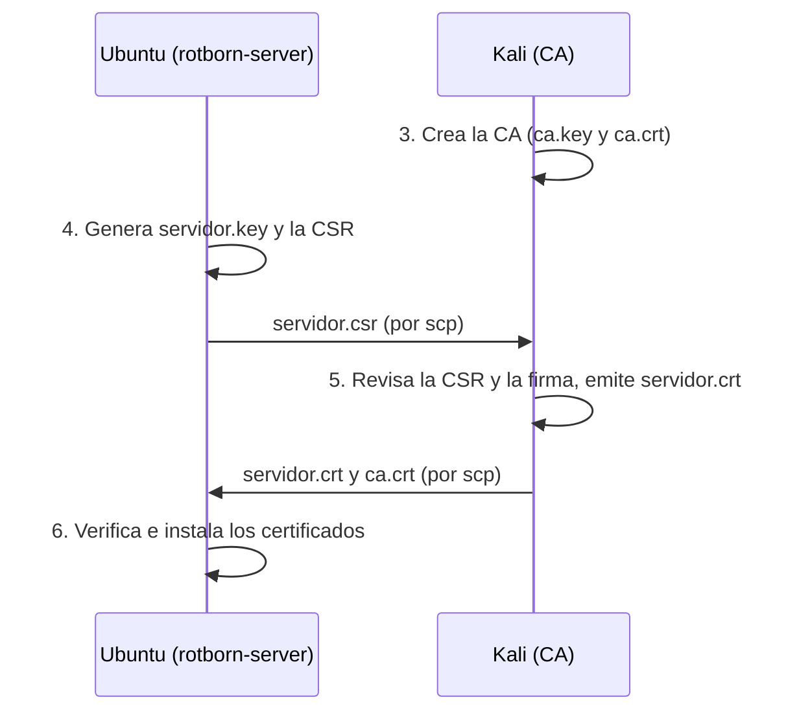

# Infraestructura PKI con OpenSSL (MF0489 · Fase 2)

Guía reproducible para montar una PKI mínima de laboratorio: una CA propia en Kali que firma el certificado del servidor, cuya clave privada se genera y permanece en Ubuntu. Es la base del HTTPS de las fases siguientes.

| | |
|---|---|
| Módulo / fase | MF0489 · Fase 2 |
| Entornos | A: Kali Linux (CA) · B: Ubuntu Server `rotborn-server` (servidor) |
| Fecha  | 27 de octubre de 2026 |
| Ubicación en el repositorio | `docs/mf0489/pki.md` (evidencias en `docs/mf0489/evidencias/fase2/`) |
| Fases relacionadas | `https-docker.md` (Nginx con este certificado) y `auditoria-tls-monitorizacion.md` (verificación en uso real) |

> **Cómo leerla.** Los bloques **Esperado** indican el resultado que debe obtenerse al repetir el paso. Los valores del Anexo A (huellas, series, fechas) son observaciones de una ejecución real y cambian en cada ejecución. 
>
> **Datos publicados.** El usuario administrador de Ubuntu se parametriza con la variable `UBUNTU_USER`. No se incluye ninguna clave privada ni contraseña.

| Apartado | Contenido |
|---|---|
| 1 | Objetivo, alcance y flujo del proceso |
| 2 | Requisitos, modos de uso, variables y copias de seguridad |
| 3 | Kali: crear la CA |
| 4 | Ubuntu: clave privada y CSR |
| 5 | Kali: revisión y firma |
| 6 | Ubuntu: verificación, instalación y comprobaciones |
| 7 | Resumen de comprobaciones |
| 8 | Consideraciones de seguridad |
| 9 | Evidencias, estado y reproducibilidad |
| 10 | Mantenimiento: renovación y cambios de nombre o IP |
| Anexos | A: evidencias · B: incidencias · C: solución de problemas |

## 1. Objetivo y alcance

Crear una PKI sencilla con dos entornos separados:

- **Kali Linux (Entorno A):** administra la CA, firma la CSR y emite el certificado.
- **Ubuntu Server `rotborn-server` (Entorno B):** genera la clave privada del servidor y la CSR, recibe los certificados públicos y los instala.

Resultado final:

| Archivo | Ubicación | Permisos | Propietario |
|---|---|---|---|
| Clave privada del servidor | `/etc/ssl/private/servidor.key` (Ubuntu) | `600` | `root:root` |
| Certificado del servidor | `/etc/ssl/certs/servidor.crt` (Ubuntu) | `644` | `root:root` |
| Certificado de la CA raíz | `/etc/ssl/mf0489/ca.crt` (Ubuntu) | `644` | `root:root` |
| Clave privada de la CA | `~/ca_root-pki/ca/private/ca.key` (Kali) | `600` | usuario de Kali |

Reglas de separación: `ca.key` nunca sale de Kali y `servidor.key` nunca sale de Ubuntu. Solo viajan entre máquinas la CSR y los certificados públicos.

**Flujo del proceso:**



**Qué viaja entre máquinas:**

| Archivo | Se crea en | ¿Viaja? | Comentario |
|---|---|---|---|
| `ca.key` | Kali | **Nunca** | Clave privada de la CA, cifrada con contraseña |
| `servidor.key` | Ubuntu | **Nunca** | Clave privada del servidor |
| `servidor.csr` | Ubuntu | Ubuntu → Kali | Contiene la clave pública, no es secreta |
| `servidor.crt` | Kali | Kali → Ubuntu | Certificado público |
| `ca.crt` | Kali | Kali → Ubuntu (y a los clientes) | Certificado público de la CA |

### Algoritmos, tamaños de claves y justificación

| Elemento | Algoritmo y tamaño | Justificación |
|---|---|---|
| Clave de la CA | RSA 4096 bits, cifrada con contraseña (AES-256-CBC) | Es el elemento más sensible y de vida larga: se prioriza el margen de seguridad sobre el rendimiento, que aquí no importa (solo firma certificados). La contraseña protege la clave en disco |
| Certificado raíz | Autofirmado, SHA-256, 10 años | SHA-1 está desaconsejado y SHA-256 es el mínimo habitual. Vigencia larga porque la raíz se distribuye a los clientes |
| Clave del servidor | RSA 3072 bits, sin contraseña | RSA 3072 ofrece unos 128 bits de seguridad (RSA 2048, unos 112). Sin contraseña para que Nginx arranque sin intervención; la protección es el permiso `root:root 600` |
| Certificado del servidor | Firmado por la CA con SHA-256, 1 año, `CA:FALSE`, uso `serverAuth`, SAN `DNS:portal.rotborn.test` | Vigencia corta: limita el daño de una clave comprometida. El SAN es lo que valida el nombre; el CN por sí solo no basta |
| Alternativa no usada | ECDSA P-256 | Más ligera, pero se elige RSA por simplicidad y compatibilidad con las herramientas del laboratorio |

**Alcance:** este procedimiento no configura DNS, Nginx ni HTTPS. Eso corresponde a las fases siguientes.

---

## 2. Prerrequisitos y modos de uso

### 2.1. Requisitos

- OpenSSL 3.x en ambas máquinas (ejecución documentada: Kali `OpenSSL 3.6.3`, Ubuntu `OpenSSL 3.0.2`):

  ```bash
  openssl version
  ```

  El formato exacto de algunas salidas puede variar entre versiones; lo relevante es su contenido.

- Un usuario administrador con `sudo` en Ubuntu (variable `UBUNTU_USER`, ver 2.3) y conectividad SSH/`scp` desde Kali.
- Dirección IP de Ubuntu (en la ejecución documentada fue `10.21.4.58`). Se obtiene en Ubuntu con:

  ```bash
  ip -br addr
  ```

- Nombre DNS del servidor: `portal.rotborn.test`.

> ⚠️ **La IP de Ubuntu cambia pero no afecta al certificado, porque se emite para el **nombre DNS**, no para la IP; pero los `ssh`/`scp` fallan con una IP antigua. Para evitarlo, reserva la IP en el DHCP o fija una estática, y comprueba siempre la IP vigente con `ip -br addr`.

### 2.2. Modos de uso

| Modo | Cuándo | Qué ejecutar |
|---|---|---|
| **A. Instalación nueva** | Laboratorio limpio, sin PKI previa | Todo el documento, en orden (secciones 3 a 6). |
| **B. PKI ya existente** | Ya hay claves y certificados que se quieren conservar | Solo los bloques marcados **Comprobación**. No ejecutar 3.2, 4.3, 5.3 ni 5.4: reescriben archivos (con copia de seguridad) y 5.4 emite un certificado nuevo. |

Los pasos de creación de claves y del certificado raíz (3.3, 3.4, 4.2) llevan un guard ejecutable: si el archivo ya existe, **no lo regeneran**.

### 2.3. Variables y copias de seguridad

Estas definiciones deben ejecutarse **al empezar cada sesión de terminal**: las variables y funciones no persisten si se abre una terminal nueva.

**En Kali:**

```bash
export UBUNTU_IP=10.21.4.58        # sustituir por la IP vigente
export UBUNTU_USER=usuario         # usuario con sudo en Ubuntu
export CA_DIR=~/ca_root-pki/ca

mkdir -p "$CA_DIR/backup"
backup() {
  [ -e "$1" ] && cp -p "$1" "$CA_DIR/backup/$(basename "$1").$(date +%Y%m%d%H%M%S)" \
    && echo "Copia de seguridad de $1"
  return 0
}
```

Comprobar la conectividad (debe responder `rotborn-server`):

```bash
ssh "$UBUNTU_USER@$UBUNTU_IP" hostname
```

**En Ubuntu:**

```bash
mkdir -p ~/mf0489/backup
backup() {
  [ -e "$1" ] && cp -p "$1" ~/mf0489/backup/"$(basename "$1")".$(date +%Y%m%d%H%M%S) \
    && echo "Copia de seguridad de $1"
  return 0
}
```

`backup` guarda una copia con marca de tiempo antes de reemplazar un archivo. No se usa nunca con claves privadas: para ellas, el procedimiento simplemente se niega a regenerarlas.

> Los valores concretos de las salidas (fechas, huellas, números de serie) serán distintos en cada ejecución. Lo que debe comprobarse es que las huellas coincidan **entre sí**, no con las de los anexos.

---

## 3. Kali: crear la CA

### 3.1. Estructura de directorios

```bash
mkdir -p "$CA_DIR/private" "$CA_DIR/solicitudes" "$CA_DIR/emitidos"
chmod 700 "$CA_DIR/private"
```

Estructura final (`*` = se crea en pasos posteriores):

```text
~/ca_root-pki/ca/
├── openssl.cnf
├── servidor.ext
├── ca.crt          *
├── ca.srl          * (lo crea OpenSSL al firmar)
├── backup/
├── private/ca.key  *
├── solicitudes/servidor.csr *
└── emitidos/servidor.crt    *
```

No se usan `index.txt` ni `serial`: la emisión se hace con `openssl x509 -req`, que no mantiene la base de datos de `openssl ca`.

### 3.2. Archivo `openssl.cnf`

Define el sujeto de la CA y las extensiones del certificado raíz. **Este paso reescribe el archivo** (hace antes una copia si ya existía). En Modo B no se ejecuta.

> **Nota sobre el sujeto:** la CA de la ejecución documentada tenía un espacio final en el campo `O` (`Rotborn Studios␠`), casi seguro un descuido al crearla. Esta configuración **no lo reproduce**: una CA nueva tendrá un sujeto ligeramente distinto de la original. Si necesitas conservar la CA original, no la regeneres (Modo B).

```bash
backup "$CA_DIR/openssl.cnf"

cat > "$CA_DIR/openssl.cnf" <<'EOF'
[ req ]
default_md         = sha256
prompt             = no
distinguished_name = dn_ca

[ dn_ca ]
C  = ES
ST = Barcelona
L  = Barcelona
O  = Rotborn Studios
OU = Cybersecurity
CN = Rotborn Studios Root CA

[ v3_ca ]
basicConstraints       = critical, CA:TRUE, pathlen:0
keyUsage               = critical, keyCertSign, cRLSign
subjectKeyIdentifier   = hash
authorityKeyIdentifier = keyid:always
EOF
```

- `CA:TRUE, pathlen:0`: CA que solo puede firmar certificados de entidad final, no otras CA.
- `keyCertSign, cRLSign`: usos de clave para firmar certificados y listas de revocación.

### 3.3. Clave privada de la CA

RSA de 4096 bits protegida con contraseña (OpenSSL la pedirá dos veces). **Si `ca.key` ya existe, no se regenera**: la clave y el certificado raíz deben seguir emparejados.

```bash
if [ -e "$CA_DIR/private/ca.key" ]; then
  echo "ca.key YA EXISTE: no se regenera. Pasar a la comprobación."
else
  openssl genpkey -algorithm RSA -aes-256-cbc \
    -pkeyopt rsa_keygen_bits:4096 \
    -out "$CA_DIR/private/ca.key" \
  && chmod 600 "$CA_DIR/private/ca.key" \
  && echo "ca.key creada."
fi
```

**Comprobación** (pide la contraseña):

```bash
openssl pkey -in "$CA_DIR/private/ca.key" -check -noout
```

Esperado: `Key is valid`.

### 3.4. Certificado raíz autofirmado

**Si `ca.crt` ya existe, no se sobrescribe.**

```bash
if [ -e "$CA_DIR/ca.crt" ]; then
  echo "ca.crt YA EXISTE: no se sobrescribe. Pasar a la comprobación."
else
  openssl req \
    -config "$CA_DIR/openssl.cnf" \
    -key "$CA_DIR/private/ca.key" \
    -new -x509 -days 3650 -sha256 \
    -extensions v3_ca \
    -out "$CA_DIR/ca.crt" \
  && echo "ca.crt creado."
fi
```

### 3.5. Comprobación de la CA

```bash
openssl x509 -in "$CA_DIR/ca.crt" -noout -subject -issuer
openssl x509 -in "$CA_DIR/ca.crt" -noout -text | grep -A1 -E "Basic Constraints|Key Usage"
openssl verify -CAfile "$CA_DIR/ca.crt" "$CA_DIR/ca.crt"

# Emparejamiento clave ↔ certificado (pide la contraseña de ca.key)
diff <(openssl pkey -in "$CA_DIR/private/ca.key" -pubout 2>/dev/null | sha256sum) \
     <(openssl x509 -in "$CA_DIR/ca.crt" -pubkey -noout | sha256sum) \
  && echo "ca.key y ca.crt EMPAREJADOS"

# Huella SHA-256 del certificado raíz: anotarla (se compara con la de Ubuntu en 6.1)
openssl x509 -in "$CA_DIR/ca.crt" -noout -fingerprint -sha256
```

Esperado:

- Subject e Issuer idénticos, con `CN = Rotborn Studios Root CA`.
- `CA:TRUE, pathlen:0` y `Certificate Sign, CRL Sign`, ambos `critical`.
- `ca.crt: OK`.
- `ca.key y ca.crt EMPAREJADOS`.
- **Huella SHA-256 de `ca.crt` anotada.** Es la que debe coincidir en Ubuntu y en cualquier cliente que confíe en la CA.

> Mantén **una única copia** de `ca.crt` en Kali. En esta ejecución llegaron a existir dos certificados raíz de la misma clave y una de las copias no coincidía con la huella anotada en la documentación (ver Anexo B y apartado 10.5).

---

## 4. Ubuntu: clave privada y CSR

### 4.1. Directorio de trabajo

Ya creado en 2.3. Comprobar:

```bash
ls -ld ~/mf0489
```

### 4.2. Clave privada del servidor

RSA de 3072 bits, sin contraseña, directamente en su ruta definitiva. **Si la clave ya existe, no se regenera**: el certificado del servidor debe corresponder a esa clave.

```bash
if sudo test -e /etc/ssl/private/servidor.key; then
  echo "La clave YA EXISTE: no se regenera."
else
  sudo openssl genpkey -algorithm RSA \
    -pkeyopt rsa_keygen_bits:3072 \
    -out /etc/ssl/private/servidor.key \
  && sudo chown root:root /etc/ssl/private/servidor.key \
  && sudo chmod 600 /etc/ssl/private/servidor.key \
  && echo "Clave creada."
fi
```

**Comprobación** (en ambos casos):

```bash
sudo openssl pkey -in /etc/ssl/private/servidor.key -check -noout
sudo openssl pkey -in /etc/ssl/private/servidor.key -noout -text | head -n 1
sudo stat -c '%U:%G %a %n' /etc/ssl/private/servidor.key
```

Esperado: `Key is valid`, `Private-Key: (3072 bit, 2 primes)` y `root:root 600 /etc/ssl/private/servidor.key`.

La clave privada no se guarda ni se copia en `~/mf0489/` ni se transfiere a Kali.

### 4.3. Solicitud de firma (CSR)

La clave es legible solo por `root`, por lo que `openssl req` necesita `sudo`. **Este paso reescribe la CSR** (hace antes una copia si ya existía). En Modo B no se ejecuta.

```bash
backup ~/mf0489/servidor.csr

sudo openssl req -new -sha256 \
  -key /etc/ssl/private/servidor.key \
  -out ~/mf0489/servidor.csr \
  -subj "/C=ES/ST=Barcelona/L=Barcelona/O=Rotborn Studios/OU=Cybersecurity/CN=portal.rotborn.test" \
  -addext "subjectAltName=DNS:portal.rotborn.test"

sudo chown "$USER":"$(id -gn)" ~/mf0489/servidor.csr
```

**Comprobación:**

```bash
openssl req -in ~/mf0489/servidor.csr -noout -verify -subject
openssl req -in ~/mf0489/servidor.csr -noout -text | grep -A1 "Subject Alternative Name"
```

Esperado:

- `Certificate request self-signature verify OK`.
- `subject=C = ES, ST = Barcelona, L = Barcelona, O = Rotborn Studios, OU = Cybersecurity, CN = portal.rotborn.test`.
- `DNS:portal.rotborn.test` en el SAN.

La CSR contiene la clave pública y los datos de la solicitud, nunca la clave privada.

---

## 5. Kali: revisión y firma

### 5.1. Traer la CSR desde Ubuntu

```bash
backup "$CA_DIR/solicitudes/servidor.csr"

scp "$UBUNTU_USER@$UBUNTU_IP:mf0489/servidor.csr" \
  "$CA_DIR/solicitudes/servidor.csr"
```

### 5.2. Revisar la CSR antes de firmar

Una CA no debe firmar una solicitud sin revisarla: se comprueba que la firma es válida y que el nombre solicitado es el autorizado.

```bash
openssl req -in "$CA_DIR/solicitudes/servidor.csr" -noout -verify -subject
openssl req -in "$CA_DIR/solicitudes/servidor.csr" -noout -text | grep -A1 "Subject Alternative Name"
```

Esperado: `Certificate request self-signature verify OK`, `CN = portal.rotborn.test` y `DNS:portal.rotborn.test`.

### 5.3. Archivo de extensiones `servidor.ext`

Estas extensiones determinan las propiedades del certificado emitido. **Este paso reescribe el archivo** (hace antes una copia si ya existía). En Modo B no se ejecuta.

```bash
backup "$CA_DIR/servidor.ext"

cat > "$CA_DIR/servidor.ext" <<'EOF'
basicConstraints       = critical, CA:FALSE
keyUsage               = critical, digitalSignature, keyEncipherment
extendedKeyUsage       = serverAuth
subjectAltName         = DNS:portal.rotborn.test
subjectKeyIdentifier   = hash
authorityKeyIdentifier = keyid,issuer
EOF
```

| Extensión | Función |
|---|---|
| `basicConstraints = critical, CA:FALSE` | Certificado de entidad final; no puede actuar como CA. |
| `keyUsage` | Usos criptográficos permitidos de la clave. |
| `extendedKeyUsage = serverAuth` | Destinado a autenticar un servidor TLS. |
| `subjectAltName` | Nombre DNS para el que se emite; debe coincidir con el usado al acceder al servicio. |
| `subjectKeyIdentifier` | Identificador derivado de la clave pública del certificado. |
| `authorityKeyIdentifier` | Identifica la CA que firmó. |

`openssl x509 -req` no copia las extensiones de la CSR: el SAN del certificado final procede de este archivo.

### 5.4. Firmar y emitir el certificado

Este bloque **solo firma si la CSR pasa la revisión** (firma válida y SAN `portal.rotborn.test`). Si ya existía un certificado emitido, se conserva una copia antes de reemplazarlo. `ca.srl` no se borra ni se reinicia: OpenSSL lo crea la primera vez y lo reutiliza después, de modo que cada emisión recibe un número de serie nuevo.

En Modo B no se ejecuta: una nueva emisión cambia el certificado, su huella y su número de serie, y obliga a repetir 5.5, 5.6 y la sección 6.

```bash
CSR="$CA_DIR/solicitudes/servidor.csr"

if openssl req -in "$CSR" -noout -verify 2>&1 | grep -q "verify OK" \
   && openssl req -in "$CSR" -noout -text | grep -q "DNS:portal.rotborn.test"; then

  backup "$CA_DIR/emitidos/servidor.crt"

  openssl x509 -req \
    -in "$CSR" \
    -CA "$CA_DIR/ca.crt" \
    -CAkey "$CA_DIR/private/ca.key" \
    -CAcreateserial \
    -out "$CA_DIR/emitidos/servidor.crt" \
    -days 365 \
    -sha256 \
    -extfile "$CA_DIR/servidor.ext"
else
  echo "La CSR no pasa la revisión: NO se firma."
fi
```

Pedirá la contraseña de `ca.key`.

### 5.5. Comprobación del certificado emitido

```bash
openssl x509 -in "$CA_DIR/emitidos/servidor.crt" -noout -text \
  | grep -E "Subject:|Issuer:|Not Before|Not After|Signature Algorithm|CA:|DNS:|Server Authentication"

openssl verify -CAfile "$CA_DIR/ca.crt" -purpose sslserver \
  "$CA_DIR/emitidos/servidor.crt"

openssl x509 -in "$CA_DIR/emitidos/servidor.crt" -noout -checkhost portal.rotborn.test

openssl x509 -in "$CA_DIR/emitidos/servidor.crt" -noout -fingerprint -sha256
```

Esperado:

- `Issuer` con `CN = Rotborn Studios Root CA`, `CA:FALSE`, `DNS:portal.rotborn.test`, `TLS Web Server Authentication`, firma `sha256WithRSAEncryption` y validez de un año.
- `servidor.crt: OK`.
- `Hostname portal.rotborn.test does match certificate`.
- **Anotar la huella SHA-256**: se compara con la de Ubuntu en 6.1.

### 5.6. Enviar los certificados públicos a Ubuntu

Primero se conserva en Ubuntu cualquier copia previa, y después se copian los archivos:

```bash
ssh "$UBUNTU_USER@$UBUNTU_IP" 'mkdir -p ~/mf0489/backup; for f in servidor.crt ca.crt; do [ -e ~/mf0489/$f ] && cp -p ~/mf0489/$f ~/mf0489/backup/$f.$(date +%Y%m%d%H%M%S); done; true'

scp "$CA_DIR/emitidos/servidor.crt" "$UBUNTU_USER@$UBUNTU_IP:mf0489/servidor.crt"
scp "$CA_DIR/ca.crt"                "$UBUNTU_USER@$UBUNTU_IP:mf0489/ca.crt"
```

No se envía `ca.key` ni su contraseña. Las rutas de `scp` sin `/` inicial son relativas al directorio personal del usuario remoto.

---

## 6. Ubuntu: verificación previa, instalación y comprobaciones

### 6.1. Verificar los archivos recibidos

```bash
chmod 644 ~/mf0489/servidor.crt ~/mf0489/ca.crt

openssl verify -CAfile ~/mf0489/ca.crt -purpose sslserver \
  -verify_hostname portal.rotborn.test ~/mf0489/servidor.crt

openssl x509 -in ~/mf0489/servidor.crt -noout -fingerprint -sha256
openssl x509 -in ~/mf0489/ca.crt -noout -fingerprint -sha256
```

Esperado: `<ruta>/mf0489/servidor.crt: OK` y dos huellas **idénticas a las anotadas en Kali**: la del certificado del servidor (5.5) y la de la CA (3.5). Si alguna no coincide, no continuar.

### 6.2. Instalar en las rutas definitivas

Se conserva una copia de los certificados que ya estuvieran instalados antes de reemplazarlos:

```bash
sudo mkdir -p /etc/ssl/mf0489

backup /etc/ssl/mf0489/ca.crt
backup /etc/ssl/certs/servidor.crt

sudo install -o root -g root -m 644 ~/mf0489/ca.crt       /etc/ssl/mf0489/ca.crt
sudo install -o root -g root -m 644 ~/mf0489/servidor.crt /etc/ssl/certs/servidor.crt
```

La clave privada ya está en `/etc/ssl/private/servidor.key` (paso 4.2); no se instala nada desde `~/mf0489/` para ella.

`ca.crt` es el certificado público de la CA, no su clave privada. Guardarlo en `/etc/ssl/mf0489/` no lo añade al almacén de confianza del sistema.

### 6.3. Comprobaciones finales

**Verificación positiva** (CA, propósito y nombre):

```bash
openssl verify -CAfile /etc/ssl/mf0489/ca.crt -purpose sslserver \
  -verify_hostname portal.rotborn.test /etc/ssl/certs/servidor.crt
```

Esperado: `/etc/ssl/certs/servidor.crt: OK`.

**Nombre incorrecto** (debe fallar):

```bash
openssl verify -CAfile /etc/ssl/mf0489/ca.crt -purpose sslserver \
  -verify_hostname servidor-equivocado.test /etc/ssl/certs/servidor.crt
```

Esperado: `error 62 ... hostname mismatch`. Una firma válida no basta: el nombre también debe coincidir.

**Sin indicar la CA** (debe fallar):

```bash
openssl verify -purpose sslserver -verify_hostname portal.rotborn.test /etc/ssl/certs/servidor.crt
```

Esperado: `error 20 ... unable to get local issuer certificate`. Es normal: la CA del laboratorio no está en el almacén de confianza del sistema. No indica que la firma sea incorrecta.

**Fechas de validez:**

```bash
openssl x509 -in /etc/ssl/certs/servidor.crt -noout -dates
openssl x509 -in /etc/ssl/certs/servidor.crt -noout -checkend 0
```

Esperado: `notAfter` un año posterior a `notBefore` y `Certificate will not expire`.

**Correspondencia entre clave privada y certificado:**

```bash
sudo openssl pkey -in /etc/ssl/private/servidor.key -pubout -outform DER | openssl dgst -sha256
openssl x509 -in /etc/ssl/certs/servidor.crt -pubkey -noout | openssl pkey -pubin -outform DER | openssl dgst -sha256
```

Esperado: los dos resúmenes SHA-256 son idénticos.

**Permisos y propietarios:**

```bash
sudo stat -c '%A %a %U:%G %n' \
  /etc/ssl/private/servidor.key /etc/ssl/certs/servidor.crt /etc/ssl/mf0489/ca.crt
```

Esperado:

```text
-rw------- 600 root:root /etc/ssl/private/servidor.key
-rw-r--r-- 644 root:root /etc/ssl/certs/servidor.crt
-rw-r--r-- 644 root:root /etc/ssl/mf0489/ca.crt
```

**Que no haya copia de la clave privada en el directorio de trabajo:**

```bash
find ~/mf0489 -maxdepth 1 -type f -printf '%f\n' | sort
```

Esperado: solo `ca.crt`, `servidor.crt` y `servidor.csr`. Las copias de seguridad están en `~/mf0489/backup/` y no aparecen en este listado.

**Huellas de los certificados instalados** (deben coincidir con las de Kali):

```bash
openssl x509 -in /etc/ssl/certs/servidor.crt -noout -fingerprint -sha256
openssl x509 -in /etc/ssl/mf0489/ca.crt -noout -fingerprint -sha256
```

---

## 7. Resumen de comprobaciones

| Comprobación | Resultado esperado |
|---|---|
| Clave de la CA | `Key is valid` |
| Autofirma de la CA raíz | `ca.crt: OK` |
| Emparejamiento `ca.key` ↔ `ca.crt` | `EMPAREJADOS` |
| Clave del servidor | `Key is valid`, 3072 bits |
| CSR | `self-signature verify OK`, SAN `portal.rotborn.test` |
| Certificado en Kali (`-purpose sslserver`) | `servidor.crt: OK` |
| Nombre DNS en Kali | `does match certificate` |
| Huella del certificado del servidor, Kali = Ubuntu | Coinciden |
| Huella de `ca.crt`, Kali = Ubuntu | Coinciden |
| Verificación con CA, propósito y nombre | `OK` |
| Verificación con nombre incorrecto | `hostname mismatch` |
| Verificación sin CA | `unable to get local issuer certificate` |
| Vigencia | `Certificate will not expire`, validez de 1 año |
| Clave del servidor ↔ certificado | Resúmenes SHA-256 idénticos |
| Permisos | `600` / `644` / `644`, todos `root:root` |

## 8. Consideraciones de seguridad

- **`ca.key`.** Solo en Kali, cifrada con contraseña (AES-256). La contraseña no se documenta ni se guarda en el repositorio. Si se hace una copia de seguridad, que sea cifrada y fuera de línea; las carpetas `backup/` del procedimiento no deben contener claves privadas.
- **`servidor.key`.** Sin contraseña (para que Nginx arranque sin intervención), `root:root` y `600`. La protección es el permiso y no sacarla del servidor. Si se monta en un contenedor, en solo lectura.
- **Confianza.** La CA del laboratorio no debe instalarse en el almacén de confianza de equipos reales. En las pruebas, el cliente confía en ella indicando `ca.crt` de forma explícita (`curl --cacert`, `openssl s_client -CAfile`), nunca desactivando la verificación.
- **Relojes.** Mantener la hora sincronizada en ambas máquinas: con un reloj atrasado, un certificado recién emitido aparece como "aún no válido".
- **Vigencias.** La CA dura 10 años y el certificado del servidor 1 año: hay que planificar la renovación (apartado 10).
- **Alcance de la verificación.** Que el certificado verifique correctamente no demuestra que HTTPS funcione: eso se prueba con Nginx en la fase siguiente.
- **Sin copia temporal de la clave del servidor.** `servidor.key` se genera directamente en `/etc/ssl/private/`. Si en tu ejecución existiera una copia en `~/mf0489/`, elimínala (`rm ~/mf0489/servidor.key`) cuando hayas verificado la clave instalada.
- Conservar la CSR como evidencia del proceso de emisión.

`.gitignore` mínimo:

```gitignore
**/*.key
**/private/
*.p12
*.pfx
.env
```

## 9. Evidencias, estado y reproducibilidad

### 9.1. Evidencias a guardar

Guardar la salida **real** de cada comprobación en `docs/mf0489/evidencias/fase2/`, distinguiendo siempre lo observado de lo esperado. No capturar nunca el contenido de `ca.key` ni de `servidor.key`.

| Evidencia | Apartado |
|---|---|
| Versión de OpenSSL en ambas máquinas | 2.1 |
| Clave de la CA válida, certificado raíz, emparejamiento y huella | 3.3, 3.5 |
| Clave del servidor (3072 bits) y permisos | 4.2 |
| CSR verificada con su SAN | 4.3, 5.2 |
| Certificado emitido, verificación y huella | 5.5 |
| Huellas coincidentes Kali = Ubuntu (servidor y CA) | 6.1 |
| Verificación correcta, nombre incorrecto y sin CA | 6.3 |
| Vigencia y correspondencia clave ↔ certificado | 6.3 |
| Permisos y propietarios finales | 6.3 |

### 9.2. Estado

Con este procedimiento quedan hechos: CA, certificado raíz, clave del servidor, CSR, certificado firmado, instalación y verificaciones.

### 9.3. Relación con las fases siguientes

El certificado y la clave se montan en Nginx (`/etc/nginx/certs/servidor.crt` y `servidor.key`, en solo lectura) y los clientes confían en la CA indicando `ca.crt` de forma explícita. La resolución de `portal.rotborn.test` y la configuración HTTPS se documentan en `https-docker.md`; la verificación del servicio real, en `auditoria-tls-monitorizacion.md`.

### 9.4. Reproducibilidad

- Los números de serie, las huellas y las fechas **cambian en cada ejecución**, aunque se usen los mismos comandos. Los valores del Anexo A son evidencias de una ejecución real, no valores que deban aparecer en otra.
- Repetir el procedimiento desde cero crea una **nueva PKI** (nueva clave de CA, nuevo certificado raíz, nuevo sujeto sin el espacio final en `O`). Hay que tratarla como una emisión nueva, repetir todas las comprobaciones y volver a distribuir el `ca.crt` nuevo a los clientes.
- Para conservar la PKI existente, usar el Modo B (sección 2.2) y no regenerar claves ni certificados.

**Estado de validación de este procedimiento:**

- [ ] Ejecutado completo, desde cero, en un entorno limpio (Modo A).
  - Fecha: ____________
  - Resultado: ____________
  - Desviaciones respecto a lo esperado: ____________

Hasta que esa casilla esté marcada, el procedimiento está **revisado pero no validado de principio a fin**.

### 9.5. Archivos públicos del repositorio

Carpeta `pki/` del repositorio, con copias **públicas** para documentación. Nginx usa los archivos instalados en `/etc/ssl/`, no estos.

| Archivo | Contenido |
|---|---|
| `pki/ca.crt` | Certificado público de la CA (la raíz definitiva, ver 10.5) |
| `pki/servidor.csr` | Solicitud de firma |
| `pki/servidor.crt` | Certificado del servidor |
| `pki/servidor.ext` | Extensiones usadas al emitirlo |

Antes de subirlos, comprueba que ninguno contiene una clave privada:

```bash
grep -l 'PRIVATE KEY' pki/* || echo "ninguna clave privada"
```

---

## 10. Mantenimiento: renovación y cambios de nombre o IP

### 10.1. Renovar el certificado del servidor

Comprobar cuánto falta para que caduque (devuelve error si caduca en menos de 30 días):

```bash
openssl x509 -in /etc/ssl/certs/servidor.crt -noout -enddate
openssl x509 -in /etc/ssl/certs/servidor.crt -noout -checkend $((30*24*3600)) \
  && echo "Caduca dentro de más de 30 días"
```

Para renovar, se conserva la clave del servidor y se repite la emisión: nueva CSR (4.3) → revisión y firma (5.1 a 5.6) → verificación e instalación (6.1 a 6.3). Después hay que recargar Nginx para que use el certificado nuevo y repetir la prueba HTTPS con `--cacert`.

### 10.2. Cambia el nombre DNS

El certificado solo es válido para los nombres de su SAN. Si cambia `portal.rotborn.test`, hay que actualizar el SAN en 4.3 y en `servidor.ext` (5.3), volver a emitir y comprobar con `-verify_hostname` (6.3).

### 10.3. Cambia la IP del servidor

El certificado **no** se ve afectado. Actualizar `UBUNTU_IP` en las sesiones de Kali y la resolución del nombre (DNS o `/etc/hosts`).

### 10.4. Revocación

Este laboratorio no mantiene lista de revocación (no se usa `openssl ca`). Si una clave de servidor se compromete, se genera una clave y una CSR nuevas, se emite un certificado nuevo y se deja de usar el anterior.

### 10.5. Dejar una sola raíz de confianza

Si existen dos certificados raíz de la misma clave (ocurrió en esta ejecución, Anexo B), se conserva el que coincide **exactamente** con el emisor del certificado del servidor. Comprobación previa en Kali (no muestra ninguna clave; `ca.key` pedirá su contraseña):

```bash
A=~/ca_root-pki/ca/ca.crt            # raíz cuyo sujeto coincide con el emisor
for f in "$A" ~/rotborn-certs/ca.crt; do
  openssl x509 -in "$f" -noout -subject -serial -fingerprint -sha256
  echo -n "pubkey: "; openssl x509 -in "$f" -noout -pubkey | sha256sum | cut -d' ' -f1
done
echo -n "ca.key: "; openssl pkey -in ~/ca_root-pki/ca/private/ca.key -pubout | sha256sum | cut -d' ' -f1
```

Las tres claves públicas deben ser iguales. Después, se archiva la raíz anterior y se instala la vigente:

```bash
# Kali: dejar una sola copia y una sola ruta
mkdir -p ~/rotborn-certs/archivo
mv ~/rotborn-certs/ca.crt ~/rotborn-certs/archivo/ca.crt.E285
[ -d ~/Documents/rotborn-certs ] && mv ~/Documents/rotborn-certs ~/rotborn-certs/archivo/Documents-rotborn-certs
cp ~/ca_root-pki/ca/ca.crt ~/rotborn-certs/ca.crt
scp ~/rotborn-certs/ca.crt "$UBUNTU_USER@$UBUNTU_IP:mf0489/ca.crt"

# Ubuntu: respaldar la anterior e instalar la nueva
mkdir -p ~/mf0489/backup
sudo cp -a /etc/ssl/mf0489/ca.crt ~/mf0489/backup/ca.crt.E285
sudo install -o root -g root -m 644 ~/mf0489/ca.crt /etc/ssl/mf0489/ca.crt
openssl x509 -in /etc/ssl/mf0489/ca.crt -noout -serial -fingerprint -sha256
```

Esperado: serie `7CF66A5A…` y huella `8F:BA…` en ambas máquinas. Verifica con `openssl verify` en Ubuntu (apartado 6.3) y con `curl --cacert ~/rotborn-certs/ca.crt` desde Kali. Nginx no usa `ca.crt`, así que no hace falta reiniciar nada. Por último, actualiza las huellas en las demás guías.

---

## Anexo A — Evidencias de la ejecución documentada (20/10/2026)

Valores observados, a título de evidencia. No se esperan idénticos en una nueva ejecución.

> **Dos certificados raíz con la misma clave.** Al auditar la Fase 4 se comprobó que en Kali existen dos certificados raíz con el mismo nombre y **la misma clave pública** (`23b0256f…`, que es también la de `ca.key`). Los valores de la tabla son los del segundo, que es el que se usó al emitir el certificado del servidor. El primero se instaló en Ubuntu y se usó en las Fases 3 y 4. **Ambos validan el certificado del servidor** (`Verification: OK`). Ver las dos últimas filas de la tabla y el Anexo B.

| Dato | Valor |
|---|---|
| Huella SHA-256 del certificado raíz (el usado al emitir el certificado del servidor) | `8F:BA:C2:89:07:F5:C3:DE:AD:D8:9A:9D:56:E5:5E:F4:F3:98:02:17:45:71:2B:51:F4:1D:08:FA:7A:6D:E4:D4` |
| Número de serie del certificado raíz | `7CF66A5ACBB3D4636971FAB68D8BFCA5E59E81B3` |
| Validez del certificado raíz | `notBefore=Oct 20 07:48:33 2026 GMT` · `notAfter=Oct 17 07:48:33 2036 GMT` · `O` con espacio final |
| Raíz anterior, misma clave (instalada en Ubuntu; usada en las Fases 3 y 4) | Huella `E2:85:AD:0F:3E:AB:5B:90:23:CB:8F:95:86:DD:DC:E2:F3:6D:F7:92:8B:09:9E:1D:25:76:B7:BB:B5:47:A9:07` · serie `1BC409D85115DD7F7B3CE4FDEEDE96AB5355DC34` · `notBefore=Oct 19 22:37:18 2026 GMT` · `notAfter=Oct 16 22:37:18 2036 GMT` · `O` sin espacio final |
| SHA-256 de la clave pública de la CA (ambas raíces y `ca.key`) | `23b0256f486a1b55c8cdaa9b6d44ff2ab0871928ba9ad3466c4e77a0312ce561` |
| Huella SHA-256 del certificado del servidor | `BC:99:64:58:F5:F5:17:2A:39:C1:38:05:68:7B:AE:FA:26:A5:CC:F2:BD:DB:2D:D3:29:FC:46:FB:F6:43:80:31` |
| Número de serie del certificado del servidor | `717DC62805383E7E47ADABE5D4C9FE19C3F23392` |
| SHA-256 de la clave pública (clave privada instalada = certificado) | `faa0b1cbf753fdb3460f21be6bb7c92bedeae5dff55179e4ba0626a5f0a65fea` |
| Validez del certificado del servidor | `notBefore=Oct 20 09:38:48 2026 GMT` · `notAfter=Oct 20 09:38:48 2027 GMT` |

La coincidencia de los dos hashes de clave pública confirma que la clave privada instalada corresponde al certificado del servidor. La CA de esta ejecución tenía un espacio final en el campo `O` del sujeto (ver nota en 3.2).

## Anexo B — Incidencias durante la ejecución original

Se recogen para trazabilidad; no forman parte del procedimiento.

- **CSR inicial sin SAN.** Se regeneró con la misma clave privada, añadiendo `-addext "subjectAltName=DNS:portal.rotborn.test"`.
- **Primera emisión con `openssl ca`.** Se reemitió con `openssl x509 -req` y `servidor.ext` para dejar `basicConstraints` como crítico y las extensiones en un archivo independiente. Quedaron restos (`index.txt`, `serial`) de la emisión anterior; `x509 -req` no actualiza `index.txt`, por lo que ese índice no registra el certificado definitivo.
- **Comando de generación de la clave del servidor.** No quedó registrado en las evidencias originales; el comando de 4.2 es el procedimiento recomendado para reproducirlo.
- **Espacio final en `O` de la CA.** La CA original lo tenía; el procedimiento no lo reproduce (ver 3.2).
- **Dos certificados raíz con la misma clave.** La raíz `E2:85…` (19 oct, 22:37 GMT, sin espacio final en `O`) se instaló en Ubuntu y se copió a Kali (`rotborn-certs`). Después se volvió a generar el certificado raíz sobre la **misma clave**: `8F:BA…` (20 oct, 07:48 GMT, con espacio final), que es el de `ca_root-pki`, el que registró esta fase y con el que se emitió el certificado del servidor (20 oct, 09:38 GMT). Ambos validan el certificado del servidor porque OpenSSL compara los nombres normalizando los espacios y la clave es la misma; un cliente más estricto podría no aceptar el que no coincide exactamente. Decisión: dejar una única raíz, `8F:BA…`, cuyo sujeto coincide con el emisor del certificado (⏳ aplicar según 10.5). La anterior se archiva, no se borra.

## Anexo C — Solución de problemas

| Síntoma | Causa probable | Qué hacer |
|---|---|---|
| `Permission denied` al leer `servidor.key` | La clave es `root:root` con permiso `600` | Usar `sudo` |
| `hostname mismatch` al verificar | El nombre usado no está en el SAN | Revisar el SAN (5.5) y usar el dominio, no la IP |
| `unable to get local issuer certificate` | La CA no está en el almacén de confianza | Indicar `-CAfile` o `--cacert`. Es normal en este laboratorio |
| `certificate is not yet valid` o `has expired` | Reloj desajustado o certificado caducado | Comprobar `date` en ambas máquinas y `-dates` (6.3) |
| El certificado emitido no tiene SAN | `x509 -req` no copia las extensiones de la CSR | Revisar `servidor.ext` (5.3) |
| Los dos hashes de clave pública no coinciden (6.3) | El certificado se emitió para otra clave | No instalarlo; regenerar la CSR con la clave de Ubuntu |
| `bad decrypt` o contraseña rechazada | Contraseña de `ca.key` incorrecta | No hay recuperación: restaurar una copia cifrada o crear una CA nueva (nueva PKI) |
| `scp` o `ssh` no conectan | La IP de Ubuntu cambió | Actualizar `UBUNTU_IP` con `ip -br addr` (2.1) |
| Huellas de `ca.crt` distintas entre Kali y Ubuntu | Hay dos certificados raíz con el mismo nombre (aunque compartan clave) | Dejar una sola raíz (10.5) y comprobar la huella (3.5, 6.1) |
