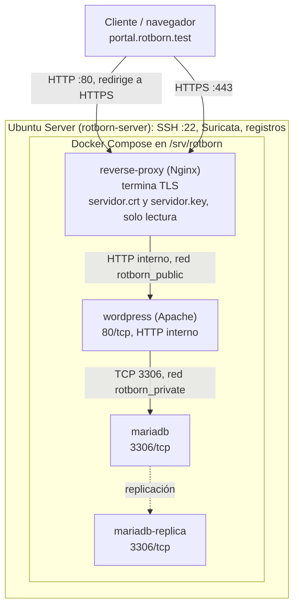

# Implementación de HTTPS con Nginx (reverse proxy) y Docker Compose (MF0489 · Fase 3)

Guía reproducible para publicar la aplicación WordPress de Rotborn Studios mediante HTTPS, con Nginx como reverse proxy y el certificado emitido por la CA del laboratorio. La aplicación sigue funcionando y la base de datos conserva sus datos.

| | |
|---|---|
| Módulo / fase | MF0489 · Fase 3 (actividades 8 a 13) |
| Entorno | Ubuntu Server `rotborn-server` (Docker Compose en `/srv/rotborn`) + Kali Linux (cliente) |
| Fecha | 27 de octubre de 2026 |
| Ubicación en el repositorio | `docs/mf0489/https-docker.md` (evidencias en `docs/mf0489/evidencias/fase3/`) |
| Fases relacionadas | `pki.md` (certificados usados aquí) y `auditoria-tls-monitorizacion.md` (pruebas avanzadas de TLS y monitorización) |

> **Leyenda:** ✅ comprobado con evidencia real · ⏳ pendiente de ejecutar y pegar la salida real · ⚠️ incidencia o punto a revisar.
>
> **Alcance.** Esta fase implanta y prueba HTTPS de extremo a extremo. El análisis avanzado de TLS, Suricata y la monitorización detallada pertenecen a la Fase 4. No se rehace la aplicación ni la base de datos. En ninguna prueba se desactiva la verificación del certificado (`-k`).
>
> **Datos publicados.** No se incluye ninguna clave privada, contraseña ni el contenido de `.env`.

## Cómo usar

La estructura sigue el contenido que se pide para `https-docker.md`. Cada apartado indica **qué se hace**, **los comandos** y **qué se obtuvo** en el laboratorio. El apartado 9 reúne el orden de ejecución completo.

| Apartado | Contenido | Actividades |
|---|---|---|
| Requisitos | Estado inicial, certificados y copia de seguridad | 8 |
| 1 | Arquitectura final y punto de terminación TLS | 9 |
| 2 | Servicios, redes y puertos antes y después | 9, 10 |
| 3 | Decisiones en Docker Compose y Nginx | 10, 11, 12 |
| 4 | Rutas de los certificados y permisos | 8, 10 |
| 5 | Resolución del nombre DNS en el cliente | 13 |
| 6 | Pruebas de HTTP → HTTPS y de confianza TLS | 13 |
| 7 | Funcionamiento de la aplicación y persistencia de datos | 12 |
| 8 | Incidencias reales y soluciones | — |
| 9 | Instrucciones de despliegue y verificación | — |
| Anexos | A: copia de seguridad · B: scripts · C: repositorio y seguridad · D: ayuda · E: evidencias | — |

### Variables y valores del laboratorio

Los comandos usan estas variables; sustitúyelas por las de tu entorno. Todos los `docker compose` se ejecutan desde `/srv/rotborn` (con `sudo` si tu usuario no pertenece al grupo `docker`).

```bash
# En el servidor (Ubuntu)
cd /srv/rotborn
export DOMINIO="portal.rotborn.test"

# En el cliente (Kali)
export DOMINIO="portal.rotborn.test"       # el nombre que figura en el SAN del certificado
export IP_SERVIDOR="10.21.4.65"            # IP vigente del servidor (ip -br addr en Ubuntu)
export CA_CERT="$HOME/rotborn-certs/ca.crt"  # solo el certificado PÚBLICO de la CA
```

| Elemento | Valor |
|---|---|
| Servidor / directorio del proyecto | `rotborn-server`, `/srv/rotborn` |
| IP del servidor en esta fase | `10.21.4.65` (DHCP; ver incidencia 4 del apartado 8) |
| Dominio | `portal.rotborn.test` |
| Servicios Compose | `wordpress`, `mariadb`, `mariadb-replica`, `reverse-proxy` |
| Imágenes | `wordpress:7.1.0-php8.3-apache`, `mariadb:10.11`, `nginx:stable` |
| Certificado, clave y CA en Ubuntu | `/etc/ssl/certs/servidor.crt`, `/etc/ssl/private/servidor.key`, `/etc/ssl/mf0489/ca.crt` |

---

## Requisitos previos y estado inicial (Actividad 8)

### Requisitos

- Fase 2 completada: certificado, clave y CA instalados en las rutas anteriores (ver `pki.md`).
- Proyecto Compose funcionando en `/srv/rotborn` con las redes `rotborn_public` y `rotborn_private`.
- Cliente con `curl`, `openssl` y el certificado público de la CA.
- **Regla de oro:** nunca ejecutar `docker compose down -v`: eliminaría los volúmenes y podría destruir la base de datos.

### Estado inicial del laboratorio

El proyecto tenía tres servicios, con redes separadas para la aplicación y la base de datos:

- `wordpress`: WordPress sobre Apache, que publicaba `8080:80`.
- `mariadb`: base de datos principal.
- `mariadb-replica`: réplica de la base de datos.

El arranque y la comprobación se hacen con `sudo /srv/rotborn/scripts/iniciar_rotborn.sh` (ver Anexo B). Resultado inicial ✅:

| Comprobación | Resultado |
|---|---|
| Docker activo | Correcto |
| Contenedores WordPress, MariaDB y réplica | En ejecución |
| Respuesta HTTP de WordPress | HTTP 200 |
| Consulta de prueba a MariaDB | Correcta |
| Replicación MariaDB | Correcta |

> Docker Compose: rotborn (running, 4 contenedores); Contenedores: mariadb, mariadb-replica, reverse-proxy y wordpress (running); Puertos en escucha: 80, 443 y 22; Configuración: /srv/rotborn/docker-compose.yml

### Copia de seguridad y vuelta atrás

Antes de tocar el Compose se hizo una copia de la configuración y exportaciones lógicas de las bases de datos, y se probó la restauración (Anexo A). Además:

```bash
sudo cp -a /srv/rotborn/docker-compose.yml /srv/rotborn/docker-compose.yml.pre-nginx
sudo ls -l /srv/rotborn/docker-compose.yml*     # ambos de 1053 bytes
```

Procedimiento de reversión (⏳ no se ha ejecutado en el laboratorio; probarlo en un entorno de prueba antes de depender de él):

```bash
cd /srv/rotborn
sudo docker compose stop reverse-proxy && sudo docker compose rm -f reverse-proxy
sudo cp -a docker-compose.yml.pre-nginx docker-compose.yml
sudo docker compose up -d
```

Los valores originales de las URL de WordPress están registrados en el apartado 3.6.

---

## 1. Arquitectura final y punto de terminación TLS



La CA privada (`ca.key`) permanece fuera de la máquina virtual.

**Dónde termina TLS.** El tramo cliente → Nginx es HTTPS (puerto 443). Nginx descifra y reenvía a WordPress por **HTTP interno** (`http://wordpress:80`) dentro de la red Docker `rotborn_public`. Ese tramo interno **no está cifrado**: es una decisión consciente, limitada a una red que no sale del host y a la que no tiene acceso el exterior. El puerto 80 publicado solo sirve para redirigir a HTTPS.

**Estado final comprobado ✅:** Nginx publica 80 y 443; WordPress no publica el 8080; MariaDB y su réplica no publican el 3306 en el host.

## 2. Servicios, redes y puertos antes y después de la modificación

| Servicio | Antes | Después | Redes |
|---|---|---|---|
| `wordpress` | Publicaba `8080:80` | `80/tcp` interno, **sin publicar** | `rotborn_public` y `rotborn_private` |
| `mariadb` | `3306/tcp` interno | Igual | `rotborn_private` |
| `mariadb-replica` | `3306/tcp` interno | Igual | `rotborn_private` |
| `reverse-proxy` | No existía | Publica `80:80` y `443:443` | `rotborn_public` |

| Red Docker | Contenedores | Justificación |
|---|---|---|
| `rotborn_public` | `reverse-proxy`, `wordpress` | Nginx alcanza a WordPress por el DNS interno de Docker. El nombre no implica exposición al host |
| `rotborn_private` | `wordpress`, `mariadb`, `mariadb-replica` | Comunicación aplicación ↔ BBDD. Nginx no se conecta aquí |
| `rotborn_net` | Ninguno | Red heredada de la fase anterior: la creó una versión anterior del Compose (proyecto `rotborn`, 15 sep 2026, subred `172.18.0.0/16`). No figura en el Compose actual y ningún contenedor la usa. Docker la conserva por sí solo; `iniciar_rotborn_https.sh` comprueba que existe y la recrea si falta (Anexo B) |
| `rotborn_restore_test_net` | `rotborn-restore-test` | Temporal, de la prueba de restauración (Anexo A) |

| Datos persistentes | Dónde | Observación |
|---|---|---|
| Base de datos principal | `/srv/rotborn/db` (montaje en el host) | Persistente |
| Réplica | `/srv/rotborn/db-replica` (montaje en el host) | Persistente |
| Archivos de WordPress (`wp-content`) | Volumen anónimo de la imagen | ⚠️ No declarado en el Compose (ver apartado 3.2) |

**Comprobación ✅** (`docker compose ps` final):

- `rotborn-reverse-proxy-1`: publica `80:80` y `443:443`.
- `rotborn-wordpress-1`: solo `80/tcp`, sin publicar el 8080.
- `rotborn-mariadb-1` y `rotborn-mariadb-replica-1`: `3306/tcp`, sin publicar en el host.

```bash
docker network inspect rotborn_public  --format '{{range .Containers}}{{.Name}} {{end}}'
docker network inspect rotborn_private --format '{{range .Containers}}{{.Name}} {{end}}'
```

Salida real de `docker compose ps` (columnas principales) y de las redes de cada contenedor:

```text
NAME                        SERVICE           STATUS          PORTS
rotborn-mariadb-1           mariadb           Up 28 minutes   3306/tcp
rotborn-mariadb-replica-1   mariadb-replica   Up 28 minutes   3306/tcp
rotborn-reverse-proxy-1     reverse-proxy     Up 28 minutes   0.0.0.0:80->80/tcp, [::]:80->80/tcp, 0.0.0.0:443->443/tcp, [::]:443->443/tcp
rotborn-wordpress-1         wordpress         Up 28 minutes   80/tcp

/rotborn-wordpress-1: rotborn_private rotborn_public
/rotborn-mariadb-1: rotborn_private
/rotborn-mariadb-replica-1: rotborn_private
/rotborn-reverse-proxy-1: rotborn_public
```

`docker network ls` muestra además `rotborn_net` y `rotborn_restore_test_net`, sin contenedores del Compose actual. La red `rotborn_public` devolvió `rotborn-reverse-proxy-1` y `rotborn-wordpress-1`; la red `rotborn_private`, `rotborn-mariadb-1`, `rotborn-mariadb-replica-1` y `rotborn-wordpress-1`. Nginx no está en la red de las bases de datos; WordPress está en ambas.

**Puerto interno, `ports` y `expose`.** El puerto interno es el que escucha la aplicación dentro del contenedor (Apache en el 80, MariaDB en el 3306). `ports: "8080:80"` publica el 80 del contenedor en el 8080 del host; no significa que Apache escuche en el 8080. `expose` solo documenta un puerto interno y **no** lo publica. Dos contenedores de la misma red definida por el usuario se comunican por el puerto interno sin publicar nada.

## 3. Decisiones tomadas en Docker Compose y Nginx

### 3.1. Decisiones de arquitectura

| Decisión | Elección |
|---|---|
| Contenedor reverse proxy | Un **Nginx nuevo** (servicio `reverse-proxy`, imagen `nginx:stable`). No existía ningún proxy previo |
| Aplicación: nombre, puerto y protocolo internos | Servicio `wordpress`, `80/tcp`, **HTTP**. La imagen `-apache` habla HTTP, así que `proxy_pass` funciona. Con una imagen `-fpm` (puerto 9000, FastCGI) no valdría |
| Contenedores en la red web | `reverse-proxy` y `wordpress` (`rotborn_public`) |
| Contenedores en la red de BBDD | `wordpress`, `mariadb` y `mariadb-replica` (`rotborn_private`). Nginx no necesita acceso a MariaDB |
| Dónde termina TLS | En Nginx. El tramo interno Nginx → WordPress es HTTP (límite documentado en el apartado 1) |

### 3.2. `docker-compose.yml` final

Se añadió el servicio `reverse-proxy` al Compose existente, sin eliminar servicios ni redes. Este es el archivo completo actual. No contiene secretos: las contraseñas se leen de `.env` mediante `${VARIABLE}`, y `.env` no se publica. Los comentarios se han añadido para esta guía.

```yaml
services:
  wordpress:
    image: wordpress:7.1.0-php8.3-apache
    restart: unless-stopped  # Política de reinicio 
    # Sin "ports": el 8080:80 original se retiró (apartado 3.7)
    networks:
      - rotborn_public
      - rotborn_private
    depends_on:
      - mariadb
    environment:
      TZ: Europe/Madrid
      WORDPRESS_DB_HOST: mariadb
      WORDPRESS_DB_NAME: rotborn
      WORDPRESS_DB_USER: rotborn
      WORDPRESS_DB_PASSWORD: ${MYSQL_PASSWORD}

  mariadb:
    image: mariadb:10.11
    restart: unless-stopped
    networks:
      - rotborn_private
    env_file:
      - .env
    volumes:
      - /srv/rotborn/db:/var/lib/mysql
      - /srv/rotborn/config/mariadb/primary.cnf:/etc/mysql/conf.d/primary.cnf:ro

  mariadb-replica:
    image: mariadb:10.11
    restart: unless-stopped
    networks:
      - rotborn_private
    environment:
      MYSQL_ROOT_PASSWORD: ${MYSQL_ROOT_PASSWORD}
    volumes:
      - /srv/rotborn/db-replica:/var/lib/mysql
      - /srv/rotborn/config/mariadb-replica/replica.cnf:/etc/mysql/conf.d/replica.cnf:ro

  reverse-proxy:
    image: nginx:stable
    restart: unless-stopped
    ports:
      - "80:80"
      - "443:443"
    networks:
      - rotborn_public
    depends_on:
      - wordpress
    volumes:
      - /srv/rotborn/nginx/default.conf:/etc/nginx/conf.d/default.conf:ro
      # Añadido en la Fase 4 (actividad 18.2): formato de log mf0489
      - /srv/rotborn/nginx/00-log-format.conf:/etc/nginx/conf.d/00-log-format.conf:ro
      - /etc/ssl/certs/servidor.crt:/etc/nginx/certs/servidor.crt:ro
      - /etc/ssl/private/servidor.key:/etc/nginx/certs/servidor.key:ro

networks:
  rotborn_public:
    name: rotborn_public
    driver: bridge

  rotborn_private:
    name: rotborn_private
    driver: bridge
```

Cambio hecho en el servicio `wordpress` durante esta fase: se retira la publicación directa (apartado 3.7):

```diff
   wordpress:
-    ports:
-      - "8080:80"
     networks:
       - rotborn_public
       - rotborn_private
```

**Qué hay que saber de este archivo:**

- **Puertos.** Solo `reverse-proxy` publica puertos (80 y 443). `wordpress` y las dos bases de datos no tienen `ports`: solo son accesibles por las redes Docker.
- **Redes.** `rotborn_public` (Nginx y WordPress) y `rotborn_private` (WordPress y bases de datos). Nginx no está en la privada.
- **Secretos.** Compose lee `.env` automáticamente para sustituir `${MYSQL_PASSWORD}` y `${MYSQL_ROOT_PASSWORD}`. El servicio `mariadb` usa además `env_file: .env`, así que recibe **todas** las variables de `.env`, no solo las suyas: funciona, pero conviene saberlo.
- **Línea de la Fase 4.** El montaje de `00-log-format.conf` pertenece a la actividad 18.2. Si repites solo la Fase 3, crea ese archivo o quita la línea: con un archivo inexistente, Docker crea un **directorio** con ese nombre y Nginx falla.
- **Rutas absolutas.** Los montajes de `db`, `config` y `nginx` usan `/srv/rotborn/...`. Quien clone el repositorio en otra ruta tendría que editarlas; con rutas relativas (`./db`, `./config/...`, `./nginx/...`) el repositorio es portable. Los certificados sí son rutas absolutas del host, por diseño.
- **Política de reinicio configurada.** Se ha añadido `restart: unless-stopped` a los cuatro servicios (`wordpress, mariadb, mariadb-replica y reverse-proxy`). La configuración se ha validado y las políticas se han verificado mediante `docker inspect`. Tras aplicar los cambios, los cuatro contenedores continúan en estado running. Esta política permite el reinicio automático tras reiniciar Ubuntu, salvo que los servicios se hayan detenido expresamente. El script sudo `/srv/rotborn/scripts/iniciar_rotborn_https.sh` se conserva como mecanismo de inicio y comprobación manual (Anexo B).
- **WordPress: volumen persistente configurado y verificado**  Inicialmente, el servicio `wordpress` no declaraba ningún montaje para `/var/www/html` y utilizaba un volumen anónimo de Docker. Para evitar depender de ese volumen, se copió la instalación completa a `/srv/rotborn/wordpress` y se declaró el montaje `/srv/rotborn/wordpress:/var/www/html` en `docker-compose.yml`. Se ajustó el propietario de los archivos a `www-data:www-data` y se verificó que WordPress funciona con la nueva configuración: respuesta `HTTP 200`, certificado HTTPS validado con la CA del proyecto y 5 registros en wp_posts. El volumen anónimo anterior se conserva como respaldo.

  ```bash
  docker inspect rotborn-wordpress-1 --format '{{range .Mounts}}{{.Type}} {{.Name}} {{.Destination}}{{println}}{{end}}'
  bind  /var/www/html
  ```

**Preguntas (10.1):**

- **¿Qué hace `ports`?** Publica puertos del contenedor en las interfaces del host con el formato `HOST:CONTENEDOR`.
- **¿Para qué sirve cada entrada de `volumes`?** La primera monta la configuración de Nginx; la segunda y la tercera montan el certificado y la clave del servidor en las rutas internas que usa `default.conf`. Se montan archivos concretos para que nada más de `/etc/ssl` entre al contenedor.
- **¿Qué significa `:ro`?** Montaje de solo lectura: el contenedor no puede modificar esos archivos del host, lo que limita el daño si se compromete.
- **¿Por qué Nginx necesita `servidor.key` pero no `ca.key`?** Para el handshake, el servidor debe demostrar que posee su clave. `ca.key` solo sirve para firmar certificados: si estuviera en el contenedor, quien lo comprometiera podría emitir certificados fraudulentos. Los clientes solo necesitan `ca.crt` (público) para verificar.
- **¿Necesita Nginx la red de la BBDD?** No. Solo reenvía HTTP a WordPress; es WordPress quien habla con MariaDB. No conectarlo reduce la superficie de ataque.

### 3.3. Configuración de Nginx (`nginx/default.conf`)

```nginx
server {
    listen 80;
    server_name portal.rotborn.test;

    return 301 https://$host$request_uri;
}

server {
    listen 443 ssl;
    server_name portal.rotborn.test;

    ssl_certificate     /etc/nginx/certs/servidor.crt;
    ssl_certificate_key /etc/nginx/certs/servidor.key;

    ssl_protocols TLSv1.2 TLSv1.3;

    location / {
        proxy_pass http://wordpress:80;

        proxy_set_header Host $host;
        proxy_set_header X-Real-IP $remote_addr;
        proxy_set_header X-Forwarded-For $proxy_add_x_forwarded_for;
        proxy_set_header X-Forwarded-Proto $scheme;
    }
}
```

| Requisito del enunciado (11.2) | Cumplimiento ✅ |
|---|---|
| Bloque en el 80 que redirige a HTTPS | `return 301 https://$host$request_uri;` (conserva host, ruta y parámetros) |
| Bloque en el 443 con TLS | `listen 443 ssl;` |
| Mismo `server_name` que el SAN | `portal.rotborn.test` (SAN `DNS:portal.rotborn.test`, ver `pki.md`) |
| Rutas internas del contenedor | `/etc/nginx/certs/servidor.crt` y `.key` (no las rutas de Ubuntu) |
| Solo TLS 1.2 y 1.3 | `ssl_protocols TLSv1.2 TLSv1.3;` |
| `proxy_pass` al servicio y puerto internos | `http://wordpress:80` |
| Cabeceras de host, IP del cliente y protocolo | `Host`, `X-Real-IP`, `X-Forwarded-For`, `X-Forwarded-Proto` |

El único bloque del puerto 80 actúa también como servidor por defecto: una petición con otro `Host` (por ejemplo `127.0.0.1`) se redirige a `https://<ese host>/`.

### 3.4. Validar y poner en marcha

```bash
docker compose config --quiet             # valida sin imprimir contraseñas
docker compose ps
docker compose up -d reverse-proxy        # solo el servicio nuevo
docker compose ps
docker compose exec reverse-proxy nginx -t
docker compose logs --tail=50 reverse-proxy
sudo ss -ltnp | grep -E ':(80|443)\b'
```

**Resultado ✅:** `config --quiet` sin errores; Docker descargó `nginx:stable` y creó `rotborn-reverse-proxy-1`; WordPress y MariaDB siguieron en ejecución; cuatro servicios activos; y:

```text
nginx: the configuration file /etc/nginx/nginx.conf syntax is ok
nginx: configuration file /etc/nginx/nginx.conf test is successful
```

`nginx -t` solo valida la configuración, no reinicia el contenedor.

> ⚠️ Validación segura de Docker Compose `docker compose -f /srv/rotborn/docker-compose.yml config -q` para validar la configuración sin imprimirla. La salida completa de docker compose config puede incluir contraseñas y otros valores sensibles; no debe guardarse ni publicarse en la documentación.


### 3.5. Prueba inicial y problema detectado

```bash
curl -sSI --resolve portal.rotborn.test:80:127.0.0.1 http://portal.rotborn.test/
curl -I --resolve portal.rotborn.test:443:127.0.0.1 --cacert /etc/ssl/mf0489/ca.crt https://portal.rotborn.test/
```

La redirección HTTP funcionó (`301` a `https://portal.rotborn.test/`). El HTTPS llegó a WordPress, pero devolvió:

```text
HTTP/1.1 301 Moved Permanently
X-Redirect-By: WordPress
Location: https://portal.rotborn.test:8080/
```

No era un fallo de Nginx ni de su sintaxis: WordPress generaba una URL equivocada. Se diagnostica en el siguiente apartado.

### 3.6. WordPress: corregir las URL públicas

**Diagnóstico.** Se descartó cada origen posible de la URL, en este orden:

```bash
# 1. Valores que WordPress tiene guardados
docker compose exec wordpress \
  sh -c 'php -r '\''require "/var/www/html/wp-load.php"; echo "home_url: " . get_option("home") . PHP_EOL; echo "site_url: " . get_option("siteurl") . PHP_EOL;'\'''

# 2. ¿Definidas como constantes en wp-config.php?
docker compose exec wordpress \
  sh -c 'grep -nE "WP_HOME|WP_SITEURL|RELOCATE" /var/www/html/wp-config.php || true'

# 3. ¿Definidas por variables de entorno?
docker compose exec wordpress \
  sh -c 'env | grep -E "^WORDPRESS_(CONFIG_EXTRA|HOME|SITEURL|URL)=" || true'

# 4. ¿Y la lógica de HTTPS tras un proxy?
docker compose exec wordpress sh -c 'tail -n 30 /var/www/html/wp-config.php'
```

Resultado ✅: las opciones `home` y `siteurl` valían `http://10.21.4.40:8080` (IP antigua, HTTP y puerto 8080). No había constantes ni variables que las fijaran, y `wp-config.php` ya incluía la lógica para reconocer `X-Forwarded-Proto: https`, así que no hizo falta añadirla. La causa estaba en la base de datos.

**Copia de los valores originales** antes de cambiar nada:

```bash
docker compose exec wordpress php -r 'require "/var/www/html/wp-load.php"; foreach (["home","siteurl"] as $key) { file_put_contents("/tmp/wordpress-urls-before.txt", $key . "=" . get_option($key) . PHP_EOL, FILE_APPEND); }'
docker compose exec wordpress cat /tmp/wordpress-urls-before.txt
```

```text
home=http://10.21.4.40:8080
siteurl=http://10.21.4.40:8080
```

> ⚠️ `/tmp` del contenedor no es una copia permanente: desaparece si se recrea. ⏳ Guárdala también fuera del contenedor:
>
> ```bash
> docker compose exec -T wordpress cat /tmp/wordpress-urls-before.txt | sudo tee "$BACKUP_DIR/wordpress-urls-before.txt" >/dev/null
> ```

**Corrección:**

```bash
docker compose exec wordpress php -r 'require "/var/www/html/wp-load.php"; update_option("home", "https://portal.rotborn.test"); update_option("siteurl", "https://portal.rotborn.test"); echo "home: " . get_option("home") . PHP_EOL; echo "siteurl: " . get_option("siteurl") . PHP_EOL;'
```

```text
home: https://portal.rotborn.test
siteurl: https://portal.rotborn.test
```

Solo se modificaron las opciones `home` y `siteurl`; no se tocaron entradas, usuarios ni tablas de contenido. Repetida la prueba HTTPS con `--cacert`, devolvió `HTTP/1.1 200 OK` y la redirección al 8080 desapareció.

### 3.7. Retirar la publicación directa del puerto 8080

Una vez verificado el acceso HTTPS a través de Nginx, el acceso web queda centralizado en el proxy inverso. Además, se sustituye el volumen anónimo de WordPress por un directorio persistente del servidor:

0. Preparar la copia de seguridad: copiar la instalación completa desde /var/www/html del contenedor a /srv/rotborn/wordpress, conservando los archivos y ajustando el propietario a `www-data:www-data`. (apartado 3.2).
1. Actualizar Compose: eliminar la publicación directa del `puerto 8080:80` del servicio wordpress y declarar el montaje:
`/srv/rotborn/wordpress:/var/www/html`.(apartado 3.2).
2. Validar la configuración `sudo docker compose -f /srv/rotborn/docker-compose.yml config -q`.
3. Aplicar el cambio: `sudo docker compose -f /srv/rotborn/docker-compose.yml up -d --no-deps wordpress.`
4. Verificar el montaje`docker compose ps` y repetir las pruebas `HTTP` y `HTTPS`.
5. Comprobar el funcionamiento: verificar el estado de los servicios, la respuesta `HTTP` de `WordPress` y el acceso `HTTPS` a través de `Nginx` con validación del `certificado` de la `CA` del proyecto.
7. Conservar el volumen anónimo anterior: no eliminarlo hasta completar las comprobaciones finales y confirmar que no es necesario como respaldo.

**Resultado verificado:** WordPress muestra `80/tcp` sin mapeo al host, Nginx publica 80 y 443, y las pruebas se repitieron correctamente.también utiliza el directorio persistente, responde con HTTP 200 y conserva los cinco registros de wp_posts. La validación del certificado HTTPS devuelve HTTP 200.

---

## 4. Rutas de los certificados y permisos aplicados

| Archivo | En Ubuntu | Dentro del contenedor Nginx | Permisos esperados |
|---|---|---|---|
| Clave privada | `/etc/ssl/private/servidor.key` | `/etc/nginx/certs/servidor.key` (`:ro`) | `600`, `root:root` |
| Certificado del servidor | `/etc/ssl/certs/servidor.crt` | `/etc/nginx/certs/servidor.crt` (`:ro`) | `644`, `root:root` |
| Certificado de la CA | `/etc/ssl/mf0489/ca.crt` | No se monta | `644`, `root:root` |

La clave privada no se copia a Kali, no se incluye en el repositorio y no se incorpora a ninguna imagen (no se usa `COPY`). Nginx no recibe `ca.key`.

Verificación, sin mostrar el contenido de las claves:

```bash
sudo ls -l /etc/ssl/private/servidor.key
ls -l /etc/ssl/certs/servidor.crt /etc/ssl/mf0489/ca.crt


openssl verify -CAfile /etc/ssl/mf0489/ca.crt -purpose sslserver \
  -verify_hostname "$DOMINIO" /etc/ssl/certs/servidor.crt
```

Resultado documentado ✅: el certificado se validó con la CA de la Fase 2 para `portal.rotborn.test` y el propósito `sslserver`, con resultado `OK`.

```text
>-rw------- 1 root root 2484 Oct 20 01:44 /etc/ssl/private/servidor.key
>-rw-r--r-- 1 root root 2041 Oct 20 11:44 /etc/ssl/certs/servidor.crt
>-rw-r--r-- 1 root root 2147 Oct 20 01:42 /etc/ssl/mf0489/ca.crt
```

>/etc/ssl/certs/servidor.crt: OK

## 5. Cómo se resuelve el nombre DNS en el cliente de laboratorio

El certificado solo incluye un SAN de tipo DNS (`portal.rotborn.test`). Por eso `https://IP_SERVIDOR` **no valida**: la IP no figura en el certificado. Hay dos formas de relacionar el nombre con la IP:

| Opción | Cómo | Uso |
|---|---|---|
| `curl --resolve` (la usada) | `--resolve "${DOMINIO}:443:${IP_SERVIDOR}"` | Temporal, sin tocar el sistema |
| Entrada en `/etc/hosts` | `echo "${IP_SERVIDOR} ${DOMINIO}" \| sudo tee -a /etc/hosts` | Permanente; necesaria para usar un navegador |

En esta fase se usó `--resolve`: contra `127.0.0.1` desde el servidor y contra la IP del servidor desde Kali. No se modificó `/etc/hosts`.

> ⚠️ La IP del servidor cambia por DHCP (ver apartado 8). Con una entrada en `/etc/hosts`, hay que actualizarla cada vez; mejor reservar la IP en el DHCP.

## 6. Pruebas de HTTP → HTTPS y de confianza TLS

### 6.1. Desde el servidor (loopback) ✅

```bash
curl -sSI --resolve portal.rotborn.test:80:127.0.0.1 http://portal.rotborn.test/
curl -sS -D - -o /dev/null --resolve portal.rotborn.test:443:127.0.0.1 \
  --cacert /etc/ssl/mf0489/ca.crt https://portal.rotborn.test/
```

```text
HTTP/1.1 301 Moved Permanently
Location: https://portal.rotborn.test/

HTTP/1.1 200 OK
```

La CA se indicó explícitamente y no se desactivó la verificación.

### 6.2. Desde Kali ✅

1. **Conectividad.** `ping -c 4 10.21.4.65`: 4 de 4 respuestas (0 % de pérdida). `nc -vz 10.21.4.65 443`: puerto 443 abierto.
2. **Prueba negativa, sin indicar la CA.** Falló como se esperaba, porque la CA del laboratorio no está en el almacén de confianza de Kali. Es la prueba de que la verificación está activa:

   ```text
   curl: (60) ... unable to get local issuer certificate
   ```

3. **Copiar solo el certificado público de la CA.** Kali ejecutó `scp` hacia sí misma desde el servidor (ver incidencia 3):

   ```bash
   mkdir -p ~/rotborn-certs
   scp USUARIO@${IP_SERVIDOR}:/etc/ssl/mf0489/ca.crt "$CA_CERT"
   ```

4. **Prueba positiva:**

   ```bash
   curl -I --resolve "${DOMINIO}:443:${IP_SERVIDOR}" --cacert "$CA_CERT" "https://${DOMINIO}/"
   ```

   Resultado: `HTTP/1.1 200 OK`, sin `-k`. La evidencia se guardó en Kali en `~/rotborn-evidencias/fase3/prueba-https-kali.txt`.

> ⚠️ **Raíz de la CA.** La copia que se usó aquí (`E2:85…`) es un certificado raíz anterior de la misma clave que `8F:BA…` (el de `ca_root-pki`); ambos validan el certificado del servidor. Se decidió dejar una sola raíz, `8F:BA…`, y una única ruta (`~/rotborn-certs/ca.crt`) según `pki.md`, apartado 10.5. ⏳ Tras aplicarlo, repite estas pruebas.

### 6.3. Pruebas del cliente que faltan por documentar ⏳

El enunciado pide estas comprobaciones **desde un cliente**. Ejecútalas desde Kali y pega las salidas:

```bash
### 13.2 Redirección HTTP

**Comando ejecutado:**

```bash
curl -I --resolve "${DOMINIO}:80:${IP_SERVIDOR}" "http://${DOMINIO}/"
```

**Resultado obtenido:**

```text
HTTP/1.1 301 Moved Permanently
Server: nginx/1.30.6
Date: Mon, 26 Oct 2026 00:19:03 GMT
Content-Type: text/html
Content-Length: 169
Connection: keep-alive
Location: https://portal.rotborn.test/
```

### 13.3 HTTPS con salida detallada

**Comando ejecutado:**

```bash
curl -v --cacert "$CA_CERT" \
  --resolve "${DOMINIO}:443:${IP_SERVIDOR}" \
  "https://${DOMINIO}/" -o /dev/null
```

**Filtro utilizado para mostrar las líneas relevantes:**

```bash
grep -E 'SSL connection using|subjectAltName:|OpenSSL verify result:|SSL certificate verified|^< HTTP/|^< Server:'
```

**Resultado obtenido:**

```text
* SSL connection using TLSv1.3 / TLS_AES_256_GCM_SHA384 / X25519MLKEM768 / RSASSA-PSS
*   subjectAltName: "portal.rotborn.test" matches cert's "portal.rotborn.test"
* OpenSSL verify result: 0
* SSL certificate verified via OpenSSL.
< HTTP/1.1 200 OK
< Server: nginx/1.30.6
```

### 13.4 OpenSSL

**Comando ejecutado:**

```bash
openssl s_client -connect "${IP_SERVIDOR}:443" -servername "$DOMINIO" \
  -CAfile "$CA_CERT" -verify_hostname "$DOMINIO" -verify_return_error -brief </dev/null
```

**Resultado obtenido:**

```text
Connecting to 10.21.4.53
CONNECTION ESTABLISHED
Protocol version: TLSv1.3
Ciphersuite: TLS_AES_256_GCM_SHA384
Peer certificate: C=ES, ST=Barcelona, L=Barcelona, O=Rotborn Studios, OU=Cybersecurity, CN=portal.rotborn.test
Hash used: SHA256
Signature type: rsa_pss_rsae_sha256
Verification: OK
Verified peername: portal.rotborn.test
Negotiated TLS1.3 group: X25519MLKEM768
DONE
```

```
 ### Prueba negativa de nombre: por IP no debe validar (el SAN es solo DNS)
curl -sS --cacert "$CA_CERT" "https://${IP_SERVIDOR}/" -o /dev/null

```text
curl: (60) SSL: no alternative certificate subject name matches target ipv4 address 
```
### 13.5 Peticiones reflejadas en el log de Nginx (en el servidor)
docker compose logs --tail=30 reverse-proxy
  | grep -E 'request=|" (GET|HEAD) / HTTP/1\.[01]" (200|301)|tls=|cipher='

```text
reverse-proxy-1  | 2026-10-25T23:35:10+00:00 client=10.21.4.73:46238 request="GET / HTTP/1.1" status=200 tls=TLSv1.3 cipher=TLS_AES_256_GCM_SHA384

reverse-proxy-1 | 2026-10-26T00:24:54+00:00 client=10.21.4.42:64413 request="GET / HTTP/1.1" status=301 tls=TLSv1.3 cipher=TLS_AES_256_GCM_SHA384
```

Resultados: HTTP redirige a HTTPS con 301; curl valida el certificado y el dominio, estableciendo TLS 1.3 y obteniendo HTTP 200. El acceso por IP falla por discrepancia de identidad del certificado, como se esperaba. Los registros de Nginx confirman peticiones 301 y 200 desde Kali.

> La Fase 4 (`auditoria-tls-monitorizacion.md`, apartados 3 y 4) contiene salidas equivalentes, pero obtenidas con la IP de aquel momento. Sirven de referencia; la evidencia de esta fase debe ser propia.

## 7. Pruebas de funcionamiento de la aplicación y de persistencia de datos

Una conexión HTTPS correcta puede mostrar una web rota. Estas comprobaciones lo descartan.

### 7.1. Acceso interno de Nginx a WordPress

```bash
docker compose exec reverse-proxy getent hosts wordpress        # Nginx resuelve el servicio
curl -sS -o /dev/null -w '%{http_code}\n' --cacert "$CA_CERT" \
  --resolve "${DOMINIO}:443:${IP_SERVIDOR}" "https://${DOMINIO}/"
```

✅ La respuesta `200` a través de Nginx demuestra que alcanza a WordPress en `wordpress:80` y que no hay `502 Bad Gateway`. Verificar la salida de `getent hosts`. Si aparece un `502`, revisa primero el nombre del servicio, el puerto y las redes compartidas.

### 7.2. Navegación y contenido mixto 

```bash
U="https://${DOMINIO}"
for ruta in / /wp-login.php /wp-admin/; do
  printf '%-14s ' "$ruta"
  curl -sS -o /dev/null -w '%{http_code}\n' --cacert "$CA_CERT" \
    --resolve "${DOMINIO}:443:${IP_SERVIDOR}" "$U$ruta"
done
/              200
/wp-login.php  200
/wp-admin/     302


# Recursos http:// en la página principal (no debería haber enlaces propios)
curl -sS --cacert "$CA_CERT" --resolve "${DOMINIO}:443:${IP_SERVIDOR}" "$U/" \
  | grep -o 'http://[^"'\'' ]*' | sort -u
```

Las comprobaciones realizadas han dado resultados satisfactorios:

- La página principal (`/`) responde con código HTTP `200`.
- La página de inicio de sesión (`/wp-login.php`) responde con código HTTP `200`.
- El acceso a la administración (`/wp-admin/`) redirige a `wp-login.php` mediante el código HTTP `302`.
- La búsqueda de referencias `http://` en el HTML de la página principal solo ha identificado `http://www.w3.org/2000/svg`, una referencia al espacio de nombres SVG que no constituye por sí sola evidencia de contenido mixto.
- Desde Firefox, la página principal, los enlaces internos y el acceso a la administración de WordPress se han comprobado correctamente.
- La consola del navegador no ha mostrado advertencias de contenido mixto durante la comprobación realizada.

Los resultados confirman el funcionamiento de las rutas principales de WordPress y el acceso mediante HTTPS. No se han identificado indicios de contenido mixto en las comprobaciones realizadas.

### 7.3. Base de datos y persistencia ⏳

La copia de seguridad previa (Anexo A) registró 12 tablas de WordPress, **5** registros en `wp_posts` y **154** en `wp_options`. Compara con la base real tras los cambios:

```bash
docker compose exec -T mariadb sh -c 'mariadb -uroot -p"$MYSQL_ROOT_PASSWORD" -e "SELECT COUNT(*) AS total_entradas FROM rotborn.wp_posts; SELECT COUNT(*) AS total_opciones FROM rotborn.wp_options;"'
total_entradas
5
total_opciones
154

sudo /srv/rotborn/scripts/rotborn_check.sh     # contenedores, HTTP, MariaDB y replicación
[OK] reverse-proxy esta en ejecucion
[OK] wordpress esta en ejecucion
[OK] mariadb esta en ejecucion
[OK] mariadb-replica esta en ejecucion

[OK] HTTP redirige con codigo 301
[OK] Destino de redireccion HTTPS correcto
[OK] HTTPS validado y WordPress responde con HTTP 200

[OK] MariaDB principal acepta una consulta SELECT 1
[OK] Hilos IO y SQL de replicacion activos, sin errores registrados
[OK] Retraso de replicacion informado: 0 segundos
```

La tabla wp_posts conserva los 5 registros registrados en la copia de seguridad.
La tabla wp_options conserva los 154 registros registrados en la copia de seguridad.
La base de datos MariaDB responde correctamente a las consultas.
El contenido de WordPress se mantiene disponible.
La replicación de MariaDB está activa, sin errores registrados y con un retraso informado de 0 segundos.
Los resultados confirman que los datos se mantienen y que la base de datos y la replicación funcionan correctamente.

---

## 8. Incidencias reales y soluciones

| # | Incidencia | Qué se investigó | Causa | Solución | Estado |
|---|---|---|---|---|---|
| 1 | La primera petición HTTPS devolvió `301` con `Location: https://portal.rotborn.test:8080/` | Que Nginx estuviera parado o con sintaxis errónea (no lo estaba); constantes en `wp-config.php`; variables de entorno; valores en la base de datos | Las opciones `home` y `siteurl` de WordPress apuntaban a `http://10.21.4.40:8080` | Actualizarlas a `https://portal.rotborn.test` tras guardar los valores originales (3.6) | ✅ |
| 2 | Desde Kali: `curl: (60) unable to get local issuer certificate` | Si el error era del servidor o del cliente | La CA del laboratorio no estaba en el almacén de confianza de Kali. Es lo esperado | Copiar solo `ca.crt` y usar `--cacert` (6.2) | ✅ |
| 3 | `scp` desde el servidor a Kali falló con `No route to host` | Que Kali alcanzara el SSH del servidor (sí lo alcanzaba) | La conexión solo funcionaba en un sentido | Invertir la dirección: Kali ejecutó el `scp`. No se tocaron reglas de red ni se abrieron puertos | ✅ |
| 4 | La IP del servidor cambia entre sesiones | Comparar las IP anotadas en cada fase | DHCP sin reserva: `10.21.4.40` (WordPress inicial), `10.21.4.58` (Fase 2), `10.21.4.65` (esta fase), `10.21.4.34` (Fase 4) | Reservar la IP en el DHCP o fijarla; no usarla en el certificado (se emite para el nombre DNS) | ✅ |
| 5 | Al revisar el Compose se ve que `wordpress` no declara ningún volumen | `docker inspect` de los montajes del contenedor (3.2) | Los archivos de WordPress están en un volumen anónimo de la imagen: se conservan al recrear, no tras `down` + `up` | Copiar `wp-content` (Anexo A) y valorar un montaje explícito | ✅ |
| 6 | Dos certificados raíz con la misma clave en Kali y en Ubuntu (`E2:85…` y `8F:BA…`) | Comparar huellas, series, fechas y clave pública (Fase 4, incidencia 1) | El certificado raíz se regeneró sobre la misma clave; ambos validan | Dejar `8F:BA…` como única raíz (`pki.md`, apartado 10.5) | ✅ |

## 9. Instrucciones de despliegue y verificación reproducibles

### 9.1. Orden de ejecución

- [ ] **0. Copia de seguridad** de la configuración y de las bases de datos, y probar la restauración (Anexo A). Guardar `docker-compose.yml.pre-nginx`.
- [ ] **1. Verificar los certificados** de la Fase 2: rutas, permisos y `openssl verify` (apartado 4).
- [ ] **2. Anotar el estado previo**: servicios, puertos y respuesta de la web (Requisitos).
- [ ] **3. Añadir el servicio `reverse-proxy`** al Compose (apartado 3.2).
- [ ] **4. Crear `nginx/default.conf`** (apartado 3.3).
- [ ] **5. Validar y arrancar** solo el servicio nuevo (apartado 3.4).
- [ ] **6. Corregir las URL de WordPress** si apuntaban a una IP o puerto (apartado 3.6).
- [ ] **7. Retirar la publicación del 8080** y recrear WordPress (apartado 3.7).
- [ ] **8. Resolver el nombre en el cliente** (apartado 5).
- [ ] **9. Probar desde el cliente**: redirección, HTTPS con `--cacert` y `openssl s_client` (apartado 6).
- [ ] **10. Verificar funcionamiento y datos** (apartado 7).
- [ ] **11. Publicar en Git** sin secretos (Anexo C).

### 9.2. Script de verificación desde el cliente

Repite las pruebas esenciales en un solo paso. No usa `-k`:

```bash
#!/usr/bin/env bash
# Requiere DOMINIO, IP_SERVIDOR y CA_CERT definidos (ver "Variables").
set -u
: "${DOMINIO:?}" "${IP_SERVIDOR:?}" "${CA_CERT:?}"

echo "== HTTP debe redirigir a HTTPS =="
curl -sI --resolve "${DOMINIO}:80:${IP_SERVIDOR}" "http://${DOMINIO}/" | grep -Ei '^(HTTP|location)'

echo "== HTTPS con CA (debe dar 200) =="
curl -sS -o /dev/null -w '%{http_code}\n' --cacert "$CA_CERT" \
  --resolve "${DOMINIO}:443:${IP_SERVIDOR}" "https://${DOMINIO}/"

echo "== HTTPS sin CA (debe FALLAR con el error 60) =="
curl -sS -o /dev/null --resolve "${DOMINIO}:443:${IP_SERVIDOR}" "https://${DOMINIO}/"
echo "código de curl: $?"

echo "== openssl s_client =="
openssl s_client -connect "${IP_SERVIDOR}:443" -servername "$DOMINIO" \
  -CAfile "$CA_CERT" -verify_hostname "$DOMINIO" -verify_return_error -brief </dev/null 2>&1 \
  | grep -E 'Protocol version|Ciphersuite|Verification|Verified peername'
```

---

## Anexo A. Copia de seguridad y prueba de restauración (Actividad 8.2)

Antes de modificar redes, puertos o el Compose, se guardó la configuración y se exportaron las bases de datos. Los directorios de datos (`db/`, `db-replica/`) **no** se copian en caliente: se usa exportación lógica con `mariadb-dump`.

```bash
cd /srv/rotborn
BACKUP_DIR="/srv/rotborn/backups/fase3-$(date +%Y%m%d-%H%M%S)"
sudo install -d -m 700 "$BACKUP_DIR"
sudo cp -a docker-compose.yml .env config "$BACKUP_DIR/"
sudo chmod 600 "$BACKUP_DIR/.env"

docker compose exec -T mariadb sh -c 'mariadb-dump --user=root --password="$MYSQL_ROOT_PASSWORD" --single-transaction --all-databases' \
  | gzip -c | sudo tee "$BACKUP_DIR/mariadb-principal.sql.gz" >/dev/null
docker compose exec -T mariadb-replica sh -c 'mariadb-dump --user=root --password="$MYSQL_ROOT_PASSWORD" --single-transaction --all-databases' \
  | gzip -c | sudo tee "$BACKUP_DIR/mariadb-replica.sql.gz" >/dev/null

sudo gzip -t "$BACKUP_DIR/mariadb-principal.sql.gz" "$BACKUP_DIR/mariadb-replica.sql.gz"
sudo find "$BACKUP_DIR" -maxdepth 5 -type f -printf '%P — %s bytes\n'
```

- La contraseña se lee de la variable del contenedor; nunca se escribe en el comando.
- `-T` permite usar la tubería sin terminal interactiva; `--single-transaction` da una exportación consistente.
- `gzip -t` solo comprueba que el archivo comprimido es legible; **no** demuestra que los datos se puedan restaurar.

**Archivos de WordPress ⏳.** La exportación de las bases de datos no incluye `wp-content` (subidas, plugins y temas), que vive en un volumen anónimo. Cópialo también:

```bash
sudo docker compose cp wordpress:/var/www/html/wp-content "$BACKUP_DIR/wp-content"
```

Copia de esta ejecución ✅: `/srv/rotborn/backups/fase3-20261021-115929/`, con `docker-compose.yml`, `.env`, `config/mariadb/primary.cnf`, `config/mariadb-replica/replica.cnf`, `mariadb-principal.sql.gz` y `mariadb-replica.sql.gz`.


### Prueba de restauración en un entorno aislado ✅

Se restauró el volcado principal en un MariaDB temporal, con volumen y red propios y sin publicar puertos, para no tocar las bases de datos reales.

```bash
sudo install -d -m 700 /srv/rotborn/restore-test
# Crear /srv/rotborn/restore-test/compose-restore-test.yml (ver plantilla)
RT=/srv/rotborn/restore-test/compose-restore-test.yml

sudo docker compose -f "$RT" config --quiet
sudo docker compose -f "$RT" config --services          # restore-test
sudo docker volume inspect rotborn_restore_test_data    # debe indicar que no existe
sudo docker compose -f "$RT" up -d
sudo docker inspect --format '{{.State.Status}}' rotborn-restore-test      # running

# Importar el volcado (pipefail para detectar errores en la tubería)
sudo BACKUP_DIR="$BACKUP_DIR" RT="$RT" bash -o pipefail -c 'gzip -dc "$BACKUP_DIR/mariadb-principal.sql.gz" | docker compose -f "$RT" exec -T restore-test sh -c '\''mariadb -uroot -p"$MYSQL_ROOT_PASSWORD"'\'''

# Verificar
sudo docker compose -f "$RT" exec -T restore-test sh -c 'mariadb -uroot -p"$MYSQL_ROOT_PASSWORD" -e "SHOW DATABASES; USE rotborn; SHOW TABLES;"'
sudo docker compose -f "$RT" exec -T restore-test sh -c 'mariadb -uroot -p"$MYSQL_ROOT_PASSWORD" -e "SELECT COUNT(*) AS total_entradas FROM rotborn.wp_posts; SELECT COUNT(*) AS total_opciones FROM rotborn.wp_options;"'
```

Plantilla equivalente del archivo descrito (⏳ compárala con tu `compose-restore-test.yml` real; la contraseña viene de una variable, nunca escrita):

```yaml
services:
  restore-test:
    image: mariadb:10.11.19
    container_name: rotborn-restore-test
    environment:
      MYSQL_ROOT_PASSWORD: ${RESTORE_TEST_ROOT_PASSWORD:?define una contraseña de prueba}
    volumes:
      - rotborn_restore_test_data:/var/lib/mysql
    networks:
      - rotborn_restore_test_net

volumes:
  rotborn_restore_test_data:
    name: rotborn_restore_test_data

networks:
  rotborn_restore_test_net:
    name: rotborn_restore_test_net
```

**Resultado ✅:** MariaDB `10.11.19-MariaDB-ubu2204`; base de datos `rotborn` con 12 tablas de WordPress (entre ellas `wp_posts`, `wp_options` y `wp_users`); `wp_posts` = 5 registros y `wp_options` = 154.

**Límites:** esta prueba valida la estructura y los datos consultados. No se probó la restauración de la réplica ni la recuperación funcional completa de WordPress.

## Anexo B. Scripts de administración

Directorio `/srv/rotborn/scripts/`:

| Script | Función |
|---|---|
| `comprobacion_inicial.sh` | Comprobaciones iniciales del entorno |
| `iniciar_rotborn.sh` | Comprueba Docker, ejecuta `docker compose up -d`, espera 15 s y ejecuta las comprobaciones funcionales |
| `rotborn-check.sh` | contenedores y redes Docker, configuración de Nginx, HTTPS y certificados TLS/PKI, WordPress, conectividad y replicación de MariaDB, monitorización de Suricata, copias de seguridad y documentación. Genera resultados, advertencias y errores sin reiniciar servicios ni modificar la infraestructura.|
| `iniciar_rotborn_https.sh` | Creado en la Fase 3 y reutilizado en la Fase 4 (la versión 2 añade comprobaciones de archivos montados, caducidad del certificado y base de datos). Arranca los servicios con `docker compose up -d`, valida Nginx y comprueba la redirección HTTP (`301`) y HTTPS con `--cacert /etc/ssl/mf0489/ca.crt` (`200`) |


### Documentación de `iniciar_rotborn_https.sh` (versión 2)

Script de inicio y verificación del laboratorio Rotborn. Permite iniciar los servicios cuando sea necesario y comprobar el acceso HTTPS. Los contenedores tienen configurado restart: unless-stopped para facilitar su recuperación tras reinicios de Ubuntu. Se conserva la versión anterior con otro nombre y se incluye el script en scripts/ del repositorio para su documentación y entrega.

```bash
sudo /srv/rotborn/scripts/iniciar_rotborn_https.sh
```

Si se ejecuta sin `sudo`, se reejecuta solo con `sudo`. Requisitos: Docker activo, `/srv/rotborn/docker-compose.yml` y `.env`, y `/etc/ssl/mf0489/ca.crt`. No imprime secretos. Termina con código `0` si todo es correcto (aunque haya avisos) y con error en cuanto falla una comprobación.

Los valores de configuración están al principio del script: directorio del proyecto, dominio, rutas de los certificados, espera máxima (60 s), días de aviso de caducidad (30) y la red heredada (`HEREDADA_NET`; vacía para no gestionarla).

| Paso | Qué hace | Si falla |
|---|---|---|
| 1 | Comprueba que Docker responde | Error |
| 2 | Comprueba que existen `docker-compose.yml` y `.env` | Error |
| 3 | Comprueba los archivos y directorios que se montan: `default.conf`, `00-log-format.conf`, `primary.cnf`, `replica.cnf`, certificado y clave del servidor, y los directorios `db` y `db-replica` | Error |
| 4 | Comprueba la caducidad del certificado del servidor | Error si ha caducado; aviso si caduca en menos de 30 días |
| 5 | `docker compose config --quiet` | Error |
| 6 | Comprueba que existe el servicio `reverse-proxy` | Error |
| 7 | Asegura que existe la red heredada `rotborn_net` | La crea |
| 8 | `docker compose up -d` | Error |
| 9 | Muestra el estado (`docker compose ps`) | — |
| 10 | `nginx -t` dentro del contenedor | Error |
| 11 | Espera hasta 60 s a que Nginx responda | Error, con las últimas 20 líneas de su log |
| 12 | Espera hasta 60 s a que MariaDB acepte consultas | Error, con las últimas 20 líneas de su log |
| 13 | Redirección HTTP: espera `301`, `302`, `307` o `308` | Error |
| 14 | HTTPS con `--cacert /etc/ssl/mf0489/ca.crt`: espera una respuesta `2xx` o `3xx` | Error |
| 15 | Comprueba que los hilos IO y SQL de la réplica están en ejecución | Aviso |
| 16 | Comprueba el estado de Suricata y los elementos de monitorización configurados | Aviso | Aviso o error, según la comprobación
| 17 | Comprueba la presencia de las copias de seguridad del proyecto | Aviso | Aviso si faltan
| 18 | Recopila y muestra los resultados de las comprobaciones realizadas | Error | Resume errores y advertencias detectados
| 19 | Finaliza el diagnóstico indicando el resultado general


**Por qué el paso 3.** Si falta un archivo montado, Docker crea un directorio con ese nombre y el servicio falla con un error confuso. Si falta `db` o `db-replica`, MariaDB crearía una base de datos vacía, lo que parecería una pérdida de datos. Por eso el script lo comprueba antes del `up`.

**Por qué el paso 12 va antes de HTTPS.** WordPress devuelve un error `500` si la base de datos todavía no está lista; sin esa espera, la comprobación de HTTPS fallaría de forma intermitente.

Salida real de la versión 1, que la versión 2 conserva:

```text
[OK] Docker esta activo.
[OK] Configuracion valida.
[+] Running 4/4
nginx: the configuration file /etc/nginx/nginx.conf syntax is ok
nginx: configuration file /etc/nginx/nginx.conf test is successful
[OK] HTTP redirige a HTTPS (301).
[OK] HTTPS responde con certificado verificado (HTTP 200).
```

## Anexo C. Repositorio y reglas de seguridad

```text
docker-compose.yml
.env.example
.gitignore
nginx/
└── default.conf
scripts/                      ← scripts de administración (revisar que no contengan secretos)
config/                       ← primary.cnf y replica.cnf (revisar que no contengan contraseñas)
pki/                          ← copias públicas: ca.crt, servidor.csr, servidor.crt, servidor.ext
docs/
└── mf0489/
    ├── arquitectura.md
    ├── pki.md
    ├── https-docker.md       ← este documento
    └── evidencias/
        └── fase3/
```

Esta estructura es orientativa: se conservan los archivos y carpetas reales del proyecto.

`.gitignore`: lo exigido como mínimo por la guía, más las reglas propias de este proyecto (datos y copias de la base de datos, que no deben publicarse):

```gitignore
# Mínimo exigido
**/*.key
**/private/
*.p12
*.pfx
.env

# Propias del proyecto
backups/
restore-test/
db/
db-replica/
ca_root-pki/
*.sql
*.sql.gz
```

Los `.pem` pueden contener certificados o claves privadas: inspecciónalos antes de subirlos.

Generar `.env.example` sin valores reales, y comprobar que el Compose no lleva contraseñas escritas:

```bash
sed -E 's/=.*/=CAMBIAR/' .env > .env.example
grep -nEi 'PASSWORD|SECRET' docker-compose.yml        # los valores deben ser ${VARIABLE}
```

Variables que usa el Compose actual (confirmadas): `MYSQL_PASSWORD` y `MYSQL_ROOT_PASSWORD`. Como el servicio `mariadb` carga todo `.env` con `env_file`, el archivo puede contener más variables (por ejemplo la base de datos y el usuario): el comando `sed` las recoge todas sin mostrar valores.

Para que otra persona pueda reproducir el despliegue en otra ruta, cambia en el Compose los montajes de `db`, `db-replica`, `config` y `nginx` a rutas relativas (`./db`, `./config/...`, `./nginx/...`).

**Reglas:**

- No publicar `servidor.key`, `ca.key`, contraseñas, `.env` con valores reales, copias de la BBDD ni datos personales.
- Publicar `docker-compose.yml`, `nginx/default.conf`, `.env.example` y la documentación, sin secretos.
- No construir imágenes que incorporen la clave con `COPY`.
- No copiar `ca.key` a Ubuntu ni incluirla en la futura OVA del CTF.
- Si una clave se publicó por error, **cambiarla** y retirarla del historial: añadir `.gitignore` después no corrige la exposición.
- Usar certificados y datos exclusivos del laboratorio.

Antes de cada `git push`:

```bash
git ls-files | grep -Ei '(\.key|\.env|\.sql(\.gz)?)$' || echo "ninguno"
grep -rIl 'PRIVATE KEY' . --exclude-dir=.git || echo "ninguno"
```

## Anexo D. Ayuda si algo falla

| Síntoma | Qué revisar | Causa habitual |
|---|---|---|
| Nginx no arranca | `docker compose logs reverse-proxy` | Error de sintaxis, certificado ausente o clave inaccesible |
| `nginx -t` falla | `default.conf` y las rutas internas | Nginx no ve `/etc/ssl/...` del host si no se montan; usar `/etc/nginx/certs/...` |
| `502 Bad Gateway` | Servicio y puerto de `proxy_pass`; redes compartidas | Nginx no alcanza al backend |
| `bind: address already in use` | `ss -tulnp` y `docker compose ps` | Otro servicio publica el 80 o el 443 |
| `hostname mismatch` | SAN del certificado y dominio usado | Conectar por IP no equivale a verificar un nombre DNS |
| `unable to get local issuer certificate` | Ruta y contenido de `ca.crt` en el cliente | La CA no está en la confianza usada por la prueba |
| Redirecciones al 8080 o bucles en WordPress | `X-Forwarded-Proto` y opciones `home`/`siteurl` | WordPress interpreta la petición interna como HTTP o usa la URL antigua |
| Aparecen recursos `http://` | URL de la aplicación y enlaces almacenados | Contenido mixto |
| WordPress no conecta a MariaDB | Redes, nombre del servicio de BBDD y datos de conexión | El proxy no sustituye la comunicación web ↔ BBDD |
| `curl` no conecta a la VM | IP vigente, red de la VM, puertos y firewall | Puede haber cambiado la IP (DHCP) o no haber conectividad |

