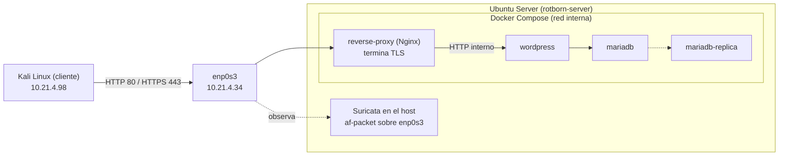

# Auditoría TLS y monitorización (MF0489 · Fase 4)

Procedimiento de validación de la configuración TLS del proxy inverso Nginx de Rotborn Studios y de la monitorización de la actividad HTTPS mediante **Suricata** y los **registros de Nginx**, incluso cuando el contenido de las comunicaciones viaja cifrado.

| | |
|---|---|
| Módulo / fase | MF0489 · Fase 4 (actividades 15 a 19) |
| Entorno | Laboratorio propio: Ubuntu Server (servidor) + Kali Linux (cliente) |
| Fecha  | 27 de octubre de 2026 |
| Ubicación en el repositorio | `docs/mf0489/auditoria-tls-monitorizacion.md` |

> **Leyenda:** ✅ comprobado con evidencia real · ⚠️ incidencia o mejora.
>
> **Alcance y reglas.** Todas las pruebas se hacen sobre la propia VM y la red de laboratorio. No se escanea a terceros ni se usan herramientas de explotación. **No se desactiva la verificación TLS** (`-k`) para obtener un resultado positivo, y `ca.key` nunca sale de la máquina donde se creó la CA.
>
> **Datos publicados.** Los nombres de usuario del sistema se han sustituido por `usuario`. No se incluye ninguna clave privada, contraseña ni variable de entorno.

## Estructura del procedimiento

Cada apartado sigue el mismo patrón: **qué se comprueba**, **cómo se hace** (comandos que se pueden copiar), **qué se obtuvo** en el laboratorio y **cómo interpretarlo**. Una persona con el despliegue de las fases anteriores puede repetir todo el proceso en orden.

| Apartado | Contenido |
|---:|---|
| 1 | Objetivo y arquitectura |
| 2 | Cliente, servidor e interfaz monitorizada |
| 3 | `curl --cacert` y `openssl s_client` |
| 4 | Versiones TLS y *cipher suites* |
| 5 | Visibilidad HTTP frente a HTTPS |
| 6 | Regla de Suricata |
| 7 | Registros de Nginx |
| 8 | Correlación entre dos fuentes |
| 9 | Evento, alerta e incidente |
| 10 | Checklist, incidencias y soluciones |
| 11 | Conclusión |

### Requisitos previos

- Fases 1 a 3 completadas: CA propia y certificado del servidor con el dominio en el SAN, Docker Compose con `reverse-proxy` (Nginx), `wordpress`, `mariadb` y `mariadb-replica`, y redirección HTTP → HTTPS.
- Suricata instalado en el host (módulo MF0488) con un archivo de reglas locales activo.
- En el cliente: `curl`, `openssl` y el certificado **público** de la CA (`ca.crt`). En el servidor: `tcpdump` y `jq`.

### Variables y valores del laboratorio

Todos los comandos del cliente usan estas variables; sustitúyelas por los valores de tu entorno.

```bash
# En el cliente (Kali)
export DOMINIO="portal.rotborn.test"       # el nombre que figura en el SAN del certificado
export IP_SERVIDOR="10.21.4.34"            # IP real del Ubuntu Server
export CA_CERT="$HOME/rotborn-certs/ca.crt"   # solo el certificado PÚBLICO de la CA
```

| Elemento | Valor en el laboratorio |
|---|---|
| Servidor | `rotborn-server`, `10.21.4.34/24`, interfaz `enp0s3` |
| Cliente | Kali Linux, `10.21.4.98`, interfaz `eth0` |
| Dominio | `portal.rotborn.test` |
| Proxy inverso | Nginx 1.30.6, contenedor `rotborn-reverse-proxy-1` |
| IDS | Suricata 6.0.4, `HOME_NET = [10.21.4.0/24,10.54.254.0/24]` |
| Compose | `/srv/rotborn/docker-compose.yml` |
| CA en el servidor | `/etc/ssl/mf0489/ca.crt` (la clave `ca.key` solo existe en el cliente) |

---

## 1. Objetivo de la auditoría y arquitectura verificada

**Objetivo.** Actuar como responsable de seguridad y demostrar que:

1. El certificado que presenta Nginx corresponde al dominio y se valida con la CA del laboratorio.
2. El servidor acepta TLS 1.2 y TLS 1.3 y rechaza TLS 1.1.
3. Aunque HTTPS cifre el contenido, la actividad se puede seguir monitorizando con Suricata (conexiones y metadatos) y con los logs de Nginx (peticiones ya descifradas).
4. Tras las pruebas, la web, la base de datos y la protección de claves siguen intactas.

**Arquitectura.**



Nginx es el único punto que descifra el tráfico. Suricata observa la interfaz externa, donde ve el tráfico ya cifrado.

### 1.1. Comprobar el estado de la infraestructura

```bash
cd /srv/rotborn
docker compose ps
sudo ss -ltnp
sudo systemctl status suricata --no-pager
docker compose exec reverse-proxy nginx -t
```

Si tu servicio no se llama `reverse-proxy`, adapta el nombre. Criterio de éxito: solo Nginx publica los puertos 80 y 443, MariaDB no aparece en el host y `nginx -t` es correcto.

**Evidencia obtenida ✅**

```bash
sudo /srv/rotborn/scripts/iniciar_rotborn_https.sh
```

```text
nginx: the configuration file /etc/nginx/nginx.conf syntax is ok
nginx: configuration file /etc/nginx/nginx.conf test is successful
[OK] HTTP redirige a HTTPS (301).
[OK] HTTPS responde con certificado verificado (HTTP 200).
```

Servicios definidos: `mariadb`, `mariadb-replica`, `wordpress`, `reverse-proxy` (los cuatro arrancaron). Puertos en escucha según `ss -ltnp`:

| Puerto | Proceso | Comentario |
|---|---|---|
| 80/tcp (IPv4 e IPv6) | `docker-proxy` | Nginx, redirección a HTTPS |
| 443/tcp (IPv4 e IPv6) | `docker-proxy` | Nginx, HTTPS |
| 22/tcp | `sshd` | Administración |
| 53 (127.0.0.53) | `systemd-resolve` | DNS local, solo loopback |
| 42649 (127.0.0.1) | `containerd` | Solo loopback |

No aparece `3306/tcp`: MariaDB no está publicada en el host. `ss` no demuestra por sí solo las reglas del cortafuegos ni la accesibilidad desde otros equipos. Suricata estaba `active (running)` y `enabled`.

### Estado de los contenedores Docker

**Comando ejecutado:**

```bash
sudo docker compose -f /srv/rotborn/docker-compose.yml ps --format "table {{.Name}}\t{{.State}}\t{{.Ports}}"
```

**Resultado obtenido:**

```text
NAME                        STATE     PORTS
rotborn-mariadb-1           running   3306/tcp
rotborn-mariadb-replica-1   running   3306/tcp
rotborn-reverse-proxy-1     running   0.0.0.0:80->80/tcp, [::]:80->80/tcp, 0.0.0.0:443->443/tcp, [::]:443->443/tcp
rotborn-wordpress-1         running   80/tcp
```

### Estado del servicio Suricata

**Comando ejecutado:**

```bash
systemctl is-active suricata; systemctl is-enabled suricata
```

**Resultado obtenido:**

```text
active
enabled
```

---

## 2. Identificación de la máquina cliente, servidor e interfaz monitorizada

**Qué se comprueba.** Que las peticiones del cliente entran por la misma interfaz que vigila Suricata; si no, no se verá nada.

```bash
# Servidor
ip -br address
grep -n -A3 'af-packet' /etc/suricata/suricata.yaml
sudo systemctl status suricata --no-pager

# Cliente
ip -br address
```

**Evidencia obtenida ✅**

- Servidor: `enp0s3` en estado `UP` con `10.21.4.34/24`.
- `suricata.yaml` (línea 581): `af-packet` sobre `enp0s3`. Suricata `active (running)`.
- Cliente: `eth0` con `10.21.4.98` (la IP de origen que aparece después en `fast.log`, `eve.json` y Nginx).

Los nombres de interfaz difieren porque son máquinas distintas; no hay que confundirlas con las interfaces virtuales de Docker.


---

## 3. Resultado de `curl --cacert` y `openssl s_client` contra el servicio real

**Qué se comprueba.** El certificado que presenta el servicio en funcionamiento (no el archivo `servidor.crt` del disco) corresponde al dominio y se valida con la CA del laboratorio.

### 3.1. Preparar el cliente

Copiar **solo** `ca.crt` y comprobar que es la misma CA que la del servidor comparando huellas:

```bash
# Cliente
scp usuario@${IP_SERVIDOR}:/etc/ssl/mf0489/ca.crt "$CA_CERT"
openssl x509 -in "$CA_CERT" -noout -fingerprint -sha256

# Servidor
openssl x509 -in /etc/ssl/mf0489/ca.crt -noout -fingerprint -sha256
```

Huella obtenida en ambos equipos ✅ (raíz anterior, ver nota):

```text
E2:85:AD:0F:3E:AB:5B:90:23:CB:8F:95:86:DD:DC:E2:F3:6D:F7:92:8B:09:9E:1D:25:76:B7:BB:B5:47:A9:07
```

> ⚠️ En Kali coexistían dos certificados raíz con el mismo nombre y **la misma clave**: este (`E2:85…`, el instalado en Ubuntu) y `8F:BA…` (el de `ca_root-pki`). Ambos validan el certificado del servidor. Se decidió dejar una sola raíz, `8F:BA…` (`pki.md`, apartado 10.5). ⏳ Tras aplicarlo, repite esta comprobación y sustituye la huella por `8F:BA:C2:89:07:F5:C3:DE:AD:D8:9A:9D:56:E5:5E:F4:F3:98:02:17:45:71:2B:51:F4:1D:08:FA:7A:6D:E4:D4`.

### 3.2. Verificar HTTPS y la redirección

```bash
curl -v --cacert "$CA_CERT" \
  --resolve "${DOMINIO}:443:${IP_SERVIDOR}" \
  "https://${DOMINIO}/" -o /dev/null

openssl s_client -connect "${IP_SERVIDOR}:443" -servername "$DOMINIO" \
  -CAfile "$CA_CERT" -verify_hostname "$DOMINIO" -verify_return_error \
  -brief </dev/null

curl -I --resolve "${DOMINIO}:80:${IP_SERVIDOR}" "http://${DOMINIO}/"
```

**Evidencia obtenida ✅** (con `curl -I --cacert`):

```text
HTTP/1.1 200 OK
Server: nginx/1.30.6
Date: Thu, 22 Oct 2026 22:56:45 GMT
Content-Type: text/html; charset=UTF-8
X-Powered-By: PHP/8.3.33
Link: <https://portal.rotborn.test/wp-json/>; rel="https://api.w.org/"
```

Redirección HTTP:

```text
HTTP/1.1 301 Moved Permanently
Location: https://portal.rotborn.test/
```
Verificación TLS mediante OpenSSL:

```text
CONNECTION ESTABLISHED
Protocol version: TLSv1.3
Ciphersuite: TLS_AES_256_GCM_SHA384
Peer certificate: C=ES, ST=Barcelona, L=Barcelona, O=Rotborn Studios, OU=Cybersecurity, CN=portal.rotborn.test
Hash used: SHA256
Signature type: rsa_pss_rsae_sha256
Verification: OK
Verified peername: portal.rotborn.test
Negotiated TLS1.3 group: X25519MLKEM768
DONE
```


> Resultado: Las pruebas confirman que el sitio responde correctamente por HTTPS con código 200 OK, que el certificado se valida correctamente para portal.rotborn.test y que la conexión negocia TLS 1.3 con la suite TLS_AES_256_GCM_SHA384. También se confirma que las peticiones HTTP se redirigen a HTTPS mediante un código 301.

### 3.3. Tabla de resultados

| Prueba | Resultado real | Evidencia |
|---|---|---|
| Contenedores y reverse proxy activos | ✅ 4 contenedores iniciados 
| Puerto 443 accesible desde el cliente | ✅ `curl` desde Kali devuelve 200 | 3.2 |
| Certificado y dominio válidos | ✅ `Verified peername: portal.rotborn.test` | 4.2 |
| Verificación de confianza satisfactoria | ✅ `Verification: OK` | 4.2 |
| Versión TLS negociada | ✅ TLS 1.2 y TLS 1.3 (forzadas) ·
| Cipher suite negociada | ✅ `ECDHE-RSA-AES256-GCM-SHA384` (1.2) y `TLS_AES_256_GCM_SHA384` (1.3) | 4.2, 4.3 |
| Aplicación funcionando | ✅ `HTTP 200` y cabecera `wp-json` de WordPress | 3.2 |

---

## 4. Versiones TLS admitidas y rechazadas; cipher suites observadas

### 4.1. Revisar el protocolo permitido en la configuración cargada

`nginx -T` muestra la configuración que Nginx tiene **realmente cargada**, no solo la del repositorio:

```bash
docker compose exec reverse-proxy nginx -T 2>&1 | grep -n -B 3 -A 3 'ssl_protocols'
```

Resultado ✅:

```nginx
ssl_certificate /etc/nginx/certs/servidor.crt;
ssl_certificate_key /etc/nginx/certs/servidor.key;

ssl_protocols TLSv1.2 TLSv1.3;
```

Se permite TLS 1.2 y 1.3; no se incluyen SSLv2, SSLv3, TLS 1.0 ni TLS 1.1. Esto confirma lo **declarado**; las pruebas siguientes confirman el **comportamiento**. No publiques la salida completa de `nginx -T` si contiene datos sensibles.

### 4.2. Negociar TLS 1.2

```bash
openssl s_client -connect "${IP_SERVIDOR}:443" -servername "$DOMINIO" \
  -CAfile "$CA_CERT" -verify_hostname "$DOMINIO" -verify_return_error \
  -tls1_2 -brief </dev/null
```

```text
CONNECTION ESTABLISHED
Protocol version: TLSv1.2
Ciphersuite: ECDHE-RSA-AES256-GCM-SHA384
Peer certificate: C=ES, ST=Barcelona, L=Barcelona, O=Rotborn Studios, OU=Cybersecurity, CN=portal.rotborn.test
Hash used: SHA256
Signature type: rsa_pss_rsae_sha256
Verification: OK
Verified peername: portal.rotborn.test
Peer Temp Key: X25519, 253 bits
DONE
```

### 4.3. Negociar TLS 1.3

Mismo comando con `-tls1_3`:

```text
CONNECTION ESTABLISHED
Protocol version: TLSv1.3
Ciphersuite: TLS_AES_256_GCM_SHA384
Peer certificate: C=ES, ST=Barcelona, L=Barcelona, O=Rotborn Studios, OU=Cybersecurity, CN=portal.rotborn.test
Hash used: SHA256
Signature type: rsa_pss_rsae_sha256
Verification: OK
Verified peername: portal.rotborn.test
Negotiated TLS1.3 group: X25519MLKEM768
DONE
```

Si una conexión no se establece, investiga antes de concluir: la versión de OpenSSL, la política del cliente y la configuración del servidor influyen. Un fallo del cliente por sí solo no demuestra que el servidor haya deshabilitado un protocolo.

### 4.4. Comprobar que TLS 1.1 se rechaza

```bash
openssl s_client -connect "${IP_SERVIDOR}:443" -servername "$DOMINIO" -tls1_1 -brief </dev/null
```

```text
error:0A00042E:SSL routines:ssl3_read_bytes:tlsv1 alert protocol version:...:SSL alert number 70
error:0A000197:SSL routines:SSL_shutdown:shutdown while in init:...
```

**Interpretación.** `tlsv1 alert protocol version` (alerta 70) es una alerta **recibida del servidor**: el `ClientHello` TLS 1.1 llegó a Nginx y este lo rechazó. Junto con `ssl_protocols TLSv1.2 TLSv1.3;` (apartado 4.1) justifica que TLS 1.1 no está permitido. Suricata registró este intento en `eve.json` (apartado 5.3). Si tu OpenSSL rechazara TLS 1.1 localmente (por ejemplo, con "no protocols available"), el cliente ni siquiera enviaría el `ClientHello` y la prueba no demostraría nada sobre el servidor.

### 4.5. Resumen de protocolos

| Protocolo | Resultado real | ¿Cumple? |
|---|---|---|
| TLS 1.1 | No se establece sesión; alerta 70 `protocol version` | Sí, rechazado |
| TLS 1.2 | Establecida; `ECDHE-RSA-AES256-GCM-SHA384`; certificado validado | Sí |
| TLS 1.3 | Establecida; `TLS_AES_256_GCM_SHA384`; certificado validado | Sí |

### 4.6. Valoración de los algoritmos negociados

**¿Qué protección aporta la cipher suite?** Ambas usan AES-256-GCM, un cifrado autenticado (AEAD) que da confidencialidad e integridad a los datos de la sesión. En TLS 1.2, `ECDHE` hace un intercambio de claves efímero (*forward secrecy*: comprometer más tarde la clave del servidor no permite descifrar sesiones pasadas), `RSA` indica la clave con la que el servidor se autentica y `SHA384` interviene en la derivación de claves. En TLS 1.3 la suite solo identifica el cifrado autenticado y el hash; el intercambio de claves y la autenticación se negocian aparte.

**¿La cipher suite es lo mismo que el algoritmo que firma el certificado?** No:

- **Cipher suite:** algoritmos que protegen la sesión.
- **Firma del certificado:** la que hizo la CA sobre `servidor.crt`; permite al cliente verificar la cadena de confianza. No protege los datos.
- `Signature type: rsa_pss_rsae_sha256` es una tercera cosa: la firma que el servidor genera durante el handshake con su clave privada para demostrar que la posee.


**Firma de la CA sobre el certificado:**

Comando ejecutado:

```bash
openssl s_client -connect "${IP_SERVIDOR}:443" -servername "$DOMINIO" </dev/null 2>/dev/null \
  | openssl x509 -noout -text | grep -E 'Signature Algorithm|Public Key Algorithm'
```

Resultado obtenido:

```text
Signature Algorithm: sha256WithRSAEncryption
Public Key Algorithm: rsaEncryption
Signature Algorithm: sha256WithRSAEncryption
```


OpenSSL confirma que el certificado utiliza la firma sha256WithRSAEncryption y una clave pública rsaEncryption, distintos de los algoritmos de la sesión TLS.


### 4.7. Persistencia de la configuración

Si modificas Nginx, valida y recarga:

```bash
docker compose exec reverse-proxy nginx -t
docker compose exec reverse-proxy nginx -s reload
```

En esta fase `ssl_protocols` no se modificó. `nginx -t` fue correcto (`syntax is ok`, `test is successful`) y el script de arranque se ejecutó bien tras reiniciar el servidor. `nginx -t` por sí solo no demuestra persistencia tras futuros reinicios; la evidencia adicional es ese arranque correcto.

---

## 5. Comparación de visibilidad HTTP y HTTPS

**Qué se comprueba.** Qué ve una captura en la interfaz externa cuando la misma petición va por HTTP y por HTTPS.

### 5.1. Petición HTTP

```bash
# Servidor
sudo tcpdump -i enp0s3 -nn -s 0 -A 'tcp port 80'

# Cliente
curl -v --resolve "${DOMINIO}:80:${IP_SERVIDOR}" \
  "http://${DOMINIO}/mf0489-prueba-http" -o /dev/null
```

**Evidencia obtenida ✅**

```http
GET /mf0489-prueba-http HTTP/1.1
Host: portal.rotborn.test

HTTP/1.1 301 Moved Permanently
Location: https://portal.rotborn.test/mf0489-prueba-http
```

`tcpdump` mostró la petición y la respuesta en texto legible, con IP y puertos. La prueba demuestra la visibilidad de la **redirección**; no significa que WordPress se sirva por HTTP.

### 5.2. Petición HTTPS

```bash
# Servidor
sudo tcpdump -i enp0s3 -nn -s 0 -A 'tcp port 443'

# Cliente
curl -v --cacert "$CA_CERT" --resolve "${DOMINIO}:443:${IP_SERVIDOR}" \
  "https://${DOMINIO}/mf0489-prueba-https" -o /dev/null
```


>
> - `curl -v`: líneas `SSL connection using TLSv1.x / <cipher>` y el estado HTTP final (`200`, `301` o `404`).
> - `tcpdump -A`: el `ClientHello` con el SNI `portal.rotborn.test` y datos TLS ilegibles, **sin** la línea `GET` ni la ruta `/mf0489-prueba-https`.
> - Línea de Nginx con esa ruta, para demostrar que la petición llegó.
> 
**Resultado de la petición HTTPS**

```text
TLS: TLSv1.3
Cipher suite: TLS_AES_256_GCM_SHA384
Intercambio de claves: X25519MLKEM768
Firma durante el handshake: RSASSA-PSS
Certificado: validado correctamente (OpenSSL verify result: 0)
SNI: portal.rotborn.test
Respuesta HTTP: 404 Not Found
```

La negociación TLS 1.3 se completó correctamente y el certificado fue validado con la CA del laboratorio. El servidor respondió HTTP 404 a la ruta `/mf0489-prueba-https`, por lo que la conexión segura funciona, aunque esa ruta no está disponible en la aplicación.


**Evidencia del registro de Nginx:**

```text
2026-10-26T11:35:55+00:00 client=10.21.4.11:52804 request="GET /mf0489-prueba-https HTTP/1.1" status=404 tls=TLSv1.3 cipher=TLS_AES_256_GCM_SHA384
```

La línea confirma que Nginx recibió la petición por TLS 1.3, utilizando `TLS_AES_256_GCM_SHA384`. La respuesta fue `404 Not Found` porque la ruta solicitada no está disponible.


Una captura ASCII sin URL es una observación útil pero no prueba el cifrado por sí sola: relaciónala con la sesión TLS verificada en el apartado 4.

### 5.3. Eventos de Suricata

```bash
sudo tail -n 30 /var/log/suricata/eve.json
sudo jq -c 'select(.event_type == "flow" or .event_type == "tls") |
  {timestamp,event_type,src_ip,src_port,dest_ip,dest_port,tls}' \
  /var/log/suricata/eve.json | tail -n 20
sudo jq -c 'select(.event_type == "tls") |
  {timestamp,src_ip,src_port,dest_ip,dest_port,tls}' /var/log/suricata/eve.json | tail -n 10
```

**Evidencia obtenida ✅**

- Las últimas 20 líneas del filtro `flow or tls` eran todas `flow` (p. ej. `10.21.4.34:47786 → 91.189.92.24:80`, con `tls: null`). Eso **no** significa que no haya eventos TLS: al filtrar solo `tls` aparecieron diez, entre ellos dos de `portal.rotborn.test`.

Evento TLS 1.2, con datos del certificado (viaja en claro en TLS 1.2):

```json
{"timestamp":"2026-10-23T19:28:16.059790+0200","src_ip":"10.21.4.98","src_port":60862,"dest_ip":"10.21.4.34","dest_port":443,"tls":{"subject":"C=ES, ST=Barcelona, L=Barcelona, O=Rotborn Studios, OU=Cybersecurity, CN=portal.rotborn.test","issuerdn":"C=ES, ST=Barcelona, L=Barcelona, O=Rotborn Studios , OU=Cybersecurity, CN=Rotborn Studios Root CA","serial":"71:7D:C6:28:05:38:3E:7E:47:AD:AB:E5:D4:C9:FE:19:C3:F2:33:92","fingerprint":"24:27:f9:db:db:3d:b3:f2:56:35:96:dd:97:fb:41:5f:90:8e:6a:96","sni":"portal.rotborn.test","version":"TLS 1.2","notbefore":"2026-10-20T09:38:48","notafter":"2027-10-20T09:38:48","ja3":{},"ja3s":{}}}
```

Evento `TLS 1.1`, con menos campos:

```json
{"timestamp":"2026-10-23T19:33:15.528136+0200","src_ip":"10.21.4.98","src_port":63781,"dest_ip":"10.21.4.34","dest_port":443,"tls":{"sni":"portal.rotborn.test","version":"TLS 1.1","ja3":{},"ja3s":{}}}
```

**Interpretación.** Ambos eventos vienen de `10.21.4.98` y sus horas son compatibles con las pruebas `-tls1_2` y `-tls1_1` del apartado 4 (⏳ confirmarlo anotando `date` al repetirlas). El evento `TLS 1.1` refleja la versión que **ofreció el cliente** en un intento rechazado con alerta 70; no indica que el servidor admita TLS 1.1. El certificado aparece en el evento TLS 1.2 porque en TLS 1.3 viaja cifrado y puede no estar disponible. Los eventos de servicios externos (`api.snapcraft.io`, `changelogs.ubuntu.com`…) son tráfico propio del servidor. Que Suricata registre metadatos TLS tampoco demuestra que el certificado se validara bien: eso lo aportan `curl --cacert` y `openssl s_client`.

### 5.4. Tabla comparativa

| Elemento observado desde la interfaz externa | HTTP :80 | HTTPS :443 |
|---|---|---|
| IP origen y destino | `10.21.4.98` → `10.21.4.34` | `10.21.4.98` → `10.21.4.34` |
| Puerto de conexión | TCP/80 | TCP/443 |
| Método HTTP | `GET`, visible | No visible |
| Ruta solicitada | `/mf0489-prueba-http`, visible | `/mf0489-prueba-https`, no visible (⏳ confirmar con 5.2) |
| Versión TLS / metadatos TLS | No aplica | SNI y versión en eventos `tls`; certificado solo en TLS 1.2 |
| Contenido HTTP en claro | Sí (petición y `301`) | No |
| Eventos disponibles en Suricata | `flow` y `http`; petición GET y redirección 301 verificadas | `flow` y `tls` | SNI y versión TLS registrados

> Para localizar el flujo HTTP de la prueba:
>
> ```bash
> sudo jq -c 'select(.src_ip=="10.21.4.98" and .dest_port==80) |
>   {timestamp,event_type,src_port,dest_port,http}' /var/log/suricata/eve.json | tail -n 5
>{
> "timestamp": "2026-10-26T13:08:49.758997+0100",
> "src_ip": "10.21.4.11",
>  "src_port": 55468,
>  "dest_ip": "10.21.4.96",
>  "dest_port": 80,
>  "http": {
>    "hostname": "portal.rotborn.test",
>    "url": "/mf0489-prueba-http",
>    "http_method": "GET",
>    "protocol": "HTTP/1.1",
>    "status": 301,
>    "redirect": "https://portal.rotborn.test/mf0489-prueba-http",
>    "length": 169
>  }
>}
> ```
 Evidencia de Suricata: Suricata registró una petición GET /mf0489-prueba-http desde 10.21.4.11 hacia 10.21.4.96:80. La respuesta HTTP fue 301 Moved Permanently, con redirección a https://portal.rotborn.test/mf0489-prueba-http. La evidencia confirma que Suricata identificó la petición HTTP y su redirección a HTTPS.


### 5.5. Limitaciones de visibilidad

HTTPS no oculta toda la información del tráfico. Las direcciones IP, los puertos, los tamaños de los paquetes y los tiempos de comunicación normalmente siguen siendo observables. También pueden quedar visibles determinados metadatos del handshake, como el SNI, salvo que se utilicen mecanismos de protección como Encrypted Client Hello (ECH).

Con TLS 1.3, el mensaje que contiene el certificado del servidor está cifrado durante el handshake, por lo que no debe suponerse que será visible en una captura pasiva. En TLS 1.2, el certificado normalmente se transmite sin cifrar.

La ausencia de eventos http o tls en Suricata no demuestra por sí sola que el tráfico no existiera ni que el sensor esté inactivo. La visibilidad depende, entre otros factores, de la interfaz de captura, la configuración de EVE, la detección del protocolo y el procesamiento de la sesión.

---

## 6. Regla de Suricata utilizada, motivo y validación

**Motivo.** Suricata no puede leer URL ni contenido HTTPS, pero sí puede registrar que se establece una conexión al puerto 443. Esa señal, correlacionada con Nginx (apartado 8), es lo que permite seguir la actividad. La regla es **didáctica**: registra conexiones, no identifica ataques ni Nmap, y puede generar ruido en redes con mucha actividad.

### 6.1. Añadir la regla

1. Localiza el archivo de reglas activo y comprueba que está incluido:

   ```bash
   sudo grep -n -A6 'rule-files' /etc/suricata/suricata.yaml
   ```

2. Elige un `sid` local libre:

   ```bash
   sudo grep -rn 'sid:1000002' /etc/suricata/rules/ || echo "libre"
   ```

3. Añade la regla en `/etc/suricata/rules/local.rules`, conservando las reglas existentes. La regla de MF0488 se mantiene sin cambios:

   ```text
   alert icmp any any -> $HOME_NET any (msg:"MF0488 - ICMP detectado"; sid:1000001; rev:1;)
   ```

   La primera versión de la regla de MF0489 utilizaba rev:1 y generó un aviso por no especificar la dirección del flujo. Se corrigió mediante flow:to_server; y se incrementó la revisión a rev:2. La versión final aplicada es:

   ```text
   alert tcp any any -> $HOME_NET 443 (msg:"MF0489 Fase 4 - Conexion HTTPS observada"; flow:to_server; flags:S; sid:1000002; rev:2;)
   ```

   Detecta paquetes TCP SYN dirigidos al puerto 443 de `$HOME_NET`, correspondientes a intentos de inicio de conexión hacia los sistemas vigilados. La alerta no demuestra por sí sola que la conexión HTTPS se haya completado.

4. Valida y reinicia:

   ```bash
   sudo suricata -T -c /etc/suricata/suricata.yaml
   sudo systemctl restart suricata
   sudo systemctl is-active suricata
   ```

### Resultado de la validación ✅

**Archivo de reglas activo**

Se comprobó que `/etc/suricata/suricata.yaml` incluye el archivo `local.rules`:

```text
1874:rule-files:
1875:  - local.rules
```

**Regla local aplicada**

Se verificó que la regla `sid:1000002` existe en `/etc/suricata/rules/local.rules`. Se actualizó la revisión de `rev:1` a `rev:2`, incorporando `flow:to_server;` para especificar la dirección del flujo:

```text
alert tcp any any -> $HOME_NET 443 (msg:"MF0489 Fase 4 - Conexion HTTPS observada"; flow:to_server; flags:S; sid:1000002; rev:2;)
```

**Validación y reinicio**

Se ejecutó la validación de configuración:

```bash
sudo suricata -T -c /etc/suricata/suricata.yaml
```

Resultado:

```text
26/10/2026 -- 13:23:38 - <Info> - Running suricata under test mode
26/10/2026 -- 13:23:38 - <Notice> - This is Suricata version 6.0.4 RELEASE running in SYSTEM mode
26/10/2026 -- 13:23:39 - <Notice> - Configuration provided was successfully loaded. Exiting.
```

La configuración se cargó correctamente y no apareció el aviso `SC_WARN_POOR_RULE` observado en la revisión anterior. Después se reinició Suricata y se comprobó que el servicio devolvía `active`.

**Conclusión:** la regla `sid:1000002`, revisión 2, está incorporada en el archivo de reglas activo. La configuración se validó correctamente y el servicio Suricata continúa activo.

### 6.2. Evidencia de detección real ✅

Tras repetir la petición HTTPS desde Kali utilizando el certificado de la CA y verificando correctamente el certificado del servidor, se consultó el registro de alertas de Suricata:

```bash
sudo grep 'MF0489 Fase 4' /var/log/suricata/fast.log | tail -n 5
```
La última entrada obtenida corresponde a la prueba realizada el 26 de octubre de 2026:

```text
10/26/2026-13:38:10.146678  [**] [1:1000002:2] MF0489 Fase 4 - Conexion HTTPS observada [**] [Classification: (null)] [Priority: 3] {TCP} 10.21.4.11:61662 -> 10.21.4.96:443
```

La alerta identifica el SID 1000002, revisión 2, el cliente 10.21.4.11:61662 y el destino 10.21.4.96:443. Esto confirma que el tráfico TCP dirigido al puerto HTTPS coincidió con la regla configurada.

La petición se realizó mediante curl sin utilizar -k. La salida del cliente confirmó que el certificado se verificó correctamente (OpenSSL verify result: 0) y que la conexión utilizó TLS 1.3.

>Conclusión: se ha comprobado la detección real de tráfico dirigido al puerto 443 mediante la regla local de Suricata, utilizando una conexión HTTPS con validación correcta del certificado. La alerta demuestra una coincidencia con la regla, pero no implica que el tráfico sea malicioso.

---

## 7. Extractos de logs de Nginx, con fechas y estados HTTP

**Qué se comprueba.** Que Nginx, al terminar TLS, registra la petición ya descifrada junto con los datos de la sesión TLS.

### 7.1. Formato de registro

Archivo `/srv/rotborn/nginx/00-log-format.conf` (se carga en el contexto `http` al montarlo en `conf.d`):

```nginx
log_format mf0489 '$time_iso8601 client=$remote_addr:$remote_port '
                  'request="$request" status=$status '
                  'tls=$ssl_protocol cipher=$ssl_cipher';
```

| Variable | Contenido |
|---|---|
| `$time_iso8601` | Fecha y hora con zona horaria |
| `$remote_addr:$remote_port` | IP y puerto de origen que ve Nginx |
| `$request` | Método, ruta y versión HTTP |
| `$status` | Código de estado |
| `$ssl_protocol`, `$ssl_cipher` | Versión TLS y cipher suite negociadas |

### 7.2. Montaje, activación y recarga

En el servicio `reverse-proxy` de `docker-compose.yml`:

```yaml
- /srv/rotborn/nginx/00-log-format.conf:/etc/nginx/conf.d/00-log-format.conf:ro
```

En `nginx/default.conf`, dentro del `server` que escucha en el 443:

```nginx
server {
    listen 443 ssl;
    server_name portal.rotborn.test;

    access_log /var/log/nginx/access.log mf0489;

    # Resto de la configuración HTTPS existente
}
```

```bash
cd /srv/rotborn
docker compose config -q && echo $?           # debe imprimir 0
docker compose up -d reverse-proxy             # recrea el contenedor con el nuevo montaje
docker compose exec reverse-proxy nginx -t
docker compose exec reverse-proxy nginx -s reload
docker compose exec reverse-proxy ls -l /var/log/nginx/access.log
```

**Evidencia obtenida ✅:** `docker compose config -q` devolvió `0`; `nginx -t` fue correcto; `[notice] signal process started` al recargar; y `access.log -> /dev/stdout`, es decir, el registro sale por la salida estándar del contenedor y se lee con `docker compose logs`.

### 7.3. Extractos

Para comprobar las peticiones registradas por Nginx, se consultaron los registros del contenedor reverse-proxy:

```bash
sudo docker compose -f /srv/rotborn/docker-compose.yml logs --since 5m reverse-proxysudo docker compose -f /srv/rotborn/docker-compose.yml logs --since 5m reverse-proxy
```
Resultado de las pruebas realizadas desde Kali

```text
2026-10-26T12:46:14+00:00 client=10.21.4.11:61844 request="HEAD / HTTP/1.1" status=200 tls=TLSv1.3 cipher=TLS_AES_256_GCM_SHA384
2026-10-26T12:46:22+00:00 client=10.21.4.11:61845 request="HEAD /mf0489-correlacion-01 HTTP/1.1" status=404 tls=TLSv1.3 cipher=TLS_AES_256_GCM_SHA384
```

La primera entrada corresponde a una petición HEAD / que recibió una respuesta 200 OK. La segunda corresponde a una petición a la ruta de prueba /mf0489-correlacion-01, que devolvió 404 Not Found porque la ruta no está disponible.

Ambas entradas registran TLS 1.3 y el cifrado TLS_AES_256_GCM_SHA384. En las dos pruebas, curl verificó correctamente el certificado del servidor mediante la CA configurada, sin desactivar la validación con -k.

> Conclusión: los registros de Nginx permiten identificar las peticiones recibidas, sus códigos de respuesta y los parámetros TLS de las conexiones HTTPS probadas. El código 404 no invalida la prueba de transporte seguro ni la validación del certificado.

---

## 8. Tabla y explicación de correlación entre dos fuentes

**Qué se demuestra.** Que una alerta de Suricata y una línea de Nginx corresponden a **la misma prueba**. No basta con adjuntar dos capturas: hay que justificar por qué coinciden.

### 8.1. Procedimiento

Tres terminales, y una ruta que no coincida con pruebas anteriores:

```bash
# Terminal A (servidor)
sudo tail -f /var/log/suricata/fast.log

# Terminal B (servidor)
cd /srv/rotborn && docker compose logs -f --tail=20 reverse-proxy

# Terminal C (cliente)
date -u
curl -v --cacert "$CA_CERT" --resolve "${DOMINIO}:443:${IP_SERVIDOR}" \
  "https://${DOMINIO}/mf0489-correlacion-02" -o /dev/null
```

Después busca por **puerto de origen** y confirma en `eve.json`:

```bash
sudo grep '10.21.4.98:PUERTO' /var/log/suricata/fast.log
docker compose logs reverse-proxy | grep 'mf0489-correlacion-02'
sudo jq -c 'select(.event_type=="alert" and .alert.signature_id==1000002)' /var/log/suricata/eve.json
```

Sustituye `PUERTO` por el puerto de origen real. Si `jq` no devuelve nada, comprueba que `$HOME_NET` incluye la IP del servidor y que la regla está cargada.

### 8.2. Normalizar las marcas de tiempo

Suricata y Nginx pueden usar zonas horarias distintas. Conviértelas a UTC antes de comparar:

```bash
date -u -d '2026-10-24T01:18:20.058317+0200' +%FT%T.%3NZ
# 2026-10-23T23:18:20.058Z
```

### 8.3. Evidencia obtenida y tabla de correlación ✅

Alerta en `fast.log`:

```text
10/24/2026-01:18:20.058317  [**] [1:1000002:1] MF0489 Fase 4 - Conexion HTTPS observada [**] [Classification: (null)] [Priority: 3] {TCP} 10.21.4.98:62899 -> 10.21.4.34:443
```

Alerta en `eve.json` (campos relevantes):

```json
{"timestamp":"2026-10-24T01:18:20.058317+0200","event_type":"alert","src_ip":"10.21.4.98","src_port":62899,"dest_ip":"10.21.4.34","dest_port":443,"proto":"TCP",
 "alert":{"action":"allowed","signature_id":1000002,"rev":1,"signature":"MF0489 Fase 4 - Conexion HTTPS observada","severity":3},
 "flow":{"pkts_toserver":1,"pkts_toclient":0,"bytes_toserver":66,"bytes_toclient":0}}
```

| Campo | Suricata | Nginx |
|---|---|---|
| Fecha y hora (original) | `2026-10-24T01:18:20.058317+0200` | `2026-10-23T23:18:22+00:00` |
| Fecha y hora (UTC) | `2026-10-23T23:18:20.058Z` | `2026-10-23T23:18:22Z` |
| IP del cliente | `10.21.4.98` | `10.21.4.98` |
| Puerto de origen | `62899` | `62899` |
| Destino | `10.21.4.34:443` | No lo registra el formato `mf0489`; se infiere del servidor HTTPS |
| Acción o evento | Alerta SID `1000002` (SYN hacia 443) | `HEAD /mf0489-correlacion-01` |
| Resultado | Alerta con acción `allowed` | HTTP `404` |
| Información TLS / HTTP observable | Solo IP, puertos y protocolo | TLS `TLSv1.3`, `TLS_AES_256_GCM_SHA384`, método y estado |

### 8.4. Por qué corresponden a la misma prueba

- **Misma IP y mismo puerto de origen** (`10.21.4.98:62899`), el identificador más fuerte de una conexión TCP.
- **Mismo destino**: el servidor en el puerto 443.
- **Hora compatible**: tras normalizar a UTC hay unos 2 segundos de diferencia. Suricata marca el SYN, al inicio de la conexión; Nginx escribe su línea al terminar de responder (resolución de segundos y tiempo de WordPress para generar el `404`). Ambos registros salen del mismo host y comparten reloj.
- **Secuencia coherente**: primero el inicio de la conexión, después la petición.

En esta prueba Docker no alteró la IP ni el puerto de origen que ve Nginx. Si en tu entorno difieren (NAT, `docker-proxy`), documéntalo en lugar de forzar una coincidencia.

### 8.5. Qué NO demuestra

- La alerta se basa **solo en el SYN**: Suricata no vio la ruta `/mf0489-correlacion-01` ni el contenido HTTP, que viajan cifrados. El IDS relaciona conexiones y metadatos; Nginx ve la solicitud HTTP una vez descifrada.
- IP y puerto prueban que ambos registros pertenecen a la **misma conexión TCP**, no que la alerta describa esa petición concreta: con *keep-alive*, una conexión puede transportar varias peticiones y generaría una sola alerta SYN.

---

## 9. Diferencias entre evento, alerta e incidente aplicadas a la prueba

| Concepto | Qué ocurrió en la prueba | Clasificación |
|---|---|---|
| **Evento** | Conexión TCP al puerto 443 y petición HTTPS recibida por Nginx | Evento observado |
| **Alerta** | Suricata activó la regla `1000002` | Alerta generada |
| **Incidente** | No hay evidencia de ataque ni de vulneración | No es incidente con las evidencias disponibles |

- Un **evento** es una actividad observable en un sistema o una red.
- Una **alerta** es una notificación generada al cumplirse una condición definida en una regla.
- Un **incidente de seguridad** es un suceso que compromete o amenaza de forma relevante la confidencialidad, integridad o disponibilidad de los sistemas o la información.

La alerta no se clasifica automáticamente como incidente: la conexión se hizo de forma intencionada y autorizada para comprobar Nginx y Suricata, la regla solo detecta el inicio de conexiones HTTPS y el `404` es coherente con una ruta de prueba inexistente. `action: allowed` indica que la alerta no bloqueó el tráfico. Una alerta es una señal que hay que interpretar en su contexto, no una confirmación de ataque.

---

## 10. Checklist de seguridad, incidencias reales y soluciones

### 10.1. Checklist posterior a las pruebas

Después de las pruebas hay que verificar que no se ha debilitado nada. Comandos:

```bash
# Servidor
cd /srv/rotborn
docker compose ps
docker compose config --quiet && echo "compose OK"
docker compose exec reverse-proxy nginx -t
docker compose exec reverse-proxy nginx -T 2>&1 | grep -n 'ssl_protocols'
sudo systemctl is-active suricata
sudo ls -l /etc/ssl/private/servidor.key
sudo ss -ltnp | grep -E ':(80|443|3306)\b'
grep -n ':ro' docker-compose.yml

# Cliente
curl -I --resolve "${DOMINIO}:80:${IP_SERVIDOR}" "http://${DOMINIO}/"
curl -I --cacert "$CA_CERT" --resolve "${DOMINIO}:443:${IP_SERVIDOR}" "https://${DOMINIO}/"

# Repositorio (solo nombres de archivo, nunca el contenido de un secreto)
git ls-files | grep -Ei '(\.key|\.env)$' || echo "ninguno"
grep -rIl 'PRIVATE KEY' . --exclude-dir=.git || echo "ninguno"
```

No publiques variables de entorno ni el contenido de ninguna clave.

| # | Comprobación | Evidencia disponible | Estado |
|---|---|---|---|
| 1 | HTTP sigue redirigiendo a HTTPS | `301` con `Location` (3.2) | ✅
| 2 | HTTPS se verifica con `curl --cacert` sin `-k` | `200` ok OpenSSL verify result: 0 y certificado validado (3.2 y prueba del 26/10) ✅
| 3 | El nombre DNS coincide con el certificado | `Verified peername: portal.rotborn.test y SAN coincidente` (4.2) | ✅ |
| 4 | Nginx usa TLS 1.2/1.3; TLS 1.1 no está habilitado | `ssl_protocols` TLSv1.2 TLSv1.3; y alerta 70 en la prueba TLS 1.1 (4) | ✅
| 5 | Aplicación y BBDD funcionan y conservan los datos | `200` de WordPress; consulta y operaciones de escritura, lectura y eliminación verificadas. En SHOW REPLICA STATUS: Slave_IO_Running: Yes, Slave_SQL_Running: Yes, Seconds_Behind_Master: 0 y errores IO/SQL a 0 | ✅ |
| 6 | Solo se publican los puertos web necesarios; BBDD no expuesta | `docker compose ps y ss` puertos 80 y 443 publicados; no aparece 3306 en el host| ✅
| 7 | Certificado y clave del servidor con permisos adecuados; montaje `:ro` | — |Clave con permisos 600, propietaria root; certificado y clave montados con :ro | ✅
| 8 | Suricata activo y reglas documentadas | Reinicio correcto y alerta real (6) | `is-active` devuelve active; regla sid:1000002, rev:2, validada y con alerta real (6) |✅

### 10.2. La clave privada de la CA permanece fuera del servidor ✅

```bash
# Servidor: no debe devolver nada
sudo find /srv/rotborn /etc/ssl -type f -name 'ca.key' 2>/dev/null
sudo find / -type f -name 'ca.key' 2>/dev/null

# Cliente: dónde está y con qué permisos
find ~ -type f -name 'ca.key' 2>/dev/null
ls -l ~/ca_root-pki/ca/private/ca.key
```

**Resultado:** ninguna de las dos búsquedas en el servidor devolvió rutas. En el cliente: `~/ca_root-pki/ca/private/ca.key` con permisos `-rw-------` (`600`, solo lectura y escritura para su propietaria). La clave está separada del servidor web; `ca.crt` (público) es lo único que se distribuye.

**Correspondencia con la CA ✅.** La clave pública de `ca.key` (`23b0256f486a1b55c8cdaa9b6d44ff2ab0871928ba9ad3466c4e77a0312ce561`) coincide con la de los dos certificados raíz de Kali, así que `ca.key` es la clave de la CA desplegada. Comprobación utilizada (no muestra la clave):

```bash
openssl pkey -in ~/ca_root-pki/ca/private/ca.key -pubout | sha256sum
openssl x509 -in "$CA_CERT" -noout -pubkey | sha256sum
```

### 10.3. Incidencias reales y soluciones

| # | Incidencia | Análisis | Solución | Estado |
|---|---|---|---|---|
| 1 | En Kali había dos certificados raíz con el mismo nombre y distinta huella (`8F:BA…` y `E2:85…`) | Misma clave pública (`23b0256f…`, igual a la de `ca.key`) y fechas distintas: el raíz se regeneró sobre la misma clave. Ambos validan el certificado del servidor; `E2:85…` estaba en Ubuntu y `8F:BA…` coincide exactamente con el emisor | Dejar una sola raíz, `8F:BA…`, y una única ruta (`~/rotborn-certs/ca.crt`), archivando la otra (`pki.md`, apartado 10.5) | ⏳ aplicar y repetir las pruebas |
| 2 | El filtro `flow or tls` solo mostró eventos `flow` | Las últimas 20 líneas eran `flow`; no implica que no haya TLS | Se filtró solo `event_type == "tls"` (5.3) | ✅ |
| 3 | `suricata -T` avisa de `SC_WARN_POOR_RULE(276)` | La primera versión de la regla no especificaba la dirección del flujo. | Se añadió `flow:to_server` y se incrementó la revisión a `rev:2`. La configuración se validó correctamente y se registró una alerta real con la revisión 2 (apartado 6).✅ 
| 6 | Marcas de tiempo en zonas distintas (Suricata `+0200`, Nginx UTC) | Suricata registra una zona +0200 en la prueba histórica y Nginx muestra UTC.| Se documentó la conversión de las marcas de tiempo a UTC y su comparación (apartados 8.2 y 8.3). | ✅ |

---

## 11. Conclusión

**¿Cómo se monitoriza una aplicación sin poder leer directamente sus peticiones `HTTPS` desde la interfaz externa?** Combinando dos 
puntos de observación que aportan información diferente:

- **Desde la red (`Suricata` en `enp0s3`):** se observan conexiones y metadatos, como `IP`, puertos, tamaños y tiempos de flujo, además de parte de la información del *handshake* `TLS`, como el `SNI` y la versión del protocolo. En `TLS 1.2` también puede observarse información del certificado; en `TLS 1.3`, el certificado viaja cifrado. No se ven directamente el método, la ruta ni el contenido `HTTP`. La regla `1000002`, revisión `rev:2`, detecta paquetes `SYN` dirigidos al puerto `443`.
- **En el punto donde termina `TLS` (`Nginx`):** la petición ya está descifrada. El formato de registro `mf0489` recoge la fecha con zona horaria, la `IP` y el puerto de origen, el método y la ruta solicitada, el estado `HTTP`, la versión `TLS` y la *cipher suite*.
- **La correlación entre ambas fuentes:** permite relacionar registros mediante la `IP`, el puerto de origen, el destino y la hora normalizada a `UTC`. La evidencia del apartado 8 corresponde a una prueba histórica de `/mf0489-correlacion-01`, con la revisión `rev:1` de la regla y las direcciones `IP` utilizadas entonces. Sirve como ejemplo de correlación de una misma conexión `TCP`, pero no como evidencia de una prueba reciente con la revisión `rev:2`.

**Limitaciones.** La regla detecta el inicio de la conexión `TCP` mediante el `SYN`; no identifica por sí sola una petición `HTTP` ni demuestra que el tráfico sea malicioso. Con *keep-alive*, varias peticiones pueden compartir una conexión y una sola alerta `SYN`. `Docker` o `NAT` pueden alterar la `IP` o el puerto de origen que ve `Nginx`. Además, el tráfico entre `Nginx` y `WordPress` (`http://wordpress:80`) circula en claro por la red interna de `Docker`, fuera de la interfaz externa monitorizada.

**Resultado de la auditoría.** Las pruebas realizadas confirman que el servidor admite `TLS 1.2` y `TLS 1.3` y rechaza `TLS 1.1` con una alerta de versión de protocolo. El certificado del servidor se ha validado mediante la `CA` del laboratorio y coincide con el dominio, sin desactivar la verificación `TLS`. También se ha comprobado que `Suricata` detecta conexiones al puerto `443` y que `Nginx` registra las peticiones `HTTPS` una vez descifradas. La comprobación del estado de `MariaDB` confirma que la replicación estaba activa y al día en el momento de la consulta.

Las comprobaciones documentadas respaldan el funcionamiento de los controles revisados. La revisión de la raíz única de la `CA` y la actualización de algunas referencias históricas siguen pendientes de aclaración documental; por ello, no se afirma que todos los aspectos de la fase estén completamente cerrados.

---

## Anexo A. Archivos del repositorio

```text
docs/
└── mf0489/
    ├── arquitectura.md
    ├── pki.md
    ├── https-docker.md
    ├── auditoria-tls-monitorizacion.md      ← este documento
    └── evidencias/
        └── fase4/                           ← capturas y salidas (sin secretos)
nginx/
├── default.conf                             ← server HTTPS, ssl_protocols, access_log mf0489
└── 00-log-format.conf                       ← log_format mf0489
suricata/
└── local.rules                              ← reglas 1000001 y 1000002
```

Para no publicar secretos por accidente, usa el `.gitignore` descrito en `https-docker.md` (Anexo C): como mínimo `**/*.key`, `**/private/`, `*.p12`, `*.pfx` y `.env`.

## Anexo B. Si algo no funciona

| Síntoma | Qué revisar |
|---|---|
| No aparece la alerta en `fast.log` | ¿Suricata vigila la interfaz por la que entra el tráfico (`af-packet`)? ¿`$HOME_NET` incluye la IP del servidor? ¿La regla está cargada (`rule-files`, `suricata -T`)? ¿La petición pasa realmente por esa interfaz? |
| No hay eventos `tls` en `eve.json` | Filtra solo por `event_type == "tls"`; revisa que EVE tenga activado el tipo `tls`. Su ausencia no prueba que el tráfico no esté cifrado ni que Suricata esté inactivo. |
| Un registro `flow` no es una alerta | No presentes un `flow` como si fuese un `alert`. |
| `-tls1_1` falla con "no protocols available" | El cliente lo rechaza localmente; no demuestra nada sobre el servidor. Busca la alerta 70 recibida. |
| `Verification` falla | Comprueba la huella de `ca.crt` (3.1) y que el dominio coincide con el SAN. No uses `-k`. |
| Nginx ve otra IP o puerto de origen | Docker o NAT; documéntalo, no fuerces la coincidencia. |
| No se ve el log de Nginx | Comprueba que `access.log` apunta a `/dev/stdout` y usa `docker compose logs`. |

## Anexo C. Script de comprobación desde el cliente (fase4_anexo_c_comprobacion.sh)

Repite en un solo paso las pruebas de los apartados 3 y 4. No usa `-k`.

```bash
#!/usr/bin/env bash
# Requiere DOMINIO, IP_SERVIDOR y CA_CERT definidos (ver "Variables").
set -u
: "${DOMINIO:?}" "${IP_SERVIDOR:?}" "${CA_CERT:?}"

for v in tls1_2 tls1_3 tls1_1; do
  echo "== ${v} =="
  openssl s_client -connect "${IP_SERVIDOR}:443" -servername "$DOMINIO" \
    -CAfile "$CA_CERT" -verify_hostname "$DOMINIO" -verify_return_error \
    "-${v}" -brief </dev/null 2>&1 \
    | grep -E 'Protocol version|Ciphersuite|Verification|Verified peername|alert|error' || true
done

echo "== HTTP -> HTTPS =="
curl -sI --resolve "${DOMINIO}:80:${IP_SERVIDOR}" "http://${DOMINIO}/" | grep -Ei '^(HTTP|location)'

echo "== HTTPS con verificación =="
curl -sI --cacert "$CA_CERT" --resolve "${DOMINIO}:443:${IP_SERVIDOR}" "https://${DOMINIO}/" | head -n 1
```

Resultado esperado: TLS 1.2 y 1.3 con `Verification: OK`; TLS 1.1 con alerta o error; `301` en HTTP y `200` en HTTPS.

```text
============================================================
MF0489 - Fase 4 - Anexo C
Dominio: portal.rotborn.test
IP del servidor: 10.21.4.53
CA: /home/nyx/ca_root-pki/ca/ca.crt
============================================================

== tls1_2 ==
Protocol version: TLSv1.2
Ciphersuite: ECDHE-RSA-AES256-GCM-SHA384
Verification: OK
Verified peername: portal.rotborn.test

== tls1_3 ==
Protocol version: TLSv1.3
Ciphersuite: TLS_AES_256_GCM_SHA384
Verification: OK
Verified peername: portal.rotborn.test

== tls1_1 ==
8067EDFB527F0000:error:0A00042E:SSL routines:ssl3_read_bytes:tlsv1 alert protocol version:../ssl/record/rec_layer_s3.c:918:SSL alert number 70
8067EDFB527F0000:error:0A000197:SSL routines:SSL_shutdown:shutdown while in init:../ssl/ssl_lib.c:2804:

== HTTP -> HTTPS ==
HTTP/1.1 301 Moved Permanently
Server: nginx/1.30.6
Date: Mon, 26 Oct 2026 16:56:03 GMT
Content-Type: text/html
Content-Length: 169
Connection: keep-alive
Location: https://portal.rotborn.test/

HTTP/1.1 301 Moved Permanently
Location: https://portal.rotborn.test/

== HTTPS con verificación ==
HTTP/1.1 200 OK

============================================================
Fin de las comprobaciones del Anexo C
============================================================
```