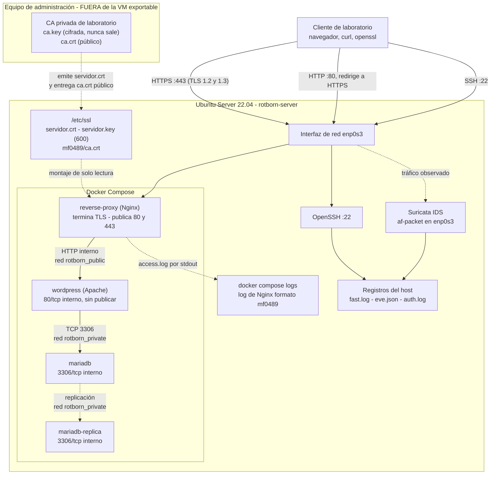

# Último check y entrega final (MF0489 · Fase 5)

Comprobación de extremo a extremo de la infraestructura de Rotborn Studios: certificados, HTTPS con Nginx como reverse proxy, Docker Compose y Suricata. El objetivo es que otra persona pueda entender qué se ha desplegado, comprobar que funciona, recuperar el servicio ante un problema y volver a ponerlo en marcha sin que haga falta publicar contraseñas ni claves privadas.

| | |
|---|---|
| Módulo / fase | MF0489 · Fase 5 |
| Fecha de las pruebas | 27 de octubre de 2026 |
| Servidor | `rotborn-server` (Ubuntu), IP en esta comprobación `10.21.4.73` (DHCP, cambia entre sesiones) |
| Cliente | Kali Linux, interfaz `eth0` en red NAT (`10.0.2.15`) |
| Ubicación en el repositorio | `docs/mf0489/entrega-final.md` (evidencias en `docs/mf0489/evidencias/fase5/`) |
| Documentos relacionados | `arquitectura.md`, `pki.md`, `https-docker.md`, `auditoria-tls-monitorizacion.md` |


## Resumen del último check

## 1. Diagrama definitivo



---

El diagrama vigente se contrasta con lo que realmente hay desplegado:

| Elemento del diagrama | Evidencia real | Estado |
|---|---|---|
| Nginx es el único servicio que publica puertos: 80 y 443 | `docker compose ps`: `0.0.0.0:80->80/tcp` y `0.0.0.0:443->443/tcp` | ✅ |
| WordPress no publica ningún puerto | `rotborn-wordpress-1 ... 80/tcp` | ✅ |
| MariaDB y réplica no publican puertos | `3306/tcp` sin mapeo al host | ✅ |
| Redes: `rotborn_public` (Nginx, WordPress) y `rotborn_private` (WordPress, MariaDB, réplica) | `docker inspect` de los cuatro contenedores (abajo) | ✅ |
| Suricata en el host | `systemctl is-active suricata` → `active` | ✅ |


```text
NAME                        SERVICE           STATUS          PORTS
rotborn-mariadb-1           mariadb           Up 28 minutes   3306/tcp
rotborn-mariadb-replica-1   mariadb-replica   Up 28 minutes   3306/tcp
rotborn-reverse-proxy-1     reverse-proxy     Up 28 minutes   0.0.0.0:80->80/tcp, [::]:80->80/tcp, 0.0.0.0:443->443/tcp, [::]:443->443/tcp
rotborn-wordpress-1         wordpress         Up 28 minutes   80/tcp

/rotborn-wordpress-1: rotborn_private rotborn_public
/rotborn-mariadb-1: rotborn_private
/rotborn-mariadb-replica-1: rotborn_private
/rotborn-reverse-proxy-1: rotborn_public
```

Las redes que aparecen en `docker network ls` son `rotborn_public`, `rotborn_private`, `rotborn_net` (heredada, sin contenedores) y `rotborn_restore_test_net` (temporal, de la prueba de restauración).

## 2. Despliegue que realmente se usa

El despliegue real es el proyecto Compose `rotborn` en `/srv/rotborn`: los contenedores se llaman `rotborn-<servicio>-1` y el archivo en uso es `/srv/rotborn/docker-compose.yml`. En ese directorio conviven archivos en uso y copias históricas; no hay que confundirlos:

| Archivo o carpeta | Situación |
|---|---|
| `docker-compose.yml` | **En uso** |
| `docker-compose.yml.backup`, `docker-compose.yml.pre-nginx` | Copias históricas (la de `backups/` es anterior a Nginx) |
| `nginx/default.conf`, `nginx/00-log-format.conf` | **En uso** (montados en el contenedor) |
| `nginx/default.conf.bak` | Copia |
| `scripts/rotborn-check.sh`, `scripts/comprobacion_inicial.sh`, `scripts/iniciar_rotborn.sh` | En uso (ver apartado 4 para `rotborn-check.sh`) |
| `scripts/*.pre-modos`, `rotborn-check.sh.save`, `docs/construccion-inicial.md.save*` | Copias de edición |
| `config/mariadb/primary.cnf`, `config/mariadb-replica/replica.cnf` | **En uso** (montados) |
| `db/`, `db-replica/` | Datos de MariaDB, en uso |
| `backups/fase3-20261021-115929/` | Copia de seguridad (no es el despliegue) |
| `restore-test/` | Entorno temporal de la prueba de restauración |


>
> ```bash
> docker compose ls
> docker inspect -f '{{index .Config.Labels "com.docker.compose.project.working_dir"}}' rotborn-reverse-proxy-1

Docker compose ls e docker inspect confirman que el proyecto rotborn está activo y asociado al directorio /srv/rotborn
> ```
> 
> rotborn             running(4)          /srv/rotborn/docker-compose.yml


## 3. Certificados instalados

En Ubuntu, sin mostrar ninguna clave:

```bash
sudo find /etc/ssl -maxdepth 3 -type f -name 'ca.crt'
sudo openssl x509 -in /etc/ssl/certs/servidor.crt -noout -subject -issuer -dates -ext subjectAltName
sudo openssl verify -CAfile /etc/ssl/mf0489/ca.crt /etc/ssl/certs/servidor.crt
sudo stat -c 'Archivo: %n | Permisos: %a | Propietario: %U | Grupo: %G' /etc/ssl/private/servidor.key
```

```text
/etc/ssl/mf0489/ca.crt

subject=C = ES, ST = Barcelona, L = Barcelona, O = Rotborn Studios, OU = Cybersecurity, CN = portal.rotborn.test
issuer=C = ES, ST = Barcelona, L = Barcelona, O = "Rotborn Studios ", OU = Cybersecurity, CN = Rotborn Studios Root CA
notBefore=Oct 20 09:38:48 2026 GMT
notAfter=Oct 20 09:38:48 2027 GMT
X509v3 Subject Alternative Name:
    DNS:portal.rotborn.test

/etc/ssl/certs/servidor.crt: OK

Archivo: /etc/ssl/private/servidor.key | Permisos: 600 | Propietario: root | Grupo: root
```

| Comprobación | Resultado |
|---|---|
| Los tres archivos están en sus rutas | ✅ certificado, clave y `ca.crt` |
| El SAN incluye el dominio | ✅ `DNS:portal.rotborn.test` |
| Vigencia | ✅ del 20 oct 2026 al 20 oct 2027 (unos 360 días) |
| La cadena se valida con la CA | ✅ `OK` |
| Clave privada protegida | ✅ `600`, `root:root` |

El emisor lleva un espacio final en la organización (`"Rotborn Studios "`), coherente con el certificado raíz que se usó al emitir (ver `pki.md`, Anexo B).

>  **Huellas de la CA.** Se comprobó la huella digital del certificado raíz en Kali y Ubuntu, verificando que ambas máquinas utilizan la misma CA. En Kali, el certificado se encuentra en `ca_root-pki/ca/ca.crt`, mientras que en Ubuntu se utiliza `/etc/ssl/mf0489/ca.crt`. La comprobación permite confirmar la coherencia de la CA utilizada para validar el certificado del servidor.
>
> ```bash
> zadmin@rotborn-server:/srv/rotborn$ sudo openssl x509 -in /etc/ssl/mf0489/ca.crt -noout -serial -fingerprint -sha256 # Ubuntu
[sudo] password for zadmin:
serial=1BC409D85115DD7F7B3CE4FDEEDE96AB5355DC34
sha256 Fingerprint=E2:85:AD:0F:3E:AB:5B:90:23:CB:8F:95:86:DD:DC:E2:F3:6D:F7:92:8B:09:9E:1D:25:76:B7:BB:B5:47:A9:07    
>   
──(nyx㉿kali-lab)-[/]
└─$ openssl x509 -in ~/rotborn-certs/ca.crt   -noout -serial -fingerprint -sha256 # Kali
serial=1BC409D85115DD7F7B3CE4FDEEDE96AB5355DC34
sha256 Fingerprint=E2:85:AD:0F:3E:AB:5B:90:23:CB:8F:95:86:DD:DC:E2:F3:6D:F7:92:8B:09:9E:1D:25:76:B7:BB:B5:47:A9:07

> ```

## 4. Archivos de configuración coherentes

| Elemento A | Elemento B | Estado |
|---|---|---|
| `ssl_certificate /etc/nginx/certs/servidor.crt` y `ssl_certificate_key /etc/nginx/certs/servidor.key` (`default.conf`) | Montajes del Compose: `/etc/ssl/certs/servidor.crt` y `/etc/ssl/private/servidor.key` → `/etc/nginx/certs/...:ro` | ✅ |
| `server_name portal.rotborn.test` | SAN del certificado `DNS:portal.rotborn.test` | ✅ |
| `proxy_pass http://wordpress:80` | Servicio `wordpress` en `rotborn_public`, Apache en el 80, sin publicar | ✅ |
| `listen 80` y `listen 443 ssl` | `ports: "80:80"` y `"443:443"` | ✅ |
| `access_log ... mf0489` | `00-log-format.conf` montado en `conf.d` | ✅ |
| `ssl_protocols TLSv1.2 TLSv1.3` | TLS 1.1 rechazado (alerta 70, Fase 4) | ✅ |
| `WORDPRESS_DB_HOST: mariadb` | Servicio `mariadb` en `rotborn_private` | ✅ |
| Sintaxis | `docker compose config --quiet` sin salida; `nginx -t` correcto | ✅ |
| `scripts/rotborn-check.sh` comprueba WordPress en `http://localhost:8080` | El puerto 8080 **ya no se publica** | ⚠️ |
| Regla `1000002` con `rev:1` (se ve `[1:1000002:1]` en `fast.log`) | La regla local de Suricata sid:1000002 se actualizó a rev:2, incorporando flow:to_server; para especificar la dirección del tráfico analizado. La configuración se validó correctamente mediante suricata -T, sin el aviso SC_WARN_POOR_RULE, y se comprobó que el servicio permanecía activo (systemctl is-active: active). 6.1) | ✅ |


## 5. Procedimiento de recuperación

El proyecto dispone de copias de seguridad y de varios mecanismos que permiten recuperar los servicios o restablecer configuraciones anteriores. Entre ellos se encuentran el script de inicio de los servicios, las copias de configuración de Nginx, los procedimientos de gestión de certificados descritos en pki.md y los volcados de la base de datos almacenados en backups/fase3-20261021-115929/.

La copia de seguridad mencionada contiene docker-compose.yml, .env y los volcados SQL. También existen docker-compose.yml.pre-nginx y nginx/default.conf.bak, que permiten disponer de versiones anteriores de la configuración. El directorio de copias tiene permisos 700 y pertenece a root.

La recuperación se apoya en estos recursos y en las instrucciones distribuidas por la documentación del proyecto. Sin embargo, no existe todavía un procedimiento único de recuperación que reúna todos los escenarios. La restauración de un volcado SQL solo se ha ensayado en un entorno aislado, documentado en https-docker.md, Anexo A; no se ha restaurado sobre la base de datos real.

A continuación se describen los escenarios de recuperación identificados, los recursos disponibles y las acciones previstas para cada caso.

| Escenario | Qué hacer |
|---|---|
| **A. El servicio no responde, o tras reiniciar Ubuntu** | `sudo /srv/rotborn/scripts/iniciar_rotborn_https.sh`. Los contenedores no tienen `restart:`, así que no arrancan solos |
| **B. Nginx no arranca tras un cambio** | `docker compose logs reverse-proxy`; restaurar `nginx/default.conf` desde la copia (`.bak`) o desde Git; `docker compose exec reverse-proxy nginx -t`; `docker compose restart reverse-proxy` |
| **C. Volver a la configuración anterior a Nginx** | Bloque de reversión de `https-docker.md` (no ejecutado) |
| **D. Certificado caducado, perdido o clave comprometida** | `pki.md`, apartados 10.1 y 10.4: nueva CSR (con la misma clave o una nueva), firma en la CA, instalación y verificación |
| **E. Base de datos dañada o perdida** | Restaurar el último volcado (abajo) |
| **F. Archivos de WordPress (`wp-content`)** | Viven en un volumen anónimo no declarado: se pierden con `docker compose down` + `up`. Copiar antes con `docker compose cp` (`https-docker.md`, Anexo A) |
| **G. La réplica diverge** | `SHOW REPLICA STATUS\G` en `mariadb-replica`. La reconstrucción de la réplica no se ha probado |

**Restaurar la base de datos (escenario E).** Es una operación destructiva: sobrescribe los datos actuales con los del volcado. Hazlo solo si se han perdido y, antes, ensaya el volcado en el entorno aislado:

```bash
cd /srv/rotborn
BACKUP_DIR=$(sudo ls -d /srv/rotborn/backups/fase3-* | tail -n 1)
sudo docker compose stop wordpress
sudo BACKUP_DIR="$BACKUP_DIR" bash -o pipefail -c 'gzip -dc "$BACKUP_DIR/mariadb-principal.sql.gz" | docker compose exec -T mariadb sh -c '\''mariadb -uroot -p"$MYSQL_ROOT_PASSWORD"'\'''
sudo docker compose start wordpress
sudo /srv/rotborn/scripts/rotborn-check.sh
```

> Copia externa de seguridad. Se ha creado una copia de seguridad del directorio backups/ en un disco externo cifrado, independiente de la máquina virtual. Esta copia permite disponer de una alternativa de recuperación en caso de pérdida o fallo de la VM.


## 6. Comprobación de reproducibilidad

El objetivo de esta comprobación es determinar si otra persona puede desplegar Rotborn Studios a partir del repositorio, utilizando su propio entorno y sus propias credenciales, sin depender de la máquina virtual original ni de sus datos privados.

El repositorio contiene los archivos de configuración y los scripts necesarios para administrar los servicios del proyecto. Sin embargo, algunos elementos deben generarse o prepararse en el entorno de destino.

| Elemento | Procedimiento para reproducir el despliegue |
|---|---|
| Variables de entorno y credenciales | Crear el archivo `.env` a partir de `.env.example` y definir contraseñas y secretos propios. |
| Certificados TLS y claves privadas | Crear una CA propia y generar los certificados necesarios siguiendo el procedimiento documentado en `pki.md`, Modo A. |
| Configuración de Docker Compose | Utilizar `docker-compose.yml` y comprobar que las rutas, los volúmenes y las variables de entorno corresponden al entorno de destino. |
| Base de datos MariaDB | Permitir que los servicios inicialicen sus datos al arrancar. Si se necesitan los datos del entorno original, restaurarlos desde una copia de seguridad compatible. |
| Réplica de MariaDB | Configurar y verificar la replicación entre la base de datos principal y la réplica. |
| Archivos de WordPress | Comprobar la persistencia de `wp-content` y recuperar sus archivos desde una copia de seguridad cuando sea necesario. |
| Proxy inverso Nginx y HTTPS | Preparar la configuración de Nginx, instalar los certificados correspondientes y verificar la redirección HTTP a HTTPS. |
| Suricata | Instalar y configurar Suricata, incluyendo la regla local `1000002` definida en `suricata/local.rules`. |

### Resultado de la comprobación

La reproducibilidad del proyecto depende de disponer del repositorio, de los secretos y certificados propios, de los requisitos del entorno y de los procedimientos de configuración correspondientes.

La existencia de archivos de configuración, scripts y documentación facilita la reconstrucción del entorno. No obstante, **la reproducibilidad completa debe considerarse pendiente de validación hasta realizar un despliegue desde cero en una máquina limpia**, sin reutilizar la configuración ni los datos de la máquina virtual original.

La comprobación deberá verificar que los cuatro servicios —`reverse-proxy`, `wordpress`, `mariadb` y `mariadb-replica`— arrancan correctamente, que el acceso HTTPS funciona y que la base de datos y su réplica operan como se espera.

Prueba en un clon limpio (en otra carpeta o VM):

```bash
git clone <URL_DEL_REPOSITORIO> rotborn-prueba && cd rotborn-prueba
ls docker-compose.yml .env.example nginx/ scripts/ pki/ docs/mf0489/
sed -E 's/=.*/=VALOR_DE_PRUEBA/' .env.example > .env        # valores ficticios
grep -E '^\s+- [./][^:]+:' docker-compose.yml | sed -E 's/^\s+- ([^:]+):.*/\1/' | while read -r p; do
  [ -e "$p" ] && echo "existe: $p" || echo "FALTA:  $p"
done
```

**Corrección recomendada.** Si el repositorio es `/srv/rotborn`, cambiar a rutas relativas apunta exactamente a los mismos archivos y hace el proyecto portable:

```bash
cd /srv/rotborn
sudo cp -a docker-compose.yml docker-compose.yml.pre-rutas
sudo sed -i 's#- /srv/rotborn/#- ./#' docker-compose.yml
docker compose config --quiet && echo "compose OK"
docker compose up -d        # no debería recrear nada: las rutas resuelven igual
```


## 7. Claves privadas protegidas

| Comprobación | Evidencia | Estado |
|---|---|---|
| Clave del servidor con permisos mínimos | `/etc/ssl/private/servidor.key`: `600`, `root:root` | ✅ |
| La clave se monta en solo lectura en Nginx | `...servidor.key:/etc/nginx/certs/servidor.key:ro` (Compose, línea 49) | ✅ |
| Datos de la base de datos y copias no legibles para un usuario normal | `find` sin `sudo`: `Permission denied` en `db/`, `db-replica/`, `restore-test/` y `backups/fase3-...` | ✅ |
| El `.env` de la copia de seguridad está protegido | Está en `backups/fase3-.../`, de modo `700` y propietario `root` | ✅ |
| `ca.key` fuera de Ubuntu | ⏳ repetir hoy (comando abajo) | ⏳ |
| `.env` con permisos restrictivos | ⏳ | ⏳ |
| Ninguna clave en el repositorio | Apartado 9 | ⏳ |

```bash
# Ubuntu: no debe devolver ninguna ruta
sudo find / -type f -name 'ca.key' 2>/dev/null
stat -c '%a %U:%G %n' /srv/rotborn/.env             # esperado: 600 (o 640) y propietario root o el administrador

# Kali: dónde está y con qué permisos
ls -l ~/ca_root-pki/ca/private/ca.key                # esperado: -rw-------
```

## 8. `.gitignore`

El archivo existe en `/srv/rotborn` (la comprobación `auditoria_fase5.sh` lo confirma), pero no se ha revisado su contenido. Debe cubrir como mínimo lo que exige la guía y lo que genera este proyecto:

| Patrón | Para qué |
|---|---|
| `**/*.key`, `**/private/`, `*.p12`, `*.pfx` | Claves privadas (mínimo exigido) |
| `.env` | Contraseñas |
| `backups/`, `restore-test/` | Copias de seguridad (incluyen un `.env` y volcados) |
| `db/`, `db-replica/`, `*.sql`, `*.sql.gz` | Datos de MariaDB |
| `ca_root-pki/` | Directorio de la CA |
| `*.bak`, `*.save`, `*.save.*`, `*.backup`, `*.pre-*` | Copias de edición que hay en el proyecto (pueden contener contraseñas escritas a mano en versiones antiguas del Compose) |

## 9. Qué se ha publicado

```bash
git ls-files                                                         # lista de lo que se publica
git ls-files | grep -Ei '(\.key|\.env|\.sql(\.gz)?|\.bak|\.save|\.backup)$' || echo "ninguno"
grep -rIl 'PRIVATE KEY' . --exclude-dir=.git || echo "ninguna clave privada"
git grep -nI -E 'PASSWORD *[:=] *[^$ "]' -- docker-compose.yml '*.md' '*.sh' || echo "ninguna contraseña escrita"
git log --all --oneline -S'PRIVATE KEY' | head                       # historial: ¿alguna vez se subió una clave?
git log --all --diff-filter=A --name-only --pretty=format: | sort -u | grep -Ei '(\.key|\.env|\.sql|backup)' || echo "sin rastro en el historial"
```

Debe aparecer: `docker-compose.yml`, `.env.example`, `.gitignore`, `nginx/`, `scripts/`, `pki/` (solo públicos), `suricata/local.rules` y `docs/mf0489/`. No debe aparecer nada de lo listado en el apartado 8.


## 10. Confianza HTTPS

La confianza se verifica indicando la CA del laboratorio (`--cacert`). `ssl_verify_result=0` es el resultado «sin errores» de OpenSSL (`X509_V_OK`).

**Desde Ubuntu** (contra `127.0.0.1`, con la CA instalada en el servidor):

```bash
curl -sS -o /dev/null -w 'HTTP_CODE=%{http_code}\nSSL_VERIFY=%{ssl_verify_result}\n' \
  --cacert /etc/ssl/mf0489/ca.crt \
  --resolve portal.rotborn.test:443:127.0.0.1 \
  https://portal.rotborn.test/
```

```text
HTTP_CODE=200
SSL_VERIFY=0
```

**Desde Kali** (otra máquina, contra la IP real del servidor, con su copia de la CA):

```bash
curl -sS -o /dev/null -w 'HTTP_CODE=%{http_code}\nSSL_VERIFY=%{ssl_verify_result}\n' \
  --cacert ~/ca_root-pki/ca/ca.crt \
  --resolve portal.rotborn.test:443:10.21.4.73 \
  https://portal.rotborn.test/
```

```text
HTTP_CODE=200
SSL_VERIFY=0
```

| Comprobación | Resultado |
|---|---|
| El certificado se acepta frente a la CA indicada | ✅ en ambas máquinas |
| El nombre coincide con el SAN | ✅ el cliente conecta por `portal.rotborn.test` |
| Conectividad de red Kali → servidor | ✅ `ping` a `10.21.4.73`: 4 de 4 respuestas, 0 % de pérdida |
| Resolución del nombre en el cliente | Sin entrada de DNS ni de hosts (`getent hosts portal.rotborn.test` no devuelve nada); se usa `--resolve` |

**Sobre `-k`.** En Kali se ejecutó una primera prueba con `curl -k` (`HTTP_CODE=200`) solo para comprobar que el servidor respondía antes de verificar el certificado. **No se usa como evidencia de confianza**: no valida nada. La evidencia es la prueba con `--cacert`.

**Nota.** Las dos máquinas verificaron con ficheros distintos: Ubuntu con `/etc/ssl/mf0489/ca.crt` y Kali con `ca_root-pki/ca/ca.crt`. Funciona porque son certificados raíz de la misma clave (`pki.md`, Anexo B); la unificación queda en el apartado 3.

## 11. Redirección HTTP → HTTPS

```bash
curl -sSI --max-time 5 --resolve portal.rotborn.test:80:<IP> http://portal.rotborn.test/
```

Desde Ubuntu (`127.0.0.1`, `Date: Sun, 25 Oct 2026 11:07:16 GMT`) y desde Kali (`10.21.4.73`, `Date: Sun, 25 Oct 2026 11:52:24 GMT`) el resultado es el mismo:

```text
HTTP/1.1 301 Moved Permanently
Server: nginx/1.30.6
Content-Type: text/html
Content-Length: 169
Connection: keep-alive
Location: https://portal.rotborn.test/
```

✅ Redirección permanente a HTTPS en las dos máquinas. El script de arranque también la comprueba (`[OK] HTTP redirige a HTTPS (301).`).

## 12. Prueba funcional de la aplicación

**Desde Kali**, por HTTPS verificado, se descargó la página principal:

```bash
curl -sS --cacert ~/ca_root-pki/ca/ca.crt --resolve portal.rotborn.test:443:10.21.4.73 https://portal.rotborn.test/ | head -n 15
```

La respuesta es la página de WordPress (`<title>Rotborn Studios</title>`, idioma `es`) y todas las URL que genera son `https://portal.rotborn.test/...` (por ejemplo `https://portal.rotborn.test/feed/`): no aparecen ni la IP ni el puerto `8080`. Esto confirma que las opciones `home` y `siteurl` de WordPress están bien (`https-docker.md`, 3.6).

El mensaje `curl: (23) Failure writing output to destination` que aparece al final **no es un fallo**: lo provoca `head` al cerrar la tubería tras 15 líneas.

**Desde Ubuntu**, `auditoria_fase5.sh` confirmó que WordPress, MariaDB principal, réplica y Nginx están en ejecución, y que HTTPS verificado devuelve `200` (apartado 13).


## 13. Prueba de configuración y monitorización

### 13.1. Auditoría automática: `rotborn_check.sh`

Script de solo lectura (`/srv/rotborn/scripts/rotborn_check.sh`, permisos `750`, propietario `root`, 7438 bytes). Hay que ejecutarlo con `sudo`: con un usuario normal da `Permission denied`, lo que además demuestra que su acceso está restringido.

```bash
sudo /srv/rotborn/scripts/rotborn_check.sh
```

| Sección | Comprobaciones | Resultado |
|---|---|---|
| 1. Docker y contenedores | Docker disponible, `docker-compose.yml` presente y válido, WordPress, MariaDB, réplica y Nginx en ejecución | 7 ✅ |
| 2. Redes y Nginx | Redes `rotborn_public` y `rotborn_private` existen; configuración de Nginx válida | 3 ✅ |
| 3. Certificado y clave | Certificado legible (X.509), `ca.crt` presente, validado con la CA, no caducado, SAN con el dominio, clave `600` y `root` | 6 ✅ |
| 4. HTTP, HTTPS y WordPress | Redirección `301`, destino HTTPS correcto, HTTPS verificado y WordPress `200` | 3 ✅ |
| 5. Suricata y registros | Servicio activo, `eve.json`, `fast.log` y `stats.log` existen y no están vacíos, hay alertas de las reglas del laboratorio | 5 ✅ |
| 6. Copias y documentación | Directorio de copias, copia histórica del Compose y `.gitignore` local | 3 ✅ |
| **Total** | | **27 ✅ · 0 advertencias · 0 errores** |

**Qué no cubre:** la réplica, los datos de WordPress, la huella de la CA, que la copia de seguridad se pueda restaurar ni el contenido del `.gitignore`. Por eso no sustituye a los apartados 3, 5, 8 y 12.


### 13.2. Suricata

```bash
sudo systemctl is-active suricata
sudo ls -lh /var/log/suricata/
sudo tail -n 10 /var/log/suricata/fast.log
```

Suricata está `active`. Los registros se rotan (`eve.json` de 11 MB y copias `.gz` anteriores) y hay alertas de las dos reglas del laboratorio:

```text
10/25/2026-01:42:52.919806  [**] [1:1000002:1] MF0489 Fase 4 - Conexion HTTPS observada [**] [Classification: (null)] [Priority: 3] {TCP} 10.21.4.35:63844 -> 10.21.4.65:443
10/25/2026-10:20:52.624136  [**] [1:1000001:1] MF0488 - ICMP detectado [**] [Classification: (null)] [Priority: 3] {ICMP} 10.21.4.1:8 -> 10.21.4.73:0
```

Se ve que:

- **La IP del servidor cambió** entre las 01:42 (`10.21.4.65`) y las 10:20 (`10.21.4.73`). La detección no se rompió porque `HOME_NET` es un rango (`10.21.4.0/24`), no una IP fija.
- **El origen de las conexiones varía** entre sesiones (`10.21.4.98`, `10.21.4.35`, y hoy Kali detrás de NAT con `10.0.2.15`).
- La regla `1000002` sigue en `rev:1` (apartado 4).

### 13.3. Correlación de la prueba de hoy 

Con Kali detrás de NAT, el servidor no ve `10.0.2.15`, sino la dirección traducida, y el puerto de origen también cambia. Por eso **no se puede correlacionar por IP y puerto** como en la Fase 4: se correlaciona por hora normalizada, ruta y número de conexiones, y se documenta la diferencia en lugar de forzar una coincidencia.

```bash
# Kali: una petición identificable, con una ruta nueva
date -u
curl -sS -o /dev/null --cacert ~/rotborn-certs/ca.crt \
  --resolve portal.rotborn.test:443:10.21.4.73 https://portal.rotborn.test/mf0489-final-01

# Ubuntu: las dos fuentes
sudo grep 'MF0489' /var/log/suricata/fast.log | tail -n 5
docker compose logs --since 30m reverse-proxy | grep 'mf0489-final-01'

# Normalizar a UTC una marca de Suricata de hoy después de las 03:00 (hora de invierno, +0100)
date -u -d '2026-10-25T12:52:24+0100' +%FT%T.%3NZ
```

Esperado: una alerta `1000002` por cada conexión TLS nueva y la línea de Nginx con `HEAD`/`GET /mf0489-final-01`, ambas en la misma hora UTC, con la IP de origen traducida.


---

## 14. Entrega

**Qué se entrega y dónde**

| Ruta en el repositorio | Contenido |
|---|---|
| `docs/mf0489/arquitectura.md` | Diagrama definitivo y explicación técnica |
| `docs/mf0489/pki.md` | Procedimiento de la CA y del certificado |
| `docs/mf0489/https-docker.md` | Despliegue de Nginx y HTTPS con Docker Compose |
| `docs/mf0489/auditoria-tls-monitorizacion.md` | Auditoría de TLS y monitorización |
| `docs/mf0489/entrega-final.md` | Este documento |
| `docs/mf0489/evidencias/fase2` … `fase5` | Salidas y capturas, sin secretos |
| `docker-compose.yml`, `.env.example`, `.gitignore`, `nginx/` | Despliegue |
| `scripts/` | `iniciar_rotborn_https.sh`, `rotborn-check.sh` (corregido), `auditoria_fase5.sh` |
| `pki/` | Copias públicas: `ca.crt`, `servidor.csr`, `servidor.crt`, `servidor.ext` |
| `suricata/local.rules` | Reglas `1000001` y `1000002` |


